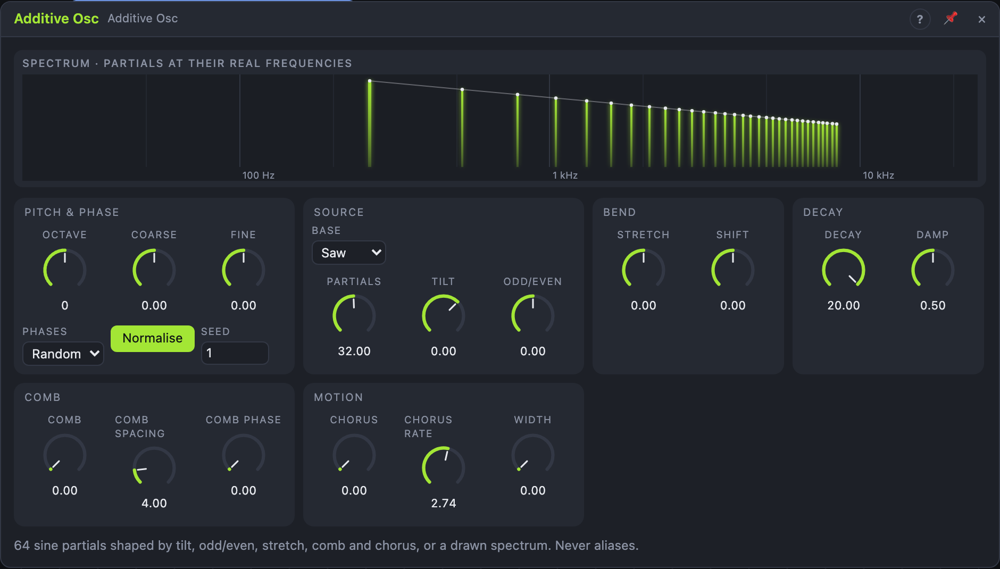

# Additive Osc

## Introduction

The Additive Osc builds its sound from up to 64 sine waves, the *partials*.
Instead of 64 sliders it has a handful of spectral knobs: *Tilt* darkens or
brightens, *Odd/Even* moves between hollow and full, *Stretch* and *Shift*
bend the series into bells and metal, *Comb* carves moving notches and
*Chorus* detunes the partials against each other. You can also draw your
own spectrum. Partials above the top of the audio band are simply left out,
so it never aliases, at any pitch.

## How does it work?

**Pitch.** The fundamental is C4 × 2^(Octave + Coarse/12 + Fine/1200 +
Pitch), clamped to 1 Hz – 20 kHz and followed sample by sample. Partial *n*
plays at the fundamental × its ratio (n, unless stretched) plus *Shift*.

**Levels.** Each partial's level is the product of:

1. **Base:** *Saw* 1/n, *Square* 1/n on odd partials only, *Flat* 1/√n
   (even energy per octave), or *Drawn*: your own bars.
2. **Tilt:** dB per octave of partial number (−24 dark … +12 bright).
3. **Odd/Even:** −1 odd partials only, +1 even only; the fundamental stays.
4. **Partials:** how many sound; the last one fades in fractionally, so
   modulating it is smooth.
5. **Comb:** notches every *Comb Spacing* partials; *Comb Phase* slides them
   along the spectrum and wraps, so an LFO sweeps them endlessly.
6. **Band limit:** partials fade out between 40 % and 45 % of the sample
   rate and are dropped above.

Levels glide over 2 ms, so all of these can be modulated without zipper
noise. **Normalise** keeps the loudness constant (RMS 0.3) while you change
the colour; off, a 64-partial saw spans about ±1.

**Stretch and Shift.** *Stretch* above 0 makes upper partials go sharp
(stiff strings, pianos, bells); below 0 it squeezes them together. The
fundamental always stays on the note. *Shift* adds the same frequency
(±1 × the note) to every partial: inharmonic, metallic, ring-modulated.

**Chorus.** Each partial wanders by up to *Chorus* cents at about *Chorus
Rate*, seeded, so the ensemble shimmer never repeats a pattern but every
render is the same.

**Phases.** *Random* starts each partial at a seeded phase (smooth, no peaky
waveform); *Aligned* starts them all together (the sharp shape of a true
saw). A *Trigger* restarts them.

**Decay.** With *Decay* below its maximum, a *Trigger* strikes: every
partial decays, the fundamental by 60 dB in *Decay*, higher partials faster
by *Damp* (at 100 % partial 10 dies 100× faster than the fundamental). A
new trigger brings the levels back up within 2 ms. At maximum (20 s) the
sound sustains; without triggers it always sustains.

**Stereo.** *Width* pans the odd partials left and the even partials right
(up to 70 % at full width); the fundamental stays centred and the mono sum
stays within 1.5 dB.

## How to use it?

- **Organ / drawbars:** *Base* Square or Drawn, *Partials* 8–16.
- **Bell:** *Stretch* +0.6, *Phases* Aligned, *Decay* 3 s, *Damp* 60 %,
  triggers from the note's gate.
- **Pluck:** *Decay* 0.4 s, *Damp* 80 %, *Tilt* −3 dB/oct.
- **Moving notches:** *Comb* 80 %, a slow LFO on *Comb Phase*.
- **Ensemble pad:** *Chorus* 20 ct, *Chorus Rate* 0.5 Hz, *Width* 70 %.
- **Sub-bass:** use the *Fundamental* output under the main sound.

### Drawing

With *Base* on *Drawn* the view shows 64 bars. Drag across them to paint
levels (Shift: fine, relative), double-click a bar to reset it to 1/n, or use
*Saw*, *Square*, *Flat*, *Smooth* and *Randomize*. A drag is one undo step.
The drawing is saved with the board.

<!-- generated:demos -->
## Demo patches

Five whole patches show what Additive Osc does. In the standalone app open **File → Presets…** (⌘P) and pick *Additive Osc* under *Demos by module*; on the website, **Run in Play** opens one in your browser. Loading one replaces the project and starts the transport.

| Patch | What it shows |
|---|---|
| **Additive Osc: Tilt Sweep** | A saw-shaped stack of partials whose Tilt is swept by a slow LFO, from dark and woolly to bright and ringing, with no filter involved. Reduce Partials for a rounder tone or push Tilt up for an organ-like glare. |
| **Additive Osc: Odd Partials Reed** | Odd/Even is pulled to the odd side so only the 1st, 3rd, 5th partials sound: a hollow, reedy tone. Move Odd/Even through zero to bring back the even partials and watch the reed turn into a full saw. |
| **Additive Osc: Stretched Bells** | A flat spectrum with Stretch pushing the partials apart gives inharmonic, bell-like tones, and each trigger restarts a decay that makes the high partials die first. Change Stretch for a metallic or glassy family, or Decay for longer ringing. |
| **Additive Osc: Comb Choir** | A slow chord line played by a comb-notched spectrum with a wide chorus, giving a shimmering, voice-like pad. Change Comb Spacing to move the notches or raise Chorus for a bigger, more unstable cloud. |
| **Additive Osc: Odd and Even Split** | The odd-partial and even-partial outputs go to separate mixer channels whose pans drift in opposite directions, so the two halves of one tone circle each other. Mute one channel to hear its half alone. |
<!-- /generated -->

<!-- generated:presets -->
## Presets

The preset bar of the Additive Osc view has 15 factory presets. Pick one to set the knobs, then change them to taste; your own presets sit next to them.

| Preset | What it does |
|---|---|
| **Soft Saw** | A smooth, slightly darkened additive saw. |
| **Organ Drawbars** | Odd partials with a limited count: a hollow organ. |
| **Clarinet** | Mostly odd partials: hollow and woody. |
| **Even Glass** | Even partials only: a thin, glassy octave-like tone. |
| **Dark Sine Pad** | Few, quiet upper partials: a dark, near-sine pad. |
| **Bright Buzz** | Strong high partials: a very bright, buzzing tone. |
| **Ensemble Pad** | Detuned partials and stereo spread: a shimmering ensemble pad. |
| **Bell** | Stretched partials struck by a trigger: patch the note gate to Trigger. |
| **Pluck** | A short, plucked string-like tone; needs a trigger from the note. |
| **Metal Shift** | Shifted, inharmonic partials: ring-modulated and metallic. |
| **Comb Notches** | Notches carved in the spectrum: modulate Comb Phase with a slow LFO. |
| **Squeezed Choir** | Compressed partials: dense, vocal and choir-like. |
| **Stiff Strings** | A slightly stretched, piano-like struck tone. |
| **Fundamental Whisper** | Just the first few partials: a pure, flute-like tone. |
| **Random Phase Cloud** | Heavily detuned partials: a wide, cloudy texture. |
<!-- /generated -->

## Reference

### Knobs and settings

| Control | Range | Default |
|---|---|---|
| Octave | −4 … +4 (stepped) | 0 |
| Coarse | −12 … +12 st | 0 st |
| Fine | −100 … +100 ct | 0 ct |
| Partials | 1 – 64 | 32 |
| Tilt | −24 … +12 dB/oct | 0 |
| Odd/Even | −1 … +1 | 0 |
| Stretch | −1 … +1 | 0 |
| Shift | −1 … +1 | 0 |
| Comb | 0 – 100 % | 0 % |
| Comb Spacing | 2 – 16 partials | 4 |
| Comb Phase | 0 – 100 % (wraps) | 0 % |
| Chorus | 0 – 50 ct | 0 ct |
| Chorus Rate | 0.01 – 5 Hz | 0.3 Hz |
| Width | 0 – 100 % | 0 % |
| Decay | 10 ms – 20 s (20 s = sustain) | 20 s (sustain) |
| Damp | 0 – 100 % | 50 % |
| Base | Saw, Square, Flat, Drawn | Saw |
| Phases | Aligned, Random | Random |
| Normalise | On, Off | On |
| Seed | 0 – 999 | 1 |

All knobs are modulation destinations; the settings are not.

### Inputs

| Input | Signal | What it does |
|---|---|---|
| Pitch | pitch, 1 V/oct | the fundamental; 0.0 = C4 |
| Trigger | trigger | restarts the phases and strikes the decay |

### Outputs

| Output | Signal | What it does |
|---|---|---|
| Out L, Out R | audio | all partials, spread by *Width* |
| Odd | audio | the fundamental and the odd partials (mono) |
| Even | audio | the even partials (mono); *Odd* + *Even* = *Out* at *Width* 0 |
| Fundamental | audio | partial 1 alone, at its level |
