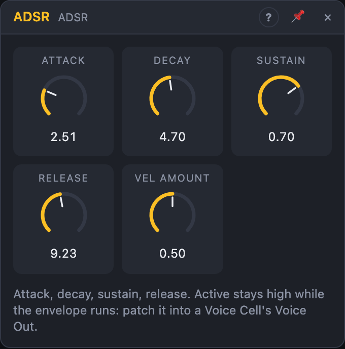

# ADSR

## Introduction

The ADSR is the classic envelope generator: **attack, decay, sustain,
release**. A gate starts it and it draws one shape over time. That shape opens
a VCA so a note gets loud and fades, or sweeps a filter's cutoff.

It also has an *Active* output that stays high while the envelope is running.
Inside a Voice Cell this tells the cell when a voice has gone quiet and can be
reused.

## How does it work?

The envelope moves through four stages:

1. **Attack:** when the *Gate* goes high, the level rises in a straight line
   to its peak. The rise starts at the current level, not at zero, so
   retriggering a note that is still sounding doesn't click.
2. **Decay:** the level falls to the sustain level along an exponential curve.
3. **Sustain:** the level holds there for as long as the gate stays high.
4. **Release:** when the gate goes low, the level falls exponentially to
   silence. When the release reaches −80 dB, the envelope stops, *End* fires
   one trigger and *Active* goes low.

The peak depends on velocity. With *Vel Amount* at 0 % every note peaks at
1.0. At 100 % the peak equals the *Velocity* input, so soft notes stay quiet.
Sustain is a share of that peak: a soft note sustains lower than a loud one.

A trigger at *Retrigger* while the gate is high restarts the attack from the
current level. Use it for repeated accents within one long note.

## How to use it?

- **Amplitude envelope:** patch *Gate* from a Voice In (or a sequencer's
  gate), *Env* onto a VCA's **Gain** knob. Since Gain starts at 0, the
  envelope opens it completely.
- **In a Voice Cell:** also patch *Active* into **Voice Out › Active**. The cell
  then frees the voice exactly when its sound has faded, and not while the
  release is still audible.
- **Filter envelope:** patch *Env* onto a filter's **Cutoff** knob and set the
  cable's amount. Use a short decay and a low sustain for a plucky sound.
- **Velocity:** patch *Velocity* from Voice In and raise *Vel Amount*.
- **Chaining:** *End* fires when the release is done. Patch it into another
  envelope's gate or a Function's *Trig* to start the next event.

## Reference

### Knobs

| Knob | Range | Default |
|---|---|---|
| Attack | 1 ms – 10 s | 5 ms |
| Decay | 1 ms – 10 s | 300 ms |
| Sustain | 0 – 100 % | 70 % |
| Release | 1 ms – 20 s | 400 ms |
| Vel Amount | 0 – 100 % | 50 % |

- **Attack:** how long the rise from silence to the peak takes. The rise is
  linear, so short attacks stay punchy. The knob's centre is 200 ms; the lower
  half gives fine control over short times.
- **Decay:** time to fall from the peak to the sustain level. The curve is
  exponential and gets close to the target after the set time. The centre is
  400 ms.
- **Sustain:** the level held while the gate stays high, as a share of the
  peak. At 0 % the envelope decays to silence even with the gate held: a
  percussive shape. At 100 % there is no decay.
- **Release:** time from the gate going low to silence (−80 dB). The centre
  is 600 ms. A gate that ends during the attack or decay starts the release
  from wherever the level is.
- **Vel Amount:** how much velocity lowers the peak. Peak = 1 − Vel Amount ×
  (1 − Velocity). At 0 % velocity is ignored; at 100 % a velocity of 0.3 gives a
  peak of 0.3.

Every knob is a modulation destination: patch a cable onto it to move it.

### Inputs

| Input | Signal | What it does |
|---|---|---|
| Gate | gate | high (≥ 0.5) starts the attack; low starts the release |
| Retrigger | trigger | while the gate is high, restarts the attack from the current level |
| Velocity | control, 0 – 1 | scales the peak through *Vel Amount*; unpatched counts as full velocity |

### Outputs

| Output | Signal | What it does |
|---|---|---|
| Env | control, 0 – 1 | the envelope |
| End | trigger | one pulse when the release reaches silence |
| Active | gate | high from the first attack until the release has finished |
