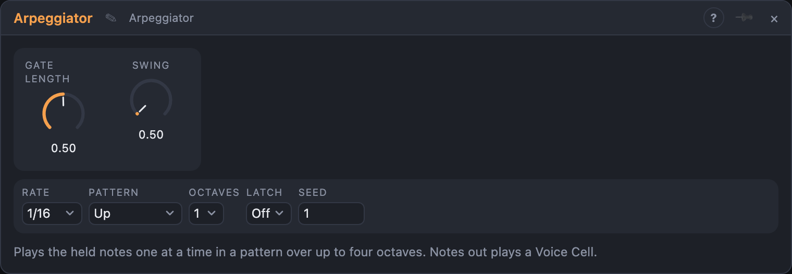

# Arpeggiator

## Introduction

The Arpeggiator plays the notes you hold **one at a time**, in a pattern, in
time with the transport or a clock. Hold a chord and it becomes a running
line. Its *Notes* output plays a Voice Cell directly; *Pitch*, *Gate*,
*Velocity* and *Trigger* drive modules outside one.

## How does it work?

The held notes form a pool, lowest first. *Octaves* repeats the pool one
octave higher per copy (up to four), and *Pattern* chooses the order:

- **Up** / **Down:** lowest to highest, or the other way.
- **Up-Down** / **Down-Up:** there and back; the top and bottom notes are
  played once per cycle.
- **Up & Down:** there and back; the top and bottom notes are played twice.
- **Played:** in the order you pressed the keys.
- **Random:** any note, chosen with *Seed*. The same seed gives the same line
  every time, also in a render.
- **Converge:** lowest, highest, second lowest, second highest, and so on
  towards the middle. **Diverge:** from the middle outwards.

One step lasts one *Rate* (1/1 … 1/32T). *Gate Length* sets how much of the
step the note sounds, *Swing* delays every second step.

With nothing patched into *Clock*, the steps lock to the song position, so
the transport has to be running. Patch a trigger into *Clock* and every pulse
is one step, whatever the transport does. A pulse into *Reset* ends the note
and the next step starts the pattern again.

With **Latch** on, the notes keep playing after you let go. The next key you
press starts a new chord. Switch Latch off to stop.

Adding or releasing keys while it plays changes the pool from the next step
on; the pattern keeps its place.

## How to use it?

- **Classic arpeggio:** MIDI port *Notes* → Arpeggiator *Notes*; *Notes* out →
  Voice Cell. Start the transport and hold a chord.
- **Hands-free:** *Latch* on, play a chord, take your hands off.
- **Chord Quantizer as the source:** its *Notes* output into the Arpeggiator
  for an arpeggio that follows a chord progression.
- **Rhythmic gates:** *Gate Length* around 25 % with *Rate* 1/16 for
  staccato; 100 % for a legato line.
- **Mono synth voice:** *Pitch* → Oscillator, *Gate* → ADSR.
- **Wider range:** *Octaves* 3 or 4 with *Up-Down*.
- **Generative lines:** *Random* plus a clock from a Pulse Generator or a
  Rotating Divider.

<!-- generated:presets -->
## Presets

The preset bar of the Arpeggiator view has 15 factory presets. Pick one to set the knobs, then change them to taste; your own presets sit next to them.

| Preset | What it does |
|---|---|
| **Classic Up** | Held notes climb in sixteenths: the standard arpeggio. |
| **Down Run** | Falls from the top note down across two octaves. |
| **Up-Down Two Octaves** | Climbs and falls over two octaves without repeating the end notes. |
| **Up and Down Repeat** | Climbs and falls, repeating the top and bottom notes. |
| **Played Order** | Plays notes in the order you pressed them. |
| **Staccato Pluck** | Very short gates for plucked, bouncy arpeggios. |
| **Legato Flow** | Notes join up across three octaves: a smooth, flowing line. |
| **Swung Sixteenths** | Shuffled sixteenths for a groovy house-style arp. |
| **Triplet Gallop** | Eighth-note triplets that gallop upward. |
| **Converge** | Alternates from the outside in, meeting in the middle. |
| **Diverge** | Starts at the middle and spreads outward. |
| **Random Sparkle** | Random notes over four octaves: glittery and unpredictable. |
| **Latched Pad Arp** | Latch keeps the arp going after you let go. |
| **Fast Trance** | Thirty-second notes over three octaves for a fast trance run. |
| **Slow Quarter Walk** | A slow, spacious quarter-note walk down and up. |
<!-- /generated -->

## Reference

### Knobs and settings

| Control | Range | Default |
|---|---|---|
| Gate Length | 1 … 100 % | 50 % |
| Swing | 50 … 75 % | 50 % |
| Rate | 1/1 … 1/32T | 1/16 |
| Pattern | Up, Down, Up-Down, Down-Up, Up & Down, Played, Random, Converge, Diverge | Up |
| Octaves | 1 … 4 | 1 |
| Latch | Off, On | Off |
| Seed | 0 … 999 | 1 |
| Sync To | Auto, Clock, Transport | Auto |

- **Sync To:** what steps the module. *Auto*: the clock pulses while *Clock* is patched, otherwise the transport. *Clock*: only the pulses step it. *Transport*: the song position steps it, and a patched *Clock* is ignored.
- **Seed:** only used by *Random*.

### Inputs

| Input | Signal | What it does |
|---|---|---|
| Notes | notes | The keys to arpeggiate |
| Clock | trigger | One step per pulse; unpatched, the transport sets the steps |
| Reset | trigger | Ends the note; the next step is step 0 |

### Outputs

| Output | Signal | What it does |
|---|---|---|
| Notes | notes | The arpeggio, one note at a time |
| Pitch | pitch | The playing note, 1 V/oct (0 = C4); holds |
| Gate | gate | High while a note sounds |
| Velocity | control | The note's velocity, 0 … 1; holds |
| Trigger | trigger | A pulse at each new note |
