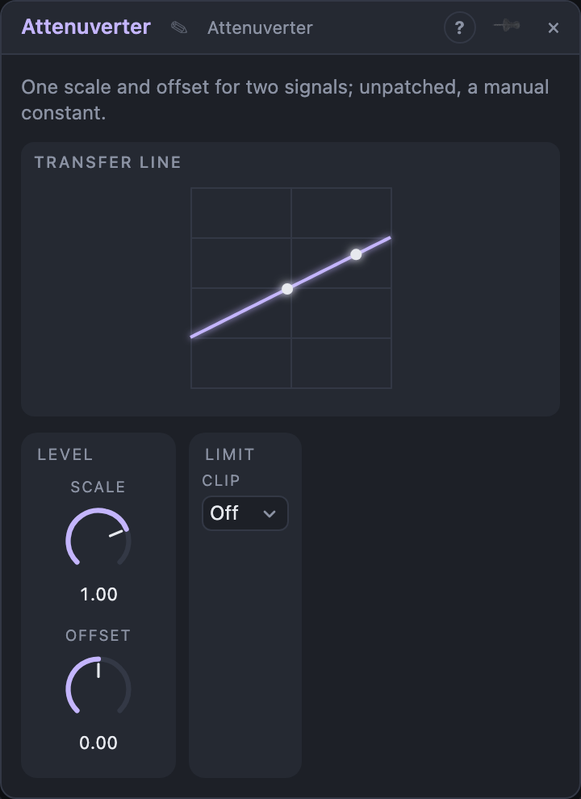

# Attenuverter

## Introduction

Makes two signals smaller, bigger, upside down or shifted, both by the same
*Scale* and *Offset*. In the module view the knobs sit next to a line that
shows the result. With nothing patched, an input is a knob you set by hand, so
the Attenuverter is also a macro control: one *Out* can feed many destinations
with the same value.

## How does it work?

Each of the two inputs computes

    Out = In × Scale + Offset

*Scale* runs from −2 to +2: +1 passes the signal unchanged, 0 mutes it, −1
turns it upside down, and values beyond ±1 boost a weak signal. *Offset*
shifts the result up or down.

An unpatched *In* counts as a constant **+1**, so an empty input outputs
*Scale* + *Offset*.

Every cable already has its own amount at the destination. The Attenuverter
is for scaling once, at the source: one knob changes the depth for every
destination, and that knob can itself be modulated.

## How to use it?

- **One depth for many destinations:** LFO → *In 1*, *Out 1* to several
  knobs at full amount. *Scale 1* now sets all depths at once.
- **Macro knob:** leave *In 1* unpatched, set *Scale* to 0 and use *Offset*
  as a manual control. Patch *Out 1* to several knobs and move them together.
- **Unipolar from bipolar:** an LFO (−1 … +1) with *Scale* 0.5 and *Offset*
  0.5 runs from 0 to 1.
- **Invert:** *Scale* −1 makes an envelope fall instead of rise.
- **Two signals, one depth:** patch both into *In 1* and *In 2* and one *Scale* moves them together.
- **Different settings?** Add another Attenuverter; to add signals together use a CV Mixer.

<!-- generated:demos -->
## Demo patches

Five whole patches show what Attenuverter does. In the standalone app open **File → Presets…** (⌘P) and pick *Attenuverter* under *Demos by module*; on the website, **Run in Play** opens one in your browser. Loading one replaces the project and starts the transport.

| Patch | What it shows |
|---|---|
| **Attenuverter: Opposite Sweeps** | One slow LFO enters two Attenuverters, one scaled +1 and one -1, and they open the left filter while closing the right one, so the arpeggio seems to travel across the stereo field. Change the scale of either one to unbalance the sweep. |
| **Attenuverter: Manual Offsets** | With nothing patched in, each Attenuverter is a constant set by its Offset: one transposes the sequencer up a fourth and the other holds the filter at a fixed opening. Turn the first Offset to change key while the music plays. |
| **Attenuverter: Wandering Sum** | Three unrelated modulators, a slow sine, a triangle and a smooth random line, are summed by a CV Mixer and the Attenuverter sets how far the total sweeps the filter along a path that rarely repeats. Change the Attenuverter scale for a wider or narrower sweep, or a CV Mixer level to give one modulator more say. |
| **Attenuverter: Hard-Clipped Sweep** | A triangle LFO is doubled by the Scale and hard-clipped, so the filter spends most of the time fully open or fully closed and only moves quickly in between. Set Clip to Off or Soft to round the sweep, or lower Scale to reduce the effect. |
| **Attenuverter: Kick Ducking** | A kick's envelope goes through an Attenuverter set to scale -1 with offset +1, turning a short burst into a short dip, and that dip pumps the volume of a chord pad on every beat. Lower the negative Scale for a gentler duck. |
<!-- /generated -->

## Reference

### Knobs and settings

| Control | Range | Default |
|---|---|---|
| Scale | −2 … +2 | +1 |
| Offset | −1 … +1 | 0 |
| Clip | Off, Soft, Hard | Off |

- **Scale:** the gain. Negative values invert.
- **Offset:** added after scaling.
- **Clip:** limits both outputs to ±1. *Soft* leaves
  values up to ±0.8 untouched and bends smoothly into ±1; *Hard* cuts off at
  ±1.

### Inputs

| Input | Signal | What it does |
|---|---|---|
| In 1, In 2 | control | The signals. Unpatched: a constant +1. |

### Outputs

| Output | Signal | What it does |
|---|---|---|
| Out 1, Out 2 | control | In × Scale + Offset, for each input |
