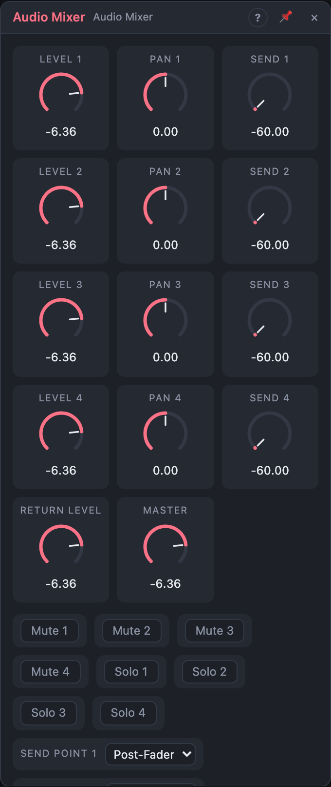

# Audio Mixer

## Introduction

A small stereo mixer for the board. It brings up to four sound sources
(oscillators, drums, Voice Cells) together into one stereo pair, with a
level, a pan, mute and solo for each, and a send for a shared effect. A
limiter on the master keeps the sum from clipping.

## How does it work?

Each channel's signal goes through:

1. **Level:** a fader in dB, from silence to +6 dB. 0 dB (unchanged) sits at
   about 80 % of the travel.
2. **Mute** and **Solo:** a muted channel is silent; when any channel is
   soloed, only soloed channels reach the master. Changes fade over 5 ms.
3. **Pan:** a mono channel (only *L* patched) is placed in the stereo field at
   even loudness; a stereo channel is balanced (moving right turns the left side
   down).
4. **Send:** a copy of the channel goes to the *Send* outputs at the *Send*
   level, after the fader, or before it with *Send Point* *Pre-Fader*.

The four channels and the *Return* (at *Return Level*) are added, scaled by
*Master*, and pass the **limiter**. It holds the output below −0.3 dBFS by
turning the gain down just before a peak (a 1 ms lookahead) and releasing it
over 50 ms. Switching it off leaves the signal untouched.

Solo doesn't affect the sends, so a reverb keeps its tail while you solo.

**Mono** sums every channel (and the return) to mono: Pan is ignored and
*Out L* and *Out R* carry the same signal.

## The view

The view is a horizontal row of channel strips. Each has a **Pan** dial, a
**Send** dial, **M**ute and **S**olo buttons and a **Level** fader with a level
meter beside it (peak, with a hold line and a clip light; click the light to
reset). The meter shares the fader's scale, so 0 dB lines up on both. The
master strip has the *Master* fader with a stereo meter, the *Limiter* and
*Mono* buttons, and the limiter's gain reduction. Double-click a control to
reset it.

## How to use it?

- **Mix a drum kit:** each drum into its own channel, *Out L/R* to an audio
  output port.
- **A shared reverb or delay:** turn up each channel's *Send*, patch *Send L/R*
  into the effect and the effect's output into *Return L/R*. The return
  arrives about 0.7 ms late (the board treats the loop as feedback), which is
  inaudible for reverbs and delays.
- **Rhythmic muting:** a clock or a gate pattern into *Mute 1*: the channel is
  silent while the gate is high.
- **Ducking:** the *Level* output follows the master's loudness; patch it with
  a negative amount onto another VCA's gain.

<!-- generated:demos -->
## Demo patches

Five whole patches show what Audio Mixer does. In the standalone app open **File → Presets…** (⌘P) and pick *Audio Mixer* under *Demos by module*; on the website, **Run in Play** opens one in your browser. Loading one replaces the project and starts the transport.

| Patch | What it shows |
|---|---|
| **Audio Mixer: Four-Piece Band** | Drums, a bass, a chord line and a lead each sit on their own channel with their own level and pan: bass in the middle, chords left, lead right. Pull a Level down or move a Pan to rebalance the band. |
| **Audio Mixer: Send to Reverb** | Each channel's Send feeds one reverb whose output returns on Return: the lead is awash in it, the bass stays dry. Raise Send 1 for more space, and switch Send Point to Pre-Fader to keep the reverb when a channel's Level is turned down. |
| **Audio Mixer: Muting Arrangement** | Mute inputs are fed from drum-grid tracks, so the hats, the chord stabs and the bass drop in and out of the mix on their own in a repeating pattern. Switch a Solo on to isolate one part, or turn a Mute on by hand. |
| **Audio Mixer: Limiter Squash** | All four channels are driven hot, well above 0 dB, and the built-in Limiter holds the master bus below full scale, giving a loud, dense and slightly pumping sound. Turn the Limiter setting off to hear how far past clipping the inputs are, and lower Master to keep it safe. |
| **Audio Mixer: Mono Check** | Two arpeggios are panned hard left and hard right with wide detune, then summed to the middle by the Mono setting: a quick way to hear what happens to a wide mix on a single speaker. Switch Mono off to open them back out, or change the Pan values. |
<!-- /generated -->

## Reference

### Knobs and settings

| Control | Range | Default |
|---|---|---|
| Level 1–4 | −60 dB (silence) … +6 dB | 0 dB |
| Pan 1–4 | −1 (left) … +1 (right) | 0 |
| Send 1–4 | −60 dB (silence) … +6 dB | silence |
| Return Level | −60 dB (silence) … +6 dB | 0 dB |
| Master | −60 dB (silence) … +6 dB | 0 dB |
| Mute 1–4 | Off, On | Off |
| Solo 1–4 | Off, On | Off |
| Send Point 1–4 | Post-Fader, Pre-Fader | Post-Fader |
| Limiter | Off, On | On |
| Mono | Off, On | Off |

### Inputs

| Input | Signal | What it does |
|---|---|---|
| In 1–4 L | audio | Left (or mono) input of each channel |
| In 1–4 R | audio | Right input; unpatched, the channel is mono |
| Return L, R | audio | The effect return; Return R unpatched copies L |
| Mute 1–4 | gate | Mutes the channel while high |

### Outputs

| Output | Signal | What it does |
|---|---|---|
| Out L, R | audio | The master mix |
| Send L, R | audio | The send bus |
| Level | control | The master's loudness, 0 … 1 (10 ms attack, 200 ms release) |
