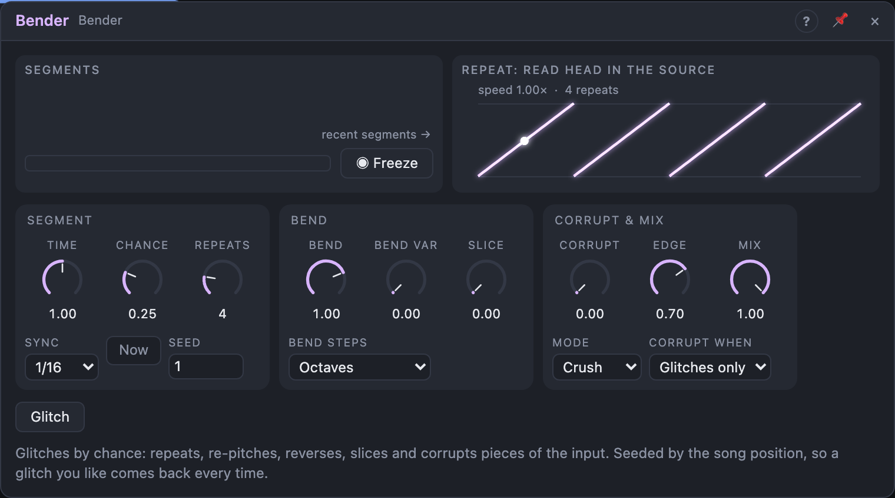

# Bender

## Introduction

Bender is a glitch effect in the spirit of circuit-bent samplers and skipping
CDs. It listens to the input, grabs short pieces of it and, by chance,
repeats, re-pitches, reverses, slices and corrupts them. Low settings add the
odd stutter to a beat; high settings shred it. Every decision comes from
*Seed* and the song position, so a glitch you like comes back every time you
play that section, and the render sounds exactly like what you heard.

## How does it work?

**Segments.** Bender cuts time into segments. With a note value in *Sync*
and the transport playing, segments sit on the song grid (a 1/16 segment
starts on every sixteenth, also after a loop jump). With *Sync* on *Free*, or
while the transport is stopped, segments follow each other at *Time* (synced
note values keep their length at the last tempo). With a cable in **Clock**,
each pulse starts a segment. *Segment* fires at every segment start.

**Decisions.** At each segment start Bender decides: pass the input, or
**glitch**. *Chance* is the probability of a glitch. A glitch repeats the
segment that just ended, *Repeats* segments long, then the input passes
again; no new decision is made while a glitch plays. The decisions are drawn
from *Seed* and the segment's number, so turning *Chance* up only adds
glitches (the ones you had stay), and changing *Seed* gives a different
pattern. A pulse at **Glitch** (or the *Glitch* button) makes the next
segment a glitch; with *Now* on, it starts one immediately. *Random* puts out
the segment's seeded value (−1 … +1) for modulation that matches the glitches;
*Active* is high while a glitch plays.

**Bend** is the playback speed of the repeats: 1 normal, 0.5 an octave down,
2 an octave up, negative values play backwards, and 0 stops the head on a
2 ms buzz. *Bend Steps* snaps it to octaves, octaves and fifths, or
semitones. *Bend Var* lets each glitch pick a different speed from a set
around *Bend* (half, double, reversed …). The repeat always lasts its full
length: faster speeds loop the source within it.

**Slice** makes each repetition shorter than the last: the accelerating
stutter. In sync, the lengths are powers of two of the segment (1/16 →
1/32 → 1/64 …), so the ratchets stay on the grid.

**Corrupt** sets the amount of the damage *Mode* picks:

| Mode | What *Corrupt* does |
|---|---|
| Crush | lower sample rate (down to 1 kHz) and fewer bits (down to 3), no filter |
| Dropout | splits each repetition into 16 cells and silences cells by chance |
| Fold | up to +24 dB into a wavefolder, then a hard clip |
| Shuffle | cuts the source into 8 slices and plays some of them out of order |
| Smear | jitters the read position by up to 20 ms: a scratchy copy |

With *Corrupt When* on *Always*, Crush, Dropout and Fold also act between
glitches. At 0 % every mode is exactly transparent.

**Edge** is the crossfade at every switch (pass → glitch, repetition →
repetition, glitch → pass, and the loop point of a re-pitched repeat):
100 % is 8 ms, 0 % hard cuts. Bender only clicks when you ask it to.

**Freeze** (the button or the gate) loops the current source for as long as
it's held and stops recording; *Bend*, *Slice* and *Corrupt* keep working on
it. When you let go, the glitch ends at the next segment start, on the grid.

**Transport.** When the transport stops mid-glitch, the glitch finishes its
repeats and the input passes again. Bender has no tail.

The view shows the decisions of this bar and the next while the transport
plays in sync (the upcoming ones dimmed), otherwise the recent segments; the
bar below shows the read head inside the source.

## How to use it?

- **Occasional stutter on a beat:** Sync 1/16, Chance 10 %, Repeats 2.
- **Ratchets:** Sync 1/8, Chance 30 %, Repeats 2, Slice 40 %.
- **Tape-stop flavour:** Bend 0.5, Bend Steps Octaves, Bend Var 50 %.
- **Shredder:** Chance 70 %, Mode Shuffle, Corrupt 80 %, Slice 30 %.
- **Glitch on demand:** Chance 0 %, *Now* on, a sequencer's trigger into
  *Glitch*.
- **Matching movement:** *Random* onto a filter's cutoff: it jumps with each
  decision.
- **In a Voice Cell:** each voice glitches on its own; with the same *Seed*
  they glitch together unless *Voice In › Random* moves a knob.

<!-- generated:demos -->
## Demo patches

Five whole patches show what Bender does. In the standalone app open **File → Presets…** (⌘P) and pick *Bender* under *Demos by module*; on the website, **Run in Play** opens one in your browser. Loading one replaces the project and starts the transport.

| Patch | What it shows |
|---|---|
| **Bender: Stutter Beat** | A drum loop and riff pass through Bender at 1/16 with a low Chance: now and then a slice repeats twice and stutters before the groove carries on. Raise Chance for more, or Repeats for longer stutters. |
| **Bender: Ratchet Arp** | An arpeggio goes through Bender at 1/8 with Slice at 40 %: repeated fragments cut into ratchets while Chance picks which beats get them. Change Seed to hear another set of decisions. |
| **Bender: Tape-Stop Pad** | A slow chord pad is re-pitched downward in Smear mode with Bend at one half and some Bend Var: pieces of the sound sag and slur like a tape machine losing speed. Try Bend Steps on Free for a continuous slide. |
| **Bender: Shredder** | Mode Shuffle with Chance at 70 %, Corrupt at 80 % and a little Slice cuts a beat and bass line into constantly rearranged, crumbling pieces. Pull Chance down to keep the groove, or try Fold and Dropout modes. |
| **Bender: Glitch Triggers** | Chance is zero, so Bender stays clean until a sequencer's trigger hits the Glitch input: only those steps are Folded, and the Random output jumps a filter's cutoff along with each decision. Change the sequencer steps to move the glitches. |
<!-- /generated -->

<!-- generated:presets -->
## Presets

The preset bar of the Bender view has 14 factory presets. Pick one to set the knobs, then change them to taste; your own presets sit next to them.

| Preset | What it does |
|---|---|
| **Stutter Repeats** | Occasional clean repeats of a sixteenth slice. |
| **Octave Jumps** | Slices randomly hop up or down octaves. |
| **Fifths Glitch** | Re-pitched slices in musical fifths and octaves. |
| **Tape Stop Fall** | Occasional downward pitch dives. |
| **Reverse Slices** | Shuffled slices that play back reversed. |
| **Dropouts** | Pieces of the signal drop out like a bad connection. |
| **Smear Clouds** | Smeared, blurred repeats for soft textures. |
| **Fold Mangle** | Folded, harsher glitches. |
| **Bit Crush Bursts** | Crushed bursts on random sixteenths. |
| **Slicer** | Chopped, rearranged slices for rhythmic breaks. |
| **Constant Corruption** | Always-on digital damage with occasional glitches. |
| **Free Roll** | Unsynced rolls with wandering pitch. |
| **Semitone Chaos** | Dense, random, chromatic glitch storm. |
| **Half-Time Freeze** | Rare long, slowed-down grabs. |
<!-- /generated -->

## Reference

### Knobs

| Knob | Range | Default |
|---|---|---|
| Time | 1 ms – 2 s | 125 ms |
| Chance | 0 – 100 % | 25 % |
| Repeats | 1 – 16 (stepped) | 4 |
| Bend | −2 … +2 | +1 |
| Bend Var | 0 – 100 % | 0 % |
| Slice | 0 – 100 % | 0 % |
| Corrupt | 0 – 100 % | 0 % |
| Edge | 0 – 100 % | 70 % |
| Mix | 0 – 100 % | 100 % |

Every knob is a modulation destination.

### Settings

| Setting | Values | Default |
|---|---|---|
| Sync | Free, 1/1 … 1/64T | 1/16 |
| Mode | Crush, Dropout, Fold, Shuffle, Smear | Crush |
| Corrupt When | Glitches only, Always | Glitches only |
| Bend Steps | Free, Octaves, Fifths + octaves, Semitones | Octaves |
| Now | Off, On | Off |
| Seed | 0 – 999 | 1 |

### Inputs

| Input | Signal | What it does |
|---|---|---|
| In L, In R | audio | the input; *In L* alone feeds both sides |
| Clock | trigger | each pulse starts a segment |
| Glitch | trigger | the next segment glitches (with *Now*: at once) |
| Freeze | gate | loops the current source while high |

### Outputs

| Output | Signal | What it does |
|---|---|---|
| Out L, Out R | audio | the processed signal |
| Active | gate | high while a glitch plays |
| Segment | trigger | a pulse at each segment start |
| Random | control | the segment's seeded value, −1 … +1 |
