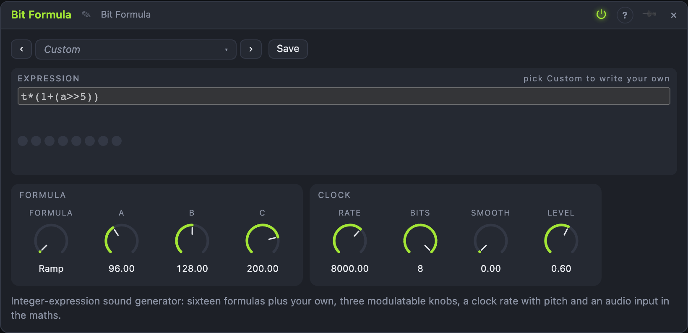

# Bit Formula

## Introduction

Bit Formula makes sound from a one-line sum of whole numbers. A counter
ticks at a clock rate; at each tick the formula turns the counter and three
knobs into a number, and the low eight bits of that number are the next
sample. Shifts, masks and exclusive-ors of a rising counter fall into
rhythms, melodies and crunchy textures. Sixteen formulas are built in, a
seventeenth is yours to type, and the audio input can be part of the maths.

## How does it work?

**The clock.** *Rate* ticks per second (250 Hz – 48 kHz, 8 kHz by default),
scaled by 1 V/oct from *Pitch*, advance a counter *t*. The output is held
between ticks, so a low rate is a lo-fi staircase. *Smooth* low-passes the
staircase (from open to about 200 Hz) and *Bits* keeps only the top 1 – 8 bits
of the result.

**The formula.** Each tick evaluates the formula with `t` (the counter), `a`,
`b`, `c` (the three knobs, 0 – 255, all modulatable) and `x` (the audio input
as 0 – 255; 128 when nothing is patched in). The result modulo 256 becomes the
sample: 0 is the bottom, 255 the top. *Value* shows the byte, *MSB* is its top
bit as a gate.

**The language.** Numbers are decimal or `0x` hex; the operators follow C's
precedence: `* / %`, then `+ -`, `<< >>`, `< <= > >=`, `== !=`, `&`, `^`, `|`,
`&&`, `||`, and `cond ? yes : no`; unary `-`, `~` and `!`; parentheses. All
arithmetic is 32-bit and wraps. Division and remainder by zero give 0 and shift
counts are taken modulo 32, so no formula can fail while it runs. There are no
functions, loops, names or assignments: the text is compiled once, when you
edit it, into at most 64 small instructions, and the audio thread only runs
those. A formula that does not fit the language (or is too long or deep) is
marked with the position of the first problem and is silent.

**Built-in formulas.** *Ramp*, *Pulse*, *Stairs*, *Sierpinski*, *Sieve*,
*Crawl*, *Chirp*, *Warble*, *Mask*, *Counting*, *Echo Ramp*, *Grid*, *Mirror*,
*Parity*, *Input Crush* and *Input Mod*; the last two use `x`. Their text is
shown in the view. *Formula* is a stepped knob: a cable can step through them.

## How to use it?

- **Tune it:** *Pitch* from a sequencer moves the clock, so every formula plays
  the notes (and their harmonics).
- **Move the maths:** an LFO or envelope into *A*, *B* or *C* changes the shifts
  and masks: the pattern re-forms at every step of the knob.
- **A drum voice:** *Rate* low (500 – 2000 Hz), *Bits* 4, *Reset* from a trigger
  each beat; *Value* or *MSB* can also drive other modules.
- **Mangle a signal:** *Input Crush* or *Input Mod* with a drum loop in *In*.
- **Write your own:** pick *Custom*, type for example `t*(a>>5) & (t>>(b>>4))`.
- **Make it gentle:** *Smooth* at 40 – 70 % and *Level* down turns harsh
  staircases into something you can put under a pad.

<!-- generated:demos -->
## Demo patches

Five whole patches show what Bit Formula does. In the standalone app open **File → Presets…** (⌘P) and pick *Bit Formula* under *Demos by module*; on the website, **Run in Play** opens one in your browser. Loading one replaces the project and starts the transport.

| Patch | What it shows |
|---|---|
| **Bit Formula: Sieve Tune** | A tune made from the overlap of two shifted counters, played by a sequencer on the clock rate. Move A and B to change which notes appear, or switch Formula to Crawl for a slower creeping line. |
| **Bit Formula: Crush the Beat** | A drum loop goes into In and the formula mixes it, bit by bit, with the counter: the beat comes back crunchy and gritted. Turn A down for a cleaner crush or switch to Input Mod for a more tonal mangle. |
| **Bit Formula: Sliding Knobs** | Three slow LFOs move A, B and C through a creeping formula, so the shifts and masks keep re-forming: a texture that is never the same twice. Change the LFO rates, or Smooth for a softer surface. |
| **Bit Formula: Drum Voice** | The counter is reset by every step and the formula is cut by a short envelope, so a falling squeal becomes a percussive hit. Change the Formula or Rate for a different drum sound. |
| **Bit Formula: Hollow Bass** | A low note on the clock rate of a shifted-mask formula: a hollow, buzzing bass with a built-in sub pattern. A sweeps the harmonic mask; try Bits at 5 for a rawer edge. |
<!-- /generated -->

<!-- generated:presets -->
## Presets

The preset bar of the Bit Formula view has 17 factory presets. Pick one to set the knobs, then change them to taste; your own presets sit next to them.

| Preset | What it does |
|---|---|
| **Ramp Saw** | The counter itself: a rising saw that wraps. |
| **Pulse Width** | A pulse; A sets its width. |
| **Stair Climb** | Stepped ramps that climb in shifting groups. |
| **Sierpinski Bass** | A hollow bass pattern from a shifted mask. |
| **Sieve Melody** | A tune from the overlap of two shifted counters. |
| **Crawl** | A slow, creeping melody with a sparse rhythm. |
| **Chirp Drops** | Falling squeals: the counter squared. |
| **Warble Pad** | Smoothed, wavering steps. |
| **Mask Rhythm** | A rhythm of masked bit patterns. |
| **Counting Noise** | Bit-counting noise with a ragged pitch. |
| **Echo Ramp Soft** | Two ramps averaged: a soft buzz. |
| **Grid Buzz** | An angular, buzzy grid of three masks. |
| **Mirror Tone** | A triangle-like tone folded by the top bit. |
| **Parity Pulse** | Parity of two shifted counters: pulsing and crunchy. |
| **Crush Input** | Patch audio into In: it is cut to a few bits and crossed with the counter. |
| **Lo-Fi 4 Bit** | A coarse four-bit staircase saw. |
| **Custom Hat** | Your own formula slot, filled with a noisy hat-like one. |
<!-- /generated -->

## Reference

### Inputs and outputs

| Jack | Signal | What it does |
|---|---|---|
| Pitch | pitch | 1 V/oct on the clock rate |
| Reset | trigger | sets the counter back to 0 |
| In | audio | becomes `x` in the formula |
| Out | audio | the byte as audio, after Bits, Smooth, Level |
| Value | control | the byte as 0 – 1 |
| MSB | gate | bit 7 of the byte |

### Knobs and settings

| Control | Range | Default |
|---|---|---|
| Formula | 16 built-in + Custom | Ramp |
| A, B, C | 0 – 255 | 96, 128, 200 |
| Rate | 250 Hz – 48 kHz | 8 kHz |
| Smooth | 0 – 100 % | 0 |
| Bits | 1 – 8 | 8 |
| Level | 0 – 100 % | 60 % |

The custom formula (up to 160 characters) is saved with the node.
