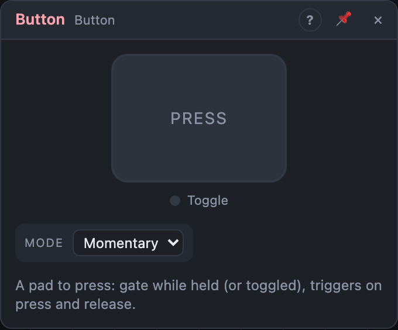

# Button

## Introduction

The Button is a **pad to press** while the patch plays. Click it, tap it or
press Space: it opens a gate, fires triggers, or switches something on and
off. Use it to start an envelope by hand, reset a sequencer, fire a drum or
mute a part.

## How does it work?

In **Momentary** mode, *Gate* is high for as long as you hold the pad. In
**Toggle** mode, each press switches *Gate* on or off, and it stays there.

Whatever the mode:

- *Trigger* fires a short pulse each time you press,
- *Release* fires one each time you let go,
- *Toggle* switches on or off with every press.

Once you've clicked the pad, **Space** and **Enter** press it too.

The toggle's state is saved with the set, so a part you switched off stays
off when you open it again.

## How to use it?

- **Play an envelope by hand:** *Gate* into an ADSR's **Gate**, the ADSR into
  a VCA.
- **Restart the music:** *Trigger* into a Step Sequencer's or an LFO's
  **Reset**.
- **Fire a drum:** *Trigger* into a drum's **Trig**.
- **Mute a part:** Toggle mode, *Gate* onto a VCA's **Gain** (or into a
  Switch to choose between two sources).

## Reference

### Settings

| Setting | Values | Default |
|---|---|---|
| Mode | Momentary, Toggle | Momentary |

### Outputs

| Output | Signal | What it does |
|---|---|---|
| Gate | gate | high while held (Momentary) or while toggled on (Toggle) |
| Trigger | trigger | a pulse on every press |
| Release | trigger | a pulse on every release |
| Toggle | gate | switches on or off with every press |
