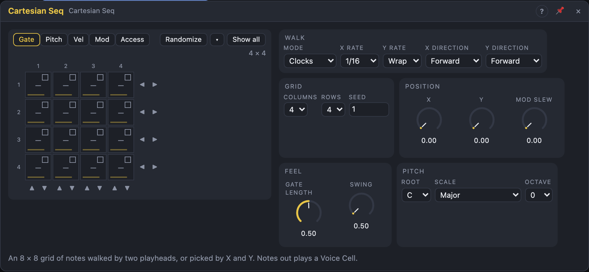

# Cartesian Seq

## Introduction

The Cartesian Seq is a sequencer on a **grid**: up to 8 × 8 cells, each with
a **gate** (off, on or tied), a **pitch**, a **velocity**, a **mod** value and
an **access** switch that takes it out of the path. Two playheads walk the
grid, one across the columns (**X**) and one down the rows (**Y**), each with
its own rate or clock and direction. The same handful of cells plays very
different melodies depending on how the playheads move.

In **Cartesian** mode the playheads stop walking and the **X** and **Y** knobs
pick the cell instead: patch an LFO, an XY gesture or another sequencer onto
them and the grid becomes a map you travel through.

Patch *Notes* into a Voice Cell and press play: a new module plays a rising
figure on the 4 × 4 corner of the grid right away.

## How does it work?

**The grid.** The module always keeps all 64 cells. *Columns* and *Rows* set
the playing area; cells outside it keep what you drew.

**Clocks mode** (the default). The X playhead follows the transport at *X
Rate* (or one column per pulse on *X Clock*). What Y does depends on *Y Rate*:

- **Wrap:** Y moves one row each time X has crossed its row. That's a
  **raster** scan: row by row through the grid, like reading a page.
- **A note value:** Y moves on its own grid, independent of X. With 4 columns
  at 1/16 and Y at 1/4., X repeats every quarter note but Y every dotted
  quarter, so the 16 cells play a line that only repeats after 3 bars.
- **Off:** Y stays on the row chosen by the *Y* knob.
- With a cable in **Y Clock**, each pulse moves Y one row, whatever *Y Rate* says.

When both playheads move on the same sample the cell plays once. Each axis
has a *Direction*: forward, backward, back and forth (*Ping-Pong*, ends not
repeated) or a seeded random order that never repeats a cell twice in a row.

The **X** and **Y** knobs shift the playheads: X at 50 % on a 4-column grid
starts every row two columns later. Modulate them to rotate the pattern while
it plays.

**Skipped cells.** A cell with access *Skip* is taken out of the path; its
notes stay. In a raster scan the path just gets shorter (skip 3 of 16 cells
and the pattern repeats every 13 steps). With independent axes a skipped
cell lends its turn to the next playing cell in the row; a row with every
cell skipped stays silent.

**Cartesian mode.** *X* and *Y* (knob plus cables) choose the column and the
row directly. With *Sample* = **Clock** the position is read at every X step
and that cell plays. With **Change** a cell plays as soon as the position
moves into a new cell — no clock needed, and it keeps playing when the
transport stops, which makes it a performance instrument. A little hysteresis
stops a position sitting on a border from chattering. Skipped cells can't be
reached; the nearest playing cell plays instead.

**Gates and ties.** *On* plays for *Gate Length* of an X step. *Tie* holds the
note into the next cell; a different pitch there starts before the old note
ends, so a Voice Cell in *Legato* mode glides. *Off* plays nothing, but the
playhead still visits the cell and *Mod* still moves. No note is ever left
hanging: stopping, Reset, changing the size or mode, and skipping or silencing
the sounding cell all end it.

**Pitch.** A cell's pitch counts semitones above *Root* + *Octave*; with the
*Transpose* input it snaps to the nearest note of the *Scale*.

**Mod.** Each cell carries a value from −100 % to +100 % that appears on the
*Mod* output when the playhead arrives, gliding there over *Mod Slew*. Use it
for a filter, a wavefold amount, a pan — a second melody for anything.

## How to use it?

- **A melody right away:** *Notes* into a Voice Cell's *Notes* input, press play.
- **Drawing:** pick a layer at the top. *Gate*: click cycles Off → On → Tie,
  drag paints. *Pitch*, *Vel* and *Mod*: drag up and down on a cell (Shift for
  fine steps; pitch snaps to the scale unless Shift is held); double-click
  resets. *Access*: click to skip a cell or bring it back. Alt-drag paints the
  first cell's value of the layer across others.
- **Rotating:** ◀ ▶ beside each row and ▲ ▼ under each column rotate that row
  or column by one cell.
- **Right-click** a cell to copy, paste or reset it.
- **Randomize** rewrites the shown layer inside the playing area; **▾** sets
  the density, pitch range, velocity range and how many cells to skip.
- **Long phrases from short loops:** set *Y Rate* to a dotted or triplet value
  against *X Rate*.
- **XY performance:** *Mode* = Cartesian, *Sample* = Change, and patch two
  slow LFOs (or a Random) onto *X* and *Y*. The crosshair shows where they go.
- **Shuffling the order:** *X Direction* = Random with a slow Function on *Y*.
- **Chaining:** *Row End* and *Grid End* make good clocks or resets for other
  modules; *X Pos* and *Y Pos* are handy modulation sources.

<!-- generated:demos -->
## Demo patches

Five whole patches show what Cartesian Seq does. In the standalone app open **File → Presets…** (⌘P) and pick *Cartesian Seq* under *Demos by module*; on the website, **Run in Play** opens one in your browser. Loading one replaces the project and starts the transport.

| Patch | What it shows |
|---|---|
| **Cartesian Seq: Two-Row Riff** | A grid of eight columns and two rows: the X playhead runs along a row every sixteenth and Y drops to the second row when it reaches the end, so a sixteen-note riff in G Dorian comes out in order. Change Rows to 1 for a short loop, or edit a cell's pitch in the view. |
| **Cartesian Seq: Ping-Pong Marimba** | Both playheads bounce back and forth over a 6 × 4 patch of the grid, X on the eighths and Y once a bar, so a marimba line keeps reversing and the long path takes ages to repeat. Set the directions to Forward for a plain scan, or Random to lose the pattern. |
| **Cartesian Seq: Mod Bass** | Every cell also stores a Mod value, and here the Mod output opens the filter of an acid bass, so each step has its own brightness: notes with a high Mod bite, low ones stay dark. Edit the Mod of a cell or turn Mod Slew up to smear the changes. |
| **Cartesian Seq: Slow Crosshair** | Cartesian mode: no clocks, two slow LFOs steer the X and Y inputs across a full 8 × 8 grid of Lydian notes, and a note sounds whenever the crosshair enters a new cell. Move X and Y yourself, or change the LFO rates to wander faster. |
| **Cartesian Seq: Row End Fills** | X runs backward through a 5 × 3 grid, and the Row End and Grid End triggers play the drums: a hat each time a row finishes, a kick and clap when the whole grid has been walked. Change Columns or Rows and the drum accents move with the melody. |
<!-- /generated -->

<!-- generated:presets -->
## Presets

The preset bar of the Cartesian Seq view has 13 factory presets. Pick one to set the knobs, then change them to taste; your own presets sit next to them.

| Preset | What it does |
|---|---|
| **Four by Four** | A 4 x 4 grid read left to right, row by row. |
| **Eight by Eight** | The full grid: sixty-four steps of melody. |
| **Single Row** | Just one row: a plain eight-step sequence. |
| **Slow Rows** | X steps fast, Y creeps slowly: rows change every half note. |
| **Backward Walk** | Both playheads run in reverse. |
| **Ping-Pong Grid** | Both playheads bounce back and forth. |
| **Random Walk** | Playheads jump about at random: a shuffled melody. |
| **Polymetric 5x3** | Two clocks at the same rate on uneven sizes: patterns drift. |
| **Swung Grid** | A swung four by four. |
| **Triplet Grid** | Triplet steps across six columns. |
| **Manual Cartesian** | Pick notes with X and Y: modulate them with LFOs. |
| **Smooth Mod Walk** | X/Y control with a slewed mod output for a smooth line. |
| **Low Drone Grid** | A slow, held low-octave pattern. |
<!-- /generated -->

## Reference

### Knobs

| Knob | Range | Default |
|---|---|---|
| Gate Length | 1 – 100 % of an X step | 50 % |
| Swing | 50 – 75 % | 50 % |
| X | 0 – 100 % | 0 % |
| Y | 0 – 100 % | 0 % |
| Mod Slew | 0 – 1 s | 0 s |

- **Gate Length:** how long each *On* cell sounds. Ties ignore it.
- **Swing:** delays every second X step.
- **X / Y:** Clocks mode: shift the playheads by whole cells. Cartesian mode:
  the position on the grid.
- **Mod Slew:** how long the *Mod* output takes to reach a new cell's value.

Every knob is a modulation destination.

### Settings

| Setting | Values | Default |
|---|---|---|
| Columns | 1 – 8 | 4 |
| Rows | 1 – 8 | 4 |
| Mode | Clocks, Cartesian | Clocks |
| X Rate | 1/1 … 1/32, dotted (.) and triplet (T) | 1/16 |
| Y Rate | Wrap, Off, 1/1 … 1/32T | Wrap |
| X Direction, Y Direction | Forward, Backward, Ping-Pong, Random | Forward |
| Sample | Clock, Change (Cartesian mode) | Clock |
| Root | C … B | C |
| Scale | the Step Sequencer's scales | Major |
| Octave | −3 … +3 | 0 |
| Seed | 0 – 999 | 1 |
| Sync To | Auto, Clock, Transport | Auto |

- **Sync To:** what steps the module. *Auto*: the clock pulses while *X Clock* / *Y Clock* is patched, otherwise the transport. *Clock*: only the pulses step it. *Transport*: the song position steps it, and a patched *X Clock* / *Y Clock* is ignored.

### Inputs

| Input | Signal | What it does |
|---|---|---|
| X Clock | trigger | each pulse moves X one column; unpatched, the transport drives X |
| Y Clock | trigger | each pulse moves Y one row (Clocks mode) |
| Reset | trigger | both playheads start again at the first cell |
| Transpose | pitch | added before quantizing (1 V/oct) |

### Outputs

| Output | Signal | What it does |
|---|---|---|
| Notes | notes | one note per played cell, ties as legato |
| Pitch | pitch | the cell's quantized pitch, held between notes |
| Gate | gate | high while a cell sounds, across ties |
| Velocity | control, 0 – 1 | the cell's velocity, held |
| Mod | control, −1 – +1 | the cell's mod value, through Mod Slew |
| Trigger | trigger | a pulse when a cell starts a new note |
| X Pos, Y Pos | control, 0 – 1 | the playing column and row |
| Row End | trigger | a pulse when X starts a new row (raster) or wraps |
| Grid End | trigger | a pulse when the whole path starts over |
