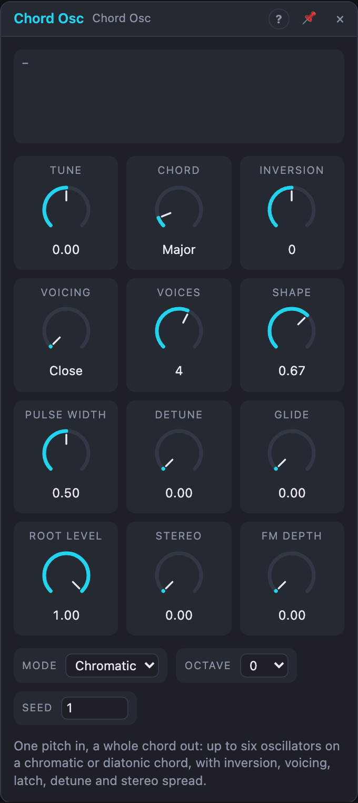

# Chord Osc

## Introduction

The Chord Osc turns one pitch into a whole chord. Up to six oscillators play
the tones of a chord built on the *Pitch* input: pick the quality (major,
minor, sevenths, sus, add9, …), the inversion and the voicing, and morph the
waveform of all voices at once. In *Scale* mode it builds the chords of a key
instead, so a simple melody becomes a chord progression. The *Root* output
carries the root alone, and *Pitch 1–4* send the four lowest chord tones to
other oscillators.

## How does it work?

Each voice is the Oscillator's core (sine, triangle, band-limited saw and
square, morphed by *Shape*). The chord is built in four steps whenever the
pitch or a stepped knob changes:

1. **Tones.** The chord has a number of tones (C major 7 has four). With
   fewer *Voices*, tones are left out in the order fifth, extension (9th),
   seventh, third; the root always stays. With more *Voices*, tones are
   doubled an octave up: root first, then fifth, third, …
2. **Inversion.** Positive steps move the lowest tone up an octave, negative
   steps move the highest tone down. The bass shows in the name (`Am7/C`).
3. **Voicing.** *Close* keeps the chord within an octave. *Drop 2*, *Drop 3*
   and *Drop 2+4* move the second, third (or second and fourth) tone from the
   top down an octave, as guitarists and arrangers do. *Open* moves the bass
   down an octave; *Wide* spreads the tones over about three octaves.
   Voicings that need more tones than are playing stay *Close*.
4. **Range guard.** If the chord would reach above 8 kHz or below 16 Hz, it
   moves by whole octaves back into range.

Every oscillator keeps "its" tone: the one playing the third plays the third
of the next chord. With *Glide* the voices slide to their new notes (smooth
voice leading); without it they jump, keeping their phase, so changes don't
click. Voices that start or stop playing fade in or out over 5 ms.

**Scale mode.** The *Pitch* input is snapped to the nearest note of *Root* and
*Scale* (exactly between two notes, it goes down). That note's scale degree is
the chord root, and the chord is stacked from scale steps: in C major a
*Triad* on D is D minor, on G it is G major, on B it is B diminished. The view
shows the chord found and its degree (ii, V, …).

**Latch.** With a cable in *Latch*, the module takes the pitch and the four
stepped settings (*Chord*, *Inversion*, *Voicing*, *Voices*) only at each pulse
and holds the chord until the next one. *Tune*, *Shape*, *Detune* and the
others stay live. Until the first pulse it plays as if unlatched.

**Mixing.** *Out L/R* is the sum of the voices divided by √(number of voices),
so a four-voice chord is about as loud as two oscillators. With square waves
and six voices the peaks can reach about ±2.4. *Root Level* sets the root
voice inside the mix; the *Root* output is always at full level (±1).

**Detune** gives each voice a fixed offset within ±*Detune* cents, drawn from
*Seed*: the same seed always gives the same offsets. **Stereo** spreads the
voices across the field, from the centre outwards and alternating sides, so
the root stays nearest the middle.

## How to use it?

- **Chord pad:** Voice In *Pitch* → *Pitch*; *Out L/R* → Filter → VCA. A
  little *Detune* (5–10 ct) and *Stereo* at 60 % make it wide.
- **Chord progression from a melody:** set *Mode* to *Scale*, pick the key,
  and play a step sequencer into *Pitch*. Each note becomes the diatonic chord
  on it. Patch the sequencer's trigger into *Latch* so chords change exactly
  on the step.
- **Moving chords:** patch a slow LFO onto *Chord* (Scale mode: Triad,
  Seventh, Ninth, …) or *Inversion* for chords that keep changing colour.
- **Voice leading:** raise *Glide* to 100–300 ms and change chords: every
  voice slides to the corresponding tone of the next chord.
- **Bass plus chords:** lower *Root Level* and send *Root* through its own
  filter as a bass voice, or use *Pitch 1* to play a separate bass oscillator.
- **Arpeggios elsewhere:** *Pitch 1–4* carry the chord tones low to high;
  switch between them with a sequential switch for an arpeggio that follows
  the chord.

## Demo patches

Five whole patches show what Chord Osc does. In the standalone app open **File → Presets…** (⌘P) and pick *Chord Osc* under *Demos by module*; loading one replaces the project and starts the transport.

| Patch | What it shows |
|---|---|
| **Chord Osc: Soft Minor Pads** | *Minor 7* with the *Open* voicing, *Detune*, *Stereo* and *Glide* turns a slow bass line into melting chords. |
| **Chord Osc: Diatonic Run** | *Mode* Scale: a plain tune becomes the diatonic chord on each note, changing on the step through *Latch*. |
| **Chord Osc: Chord Arpeggio** | The *Pitch 1–4* outputs feed a Switch and an oscillator: an arpeggio that follows the held chord. |
| **Chord Osc: Offbeat Stabs** | Short *Dominant 9* stabs with the *Drop 2* voicing and a squarer *Shape* over a four-on-the-floor beat. |
| **Chord Osc: FM Quartal Glow** | Sine voices in fourths with an oscillator in *FM* whose amount is moved by a slow LFO. |

## Reference

### Knobs and settings

| Control | Range | Default |
|---|---|---|
| Tune | −100 … +100 ct | 0 ct |
| Chord | Chromatic: 24 qualities; Scale: 10 stacks | Major / Triad |
| Inversion | −4 … +4 | 0 |
| Voicing | Close, Drop 2, Drop 3, Drop 2+4, Open, Wide | Close |
| Voices | 1 – 6 | 4 |
| Shape | 0 – 100 % | 67 % (saw) |
| Pulse Width | 5 – 95 % | 50 % |
| Detune | 0 – 50 ct | 0 ct |
| Glide | 0 – 1 s | 0 ms |
| Root Level | 0 – 100 % | 100 % |
| Stereo | 0 – 100 % | 0 % |
| FM Depth | 0 – 100 % | 0 % |
| Mode | Chromatic, Scale | Chromatic |
| Octave | −3 … +3 | 0 |
| Root | C … B (Scale mode) | C |
| Scale | Chromatic … Hirajoshi (Scale mode) | Major |
| Seed | 0 – 999 | 1 |

- **Chord:** in *Chromatic* mode the quality: Unison, Fifth, Major, Minor,
  Diminished, Augmented, Sus2, Sus4, Major 6, Minor 6, Dominant 7, Major 7,
  Minor 7, Half-diminished, Diminished 7, Minor-major 7, 7sus4, Add9, Minor
  add9, 6/9, Major 9, Minor 9, Dominant 9, Quartal. In *Scale* mode a stack of
  scale steps: Single, Fifth, Triad, Sus2, Sus4, Sixth, Seventh, Add9, Ninth,
  Quartal. Each mode has its own dropdown; a cable moves them from entry to entry,
  read once per audio block.
- **Inversion**, **Voices:** stepped knobs; **Voicing:** a dropdown a cable can drive, see *How does it
  work?*.
- **Shape:** sine → triangle → saw → square for every voice, as the
  Oscillator's *Shape*.
- **Glide:** time for a voice to reach a new note (99 %). Also glides pitch
  changes at the input.
- **FM Depth:** scales the *FM* input: at 100 % an FM signal of ±1 swings
  each voice's frequency by ±4× its base, through zero.
- **Octave**, **Tune:** transpose the whole chord.
- **Seed:** chooses the detune offsets and the voices' start phases.

All knobs are modulation destinations; *Mode*, *Octave*, *Root*, *Scale* and
*Seed* are settings.

### Inputs

| Input | Signal | What it does |
|---|---|---|
| Pitch | pitch, 1 V/oct | the chord root; 0.0 = C4. Scale mode: snapped to the scale first |
| Latch | trigger | when patched, the chord changes only at its pulses |
| FM | audio | linear, through-zero FM for all voices, scaled by *FM Depth* |

### Outputs

| Output | Signal | What it does |
|---|---|---|
| Out L, Out R | audio | all voices, panned by *Stereo*, divided by √voices |
| Root | audio | the chord root alone at full level, whatever the inversion and voicing |
| Pitch 1 … 4 | pitch | the four lowest voices, low to high; with fewer voices the last ones repeat the highest |
