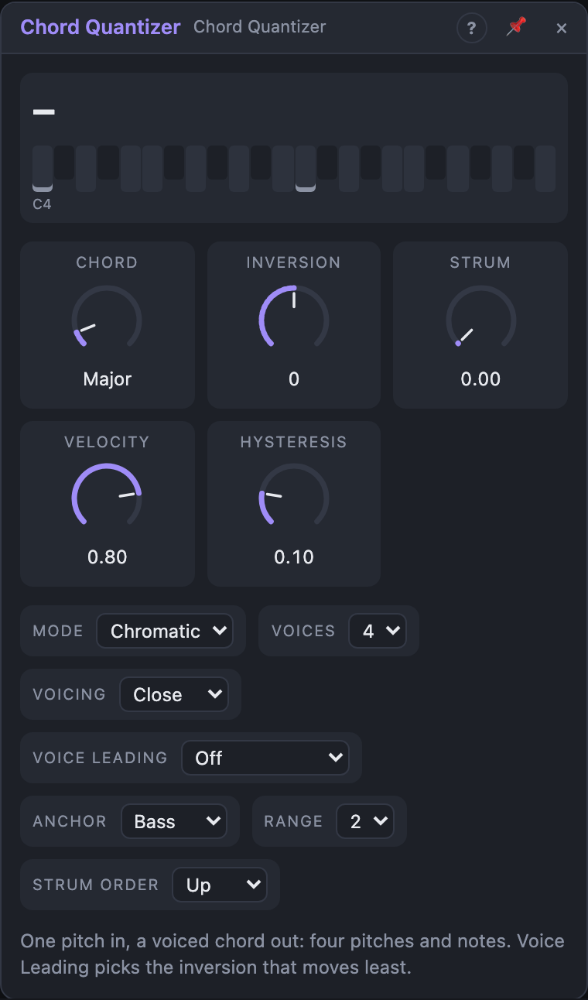

# Chord Quantizer

## Introduction

One pitch in, a **chord** out. The input picks the chord's root, the module
builds a chord on it, inverts and voices it, and plays it on four pitch
outputs and a *Notes* output. Patch a melody in and get a chord that moves
with it; switch on **Voice Leading** and each new chord picks the inversion
that moves the voices least, so a jumpy sequence turns into smooth changes.

## How does it work?

**Mode** decides how the root and the chord are found:

- **Chromatic:** the root is the input rounded to the nearest semitone and
  *Chord* chooses the chord (Major, Minor, Dominant 7, … Quartal).
- **Diatonic:** the input snaps to *Root* + *Scale*, and *Chord* chooses a
  stack of scale steps (Triad, Seventh, Sus4, Ninth, …). The chord quality
  follows the key: in C major a Triad on D is D minor. With *Harmony* on a
  bus, key and scale come from the Harmony Master.
- **Follow:** the chord **is** the Harmony Master's current chord (slash bass
  included); the input only moves it up and down. Without a Harmony Master on
  the bus it acts as Diatonic and says "no harmony".

**Voices** sets how many notes the chord has (1–4). With fewer than the chord
has, the fifth goes first, then extensions, the seventh, the third; with more,
the root, fifth and third are doubled an octave up.

**Inversion** moves the lowest voice up an octave (or the highest down, for
negative values). **Voicing** spreads the chord: *Drop 2* and *Drop 3* move
the 2nd or 3rd voice from the top down an octave, *Spread* opens it into a
wide pad (bass down, the rest at least a fourth apart), *Open* moves every
second voice up an octave. A voicing that needs more voices plays Close.

**Register.** The chord is moved by octaves so its lowest voice (*Anchor* =
*Bass*), its middle (*Centre*) or its top voice (*Top*) is as close to the
input as possible. *Range* folds voices more than that many octaves above the
bass back down.

**Voice Leading.** *Smooth* tries every inversion of the next chord in a few
octaves and plays the one whose voices move least (and that stays near the
input). *Smooth + Top* also keeps the top voice still where it can, like a held
melody note. *Inversion* is ignored then.

**Trig.** Unpatched, the chord follows the input all the time; *Hysteresis*
keeps a slightly noisy input from flickering between roots. Patch a trigger
and the input is read only on each pulse, then held. A pulse that gives the
same chord plays it again.

**Strum.** With *Strum* above 0 a new chord reaches the voices one after the
other (*Strum Order* Up: bass first), spread over the *Strum* time.

## How to use it?

- **Chords from a melody:** a Step Sequencer's *Pitch* into *Pitch*, its
  *Trigger* into *Trig*, *Notes* into a Voice Cell.
- **Smooth pads:** Voice Leading *Smooth*, Voicing *Spread*, a slow sequence
  of roots.
- **Follow the song's chords:** Mode *Follow*, *Harmony* = the Harmony
  Master's bus; patch an LFO into *Pitch* to move the chord's register.
- **Four oscillators:** *Voice 1 … 4* into four oscillators instead of a Voice
  Cell; *Change* retriggers their envelopes.
- **Gated chords:** patch a gate into *Gate*: notes sound only while it is
  high.

## Reference

### Knobs

| Knob | Range | Default |
|---|---|---|
| Chord | Chromatic: Unison … Quartal; Diatonic: Single … Quartal | Major / Triad |
| Inversion | −3 … +3 | 0 |
| Strum | 0 – 100 ms | 0 |
| Velocity | 1 – 100 % | 80 % |

Every knob is a modulation destination. *Chord* shows the table in Chromatic
and the scale stacks in Diatonic.

### Settings

| Setting | Values | Default |
|---|---|---|
| Mode | Chromatic, Diatonic, Follow | Chromatic |
| Root | C … B | C |
| Scale | the 17 scales | Major |
| Harmony | Off, Bus A – D | Off |
| Voices | 1 – 4 | 4 |
| Voicing | Close, Drop 2, Drop 3, Spread, Open | Close |
| Voice Leading | Off, Smooth, Smooth + Top | Off |
| Anchor | Bass, Centre, Top | Bass |
| Range | 1 – 4 octaves | 2 |
| Strum Order | Up, Down | Up |
| Hysteresis | 0 – 50 % of a semitone | 10 % |

### Inputs

| Input | Signal | What it does |
|---|---|---|
| Pitch | pitch | picks the root (and the register) |
| Trig | trigger | patched: the chord is read at each pulse and held |
| Gate | gate | patched: notes sound while it is high |

### Outputs

| Output | Signal | What it does |
|---|---|---|
| Voice 1 … Voice 4 | pitch | the chord, low to high; unused voices repeat the highest |
| Root | pitch | the chord's root, at or above Voice 1 |
| Notes | notes | the chord as notes; voices that keep their pitch keep sounding |
| Change | trigger | a pulse when the chord changes |
