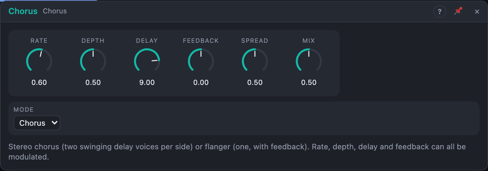

# Chorus

## Introduction

The Chorus makes one sound into several: it mixes the input with copies of itself that are delayed by a few milliseconds, with the delay time swinging up and down. The slightly changing delay detunes the copies against the original, which sounds like several players, or a wide, shimmering instrument. Set to a very short delay with feedback it becomes a **flanger**, with the sweeping comb-filter whoosh of jet planes and tape machines.

## How does it work?

Each channel has a short delay line. A triangle LFO swings its delay time around the centre *Delay*, with *Depth* as the share of the centre time it moves. A bit of the delayed signal is fed back into the delay line (*Feedback*). In **Chorus** mode every channel has two voices, with the LFO half a cycle apart and slightly different delay times, so the sound is thicker. In **Flanger** mode there is one voice per channel and the feedback is a little more generous.

- **Rate** is the LFO speed, 0.02 to 10 Hz. Slow rates (0.2–0.8 Hz) are lush, fast ones become vibrato.
- **Depth** is how far the delay time swings. More depth is a stronger detune.
- **Delay** is the centre delay time. Chorus likes 7–20 ms; a flanger 0.5–5 ms.
- **Feedback** sends the delayed signal back in. Positive feedback emphasises the comb's peaks (metallic ring); negative feedback emphasises the notches (hollow, "inverted" flanging). Chorus uses little or none.
- **Spread** moves the right channel's LFO away from the left, up to half a cycle, which makes a wide stereo movement. At 0 both sides move together.
- **Mode** is Chorus or Flanger.
- **Mix** blends dry and wet. 50 % is the classic setting; the flanger notches are deepest at 50 %.

Mix, rate, depth, delay and feedback can all be modulated. Modulating *Delay* with another LFO is how tape-style wobble is made. With only *In L* patched, the signal feeds both sides.

## How to use it?

- **Lush chorus on a pad:** Chorus mode, Rate 0.4 Hz, Depth 50 %, Delay 12 ms, Mix 40 %.
- **Jet flanger:** Flanger mode, Rate 0.15 Hz, Depth 80 %, Delay 2 ms, Feedback 70 %, Mix 50 %.
- **Hollow flanger:** the same with Feedback −70 %.
- **Vibrato:** Rate 5 Hz, Depth 20 %, Mix 100 % (no dry signal means no chorus effect, only pitch wobble).
- **Slap thickener on a guitar:** Delay 20 ms, Depth 0 %, Mix 30 %.

## Origin

The modulated-delay voice (swinging delay with feedback, and the flanger's extra sample of delay) is from **Chorus and Flanger (DaisySP)** by Electrosmith, [github.com/electro-smith/DaisySP](https://github.com/electro-smith/DaisySP), MIT licence. Bleep's version puts both effects in one stereo module, with an LFO phase spread, cubic interpolation, feedback in both polarities and a rate in hertz. The original licence text is in this module's `LICENSE` file.
