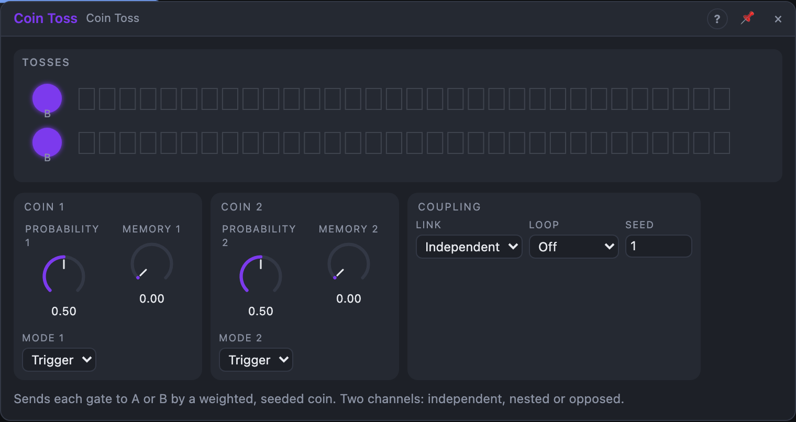

# Coin Toss

## Introduction

Coin Toss is a probability router. Every gate or trigger that arrives at its
input is sent to output *A* or to output *B*, decided by a weighted coin.
There are two channels, so one clock becomes two complementary rhythms that
keep changing. Every toss comes from a seed, so a rendered song sounds
exactly like the live playback.

## How does it work?

**Tosses.** Each rising edge at *In* tosses the coin. *Probability* is the
chance that it lands on **B**: 0 % always A, 100 % always B, 50 % a fair coin.
*In 2* listens to *In 1* while nothing is patched into it, so channel 2 makes
its own decision on the same events.

**Memory.** With *Memory* above 0 % a toss sometimes simply repeats the last
result instead of flipping a new coin. You get runs of A and runs of B, while
the long-term balance stays the same. At 50 % the runs are about twice as long.

**Modes.**

- **Trigger:** the chosen output copies the input gate (same length); the other
  stays low. A trigger in gives a trigger out.
- **Latch:** the chosen output goes high and stays high until a toss chooses
  the other side. A and B are always opposite: a random switch.
- **Toggle:** a toss that lands on B swaps which output is high; one that lands
  on A changes nothing. *Probability* becomes the chance of a change.

**Link.**

- **Independent:** each channel tosses its own coin.
- **Shared:** one coin for both, compared against each channel's own
  *Probability*. If channel 1's probability is lower, channel 2 always goes B
  when channel 1 does: nested probability, e.g. hats at 70 % and an open hat at
  20 %, never one without the other.
- **Opposed:** one coin, but channel 2 reads it from the other end, so the
  channels avoid each other: B on both never happens as long as the two
  probabilities add up to 100 % or less.

In *Shared* and *Opposed* the tosses happen on channel 1's edges; *In 2* only
sets channel 2's gate lengths.

**Repeatable.** Each channel counts its tosses. Reset (or a transport start)
sets the count to 0, so the same decisions follow again. *Loop* makes the
count wrap after 2 … 32 tosses: a fixed random rhythm that repeats. Change
*Seed* for another one.

## How to use it?

- **Two rhythms from one clock:** patch a clock or a sequencer's gate into
  *In 1*, *A 1* to one drum, *B 1* to another.
- **Ghost notes:** *Probability* 15 %, *B 1* into a quieter second voice.
- **Fills that build up:** an LFO or a slow envelope on *Probability 1*.
- **A random switch:** *Mode 1* on *Latch*, *Coin 1* into a crossfader or a
  sequential switch's address.
- **Nested hats:** *Link* on *Shared*, *Probability 1* 20 % (open hat on *B 1*),
  *Probability 2* 70 % (closed hat on *B 2*).
- **A fixed random pattern:** *Loop* on 8 or 16, and a Reset from the bar
  (e.g. the Step Sequencer's *End*) so it stays on the bar.

<!-- generated:demos -->
## Demo patches

Five whole patches show what Coin Toss does. In the standalone app open **File → Presets…** (⌘P) and pick *Coin Toss* under *Demos by module*; on the website, **Run in Play** opens one in your browser. Loading one replaces the project and starts the transport.

| Patch | What it shows |
|---|---|
| **Coin Toss: Heads or Tails Drums** | A steady sixteenth-note gate is tossed twice: channel 1 sends each step to a closed hat or a quiet snare ghost note, channel 2 (with some Memory, so it comes in runs) occasionally turns it into an open hat. The kick and backbeat stay fixed, the rest never repeats. Move Probability 1 and 2. |
| **Coin Toss: Trading Voices** | One pentatonic melody is dealt note by note to two different instruments: a round low pluck on A and a bright high one on B, panned apart. Memory makes them trade in runs instead of strictly alternating. Raise Memory 1 for longer runs, move Probability 1 towards one side. |
| **Coin Toss: Latch Layers** | Both channels are in Latch mode, so A and B are always opposite. Channel 1 tosses once a bar and decides whether the pad or the arpeggio is muted; channel 2 independently switches the drums on or off. The song re-arranges itself. Change Mode to Trigger or Toggle, or the Seed. |
| **Coin Toss: Looped Groove** | Link is Shared and Loop is 16 tosses: one coin decides a nested pattern, a 30 % clap and a 70 % closed hat that always contains it, and the whole random figure repeats every bar over a steady kick and bass. Change the Seed for another groove, or Loop to Off to let it wander. |
| **Coin Toss: Coin on the Pitch** | The Coin outputs are control voltages: channel 1 in Toggle mode occasionally flips a switch that lifts a bell melody up a fifth, channel 2 in Latch mode opens or closes a low-pass filter on a drone with each toss. Nothing is gated; the coin steers the sound. Change Probability 1 to flip more often. |
<!-- /generated -->

<!-- generated:presets -->
## Presets

The preset bar of the Coin Toss view has 12 factory presets. Pick one to set the knobs, then change them to taste; your own presets sit next to them.

| Preset | What it does |
|---|---|
| **Fair Coin** | Each gate goes to A or B at random, half and half. |
| **Mostly A** | Most gates go to A, B only sometimes: an occasional accent. |
| **Mostly B** | Most gates go to B, A only now and then. |
| **Rare Fill** | A very rare toss: a fill every so often. |
| **Sticky Streaks** | High memory repeats the last result: long runs on one side. |
| **Alternating Feel** | Two channels play opposite results for call-and-response. |
| **Shared Toss** | One toss decides both channels together. |
| **Latch Switch** | The chosen output stays on until the next toss. |
| **Toggle Flip** | Each toss can flip the output on or off. |
| **Loop Four** | Four tosses repeat in a loop: random but a repeating pattern. |
| **Loop Sixteen** | A sixteen-toss pattern that repeats for a bar of variation. |
| **Loop Three vs Eight** | Short loops give a rhythm that keeps shifting. |
<!-- /generated -->

## Reference

### Knobs and settings

| Control | Range | Default |
|---|---|---|
| Probability 1, 2 | 0 – 100 % | 50 % |
| Memory 1, 2 | 0 – 100 % | 0 % |
| Mode 1, 2 | Trigger, Latch, Toggle | Trigger |
| Link | Independent, Shared, Opposed | Independent |
| Loop | Off, 2, 3, 4, 6, 8, 12, 16, 32 tosses | Off |
| Seed | 0 – 999 | 1 |

- **Probability:** the chance that a toss chooses B. Read at the moment of the
  edge, so modulating it never cuts a gate.
- **Memory:** the chance that a toss repeats the last result.
- **Mode:** see above. Changing it while a gate is high sets the outputs low
  until the next toss.
- **Link:** how the two channels' coins relate.
- **Loop:** the number of tosses before the decisions repeat.
- **Seed:** picks the sequence of tosses.

*Probability* and *Memory* are modulation destinations.

### Inputs

| Input | Signal | What it does |
|---|---|---|
| In 1 | gate | each rising edge tosses channel 1's coin; the gate is routed to A 1 or B 1 |
| In 2 | gate | the same for channel 2; unpatched it listens to In 1 |
| Reset | trigger | both toss counters back to 0; Latch and Toggle back to A |

### Outputs

| Output | Signal | What it does |
|---|---|---|
| A 1, B 1, A 2, B 2 | gate | the routed gates (see *Mode*) |
| Coin 1, Coin 2 | control, 0 … 1 | 1 while the last toss chose A, 0 after B |
