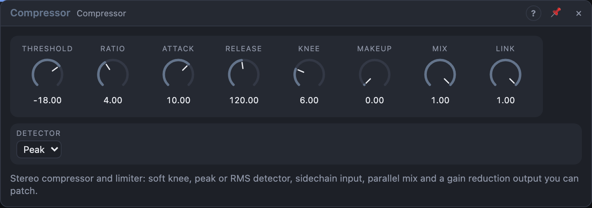

# Compressor

## Introduction

A compressor turns loud parts of a sound down, so the difference between loud and quiet gets smaller. Used lightly, it makes a bass or a vocal sit evenly in a mix; used hard, it makes drums punch and pumps; with a very high ratio it is a **limiter** that keeps a signal below a ceiling, for instance inside a feedback loop or on the output of a patch.

## How does it work?

A *detector* measures how loud the signal is, in decibels. Above the **Threshold**, the compressor turns the level down so that every *Ratio* dB over the threshold at the input becomes 1 dB over at the output. At 4:1, a peak 12 dB over comes out 3 dB over. The gain is turned down gradually, over the **Attack** time, and let go again over the **Release** time, so the sound doesn't click.

- **Threshold** is the level (−60 to 0 dB) where compression starts.
- **Ratio** goes from 1:1 (nothing) to 40:1. From 40:1 on the Compressor is a limiter: nothing passes the threshold.
- **Attack** (0.1 to 100 ms) is how fast it clamps down. A slow attack lets the start of a note through (punch); a fast one catches every peak.
- **Release** (10 ms to 2 s) is how fast it lets go. Short releases pump with the rhythm, long ones are smooth and invisible.
- **Knee** (0 to 24 dB) softens the corner at the threshold. A wide knee starts compressing gently before the threshold.
- **Makeup** adds gain after compression to bring the level back up.
- **Mix** blends the compressed signal with the dry one: *parallel compression*. 30–50 % keeps the transients and adds weight.
- **Link** is how much the two channels follow each other. At 100 % the louder channel controls both, so the stereo image doesn't shift. At 0 they work independently.
- **Detector** is *Peak* (reacts to every peak, fast) or *RMS* (measures average power over 10 ms, closer to how loud the sound seems and gentler on drums).

The **Sidechain** input lets another signal control the compression: a kick drum pumping the pads (put the kick into *Sidechain* and a fast attack, release 150–300 ms, ratio 8:1, low threshold). The gain is applied to *In L/R*. Without a cable there, the detector listens to the input itself.

The **Reduction** output is a control signal from 0 (no compression) to 1 (24 dB of reduction or more). Use it to open a filter when the sound gets squashed or to light a lamp.

## How to use it?

- **Glue on a mix:** threshold −18 dB, ratio 2:1, attack 30 ms, release 200 ms, knee 12 dB.
- **Punchy drums:** ratio 6:1, attack 20 ms, release 80 ms, Makeup to taste.
- **Parallel smash:** ratio 20:1, threshold −40 dB, attack 1 ms, Mix 30 %.
- **Limiter:** ratio 40:1, attack 0.1 ms, release 50 ms, threshold −3 dB. Put one at the end of a feedback loop, like the Shimmer Verb's, to keep it under control.
- **Ducking:** a kick on the Sidechain input, ratio 10:1, threshold −35 dB, release 200 ms.

<!-- generated:presets -->
## Presets

The preset bar of the Compressor view has 13 factory presets. Pick one to set the knobs, then change them to taste; your own presets sit next to them.

| Preset | What it does |
|---|---|
| **Gentle Glue** | Light bus compression that holds a mix together. |
| **Vocal Leveler** | Even out a voice or lead with smooth RMS detection. |
| **Drum Punch** | Slow attack lets the transient through, then clamps the body. |
| **Bass Control** | Keeps a bass line steady and solid. |
| **Parallel Smash** | Hard compression blended under the dry signal for density. |
| **Soft Limiter** | Catches peaks at the end of a chain. |
| **Brick Wall** | Near-hard limiting; nothing gets past the ceiling. |
| **Slow Opto** | Slow, smooth levelling with a wide knee. |
| **Sustain Boost** | Pulls up tails: guitars and plucks ring longer. |
| **Pump Duck** | Audible pumping on loud material; patch a kick into Key for ducking. |
| **Transient Tamer** | Fast attack rounds off clicks and spikes. |
| **Wide Squash** | Heavy squash with loosely linked channels for a wider image. |
| **Gain Reduction Source** | Take the Reduction output as a control signal for pumping other modules. |
<!-- /generated -->
