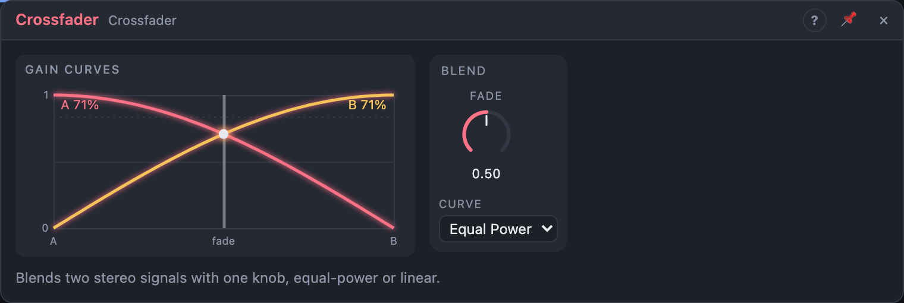

# Crossfader

## Introduction

The Crossfader blends between two stereo signals with one knob: dry and wet
of an effect, two oscillators, two drum loops, or two modulators. Patch an
LFO or an envelope onto *Fade* and one sound turns into the other.

## How does it work?

*Fade* at 0 plays only **A**, at 1 only **B**; in between, both are mixed.
*Curve* decides how:

- **Equal Power:** the loudness stays even across the fade. Use it for two
  different sounds.
- **Linear:** the gains add up to exactly 1. Use it for dry/wet of the same
  sound (where equal power would be 3 dB louder in the middle) and for
  modulation and pitch signals, where the output should be the exact average.

If only the left input of a pair is patched, it feeds both sides.

## How to use it?

- **Dry/wet:** the dry signal into *A*, the effect's output into *B*, *Curve*
  *Linear*.
- **Morph two oscillators:** two different oscillators into *A L* and *B L*, a
  slow LFO onto *Fade*.
- **Blend two modulators:** two LFOs into *A L* and *B L*, *Curve* *Linear*;
  *Out L* is a modulation source that moves between them.

<!-- generated:demos -->
## Demo patches

Five whole patches show what Crossfader does. In the standalone app open **File → Presets…** (⌘P) and pick *Crossfader* under *Demos by module*; on the website, **Run in Play** opens one in your browser. Loading one replaces the project and starts the transport.

| Patch | What it shows |
|---|---|
| **Crossfader: Two Voices Morph** | A soft sine arpeggio on side A and a bright buzzy line on side B share one Crossfader; a slow LFO on Fade moves between them. Drag Fade by hand, or try the Linear curve and listen for the dip at the middle. |
| **Crossfader: Beat Swap** | Two different drum loops run at once, a steady four-on-the-floor and a broken pattern, and a square LFO flips the Crossfader between them every two bars. Change the LFO's Sync for faster swaps, or move Fade by hand to blend both beats. |
| **Crossfader: Dry Wet Blend** | A plucked line is split: side A is the dry signal and side B goes through a long, fully wet reverb. Random values on Fade walk the blend between a close, dry sound and a distant, washed one. Turn Fade by hand to set your own mix. |
| **Crossfader: Dark to Bright** | The same saw line goes through a dark low-pass on A and a bright, resonant high-pass on B, and an envelope on Fade sweeps from one colour to the other on each note. Change either filter's Cutoff to retune the two colours, or the envelope's Decay for a slower change. |
| **Crossfader: Linear Curve** | Curve is set to Linear: two similar sustained chords are cross-faded back and forth by a triangle LFO, and the sum dips slightly in the middle where an equal-power fade would stay full. Switch Curve to Equal Power to hear the dip disappear. |
<!-- /generated -->

## Reference

### Knobs and settings

| Control | Range | Default |
|---|---|---|
| Fade | 0 (A) … 1 (B) | 0.5 |
| Curve | Equal Power, Linear | Equal Power |

### Inputs

| Input | Signal | What it does |
|---|---|---|
| A L, A R | audio | Source A; A R unpatched copies A L |
| B L, B R | audio | Source B; B R unpatched copies B L |

### Outputs

| Output | Signal | What it does |
|---|---|---|
| Out L, Out R | audio | The blend |
