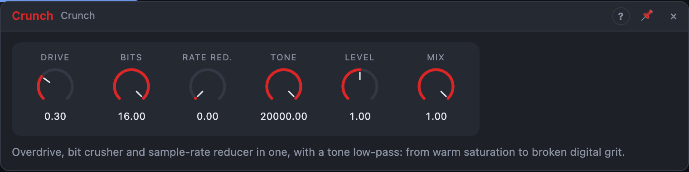

# Crunch

## Introduction

Crunch dirties up a sound in two ways. **Drive** is analogue-style overdrive: from a slight warmth through crunchy guitar-amp distortion to a square-wave fuzz. **Bits** and **Rate Red.** are digital: they throw away resolution and sample rate until the sound turns into the grit of a 90s sampler, an old game console or a broken phone. Use them separately or together.

## How does it work?

The signal passes through, in this order:

1. **Overdrive.** A gain stage followed by a soft clipper: the louder the input, the more it is rounded off. Soft clipping creates odd harmonics, which is why overdrive sounds "warm". Drive sets the gain before the clipper. The Drive knob is level-compensated, so more drive changes the *colour* without getting louder.
2. **Sample-rate reduction.** *Rate Red.* holds every sample for several sample periods. This turns the sound into a stair-step wave and folds high frequencies back down as inharmonic, metallic aliasing. At 100 % the signal is held for 96 samples.
3. **Bit crushing.** *Bits* rounds the level to a coarse grid of 2^(bits−1) steps per unit. At 16 bits nothing happens; at 8 bits you hear a faint hiss on quiet parts; at 4 bits the sound is rough; at 1 bit it's a square wave. The knob is continuous, so you can sweep it.
4. **Tone.** A low-pass filter at the end, from 500 Hz to 20 kHz (20 kHz is off) takes the harshest top off the digital sound.

**Level** sets the processed signal's volume, **Mix** blends it with the dry input (parallel distortion keeps the transients).

With only *In L* patched, the signal feeds both sides.

## How to use it?

- **Warm saturation on a bus:** Drive 20 %, Mix 50 %.
- **Crunchy bass:** Drive 60 %, Tone 4 kHz, Mix 70 %.
- **Fuzz lead:** Drive 100 %, Tone 3 kHz.
- **Lo-fi drums:** Bits 8, Rate Red. 25 %, Tone 8 kHz.
- **Broken radio:** Bits 4, Rate Red. 60 %, Tone 2 kHz.
- **Sweep:** an LFO or envelope onto *Bits* or *Rate Red.* for sounds that dissolve and rebuild.

## Origin

The overdrive curve and its gain structure are Émilie Gillet's (Mutable Instruments, *Plaits*, 2014), the sample-rate reduction is from DaisySP's `Decimator`, both through **Overdrive and Decimator (DaisySP, from Plaits)** by Electrosmith, [github.com/electro-smith/DaisySP](https://github.com/electro-smith/DaisySP), MIT licence. Bleep's version has both in one stereo module; the Drive knob covers the useful part of Plaits' curve with level compensation, the bit crusher rounds (and takes fractional bit depths) instead of truncating, and a tone filter and output level were added. The original licence texts are in this module's `LICENSE` file.

<!-- generated:presets -->
## Presets

The preset bar of the Crunch view has 13 factory presets. Pick one to set the knobs, then change them to taste; your own presets sit next to them.

| Preset | What it does |
|---|---|
| **Warm Saturation** | Gentle tube-like warmth on anything. |
| **Overdrive** | Classic mid-gain overdrive. |
| **Fuzz Wall** | Thick, compressed fuzz with the top rolled off. |
| **Lo-Fi Bits** | 8-bit quantisation noise, old sampler style. |
| **Telephone Crush** | Narrow, crushed and aliased. |
| **Rate Grinder** | Sample-rate reduction aliasing without much bit loss. |
| **Broken Machine** | Harsh digital breakdown. |
| **Parallel Grit** | Crunch blended under a clean signal for grit with body. |
| **Drum Crunch** | Adds bite and crackle to drum loops. |
| **Dark Dirt** | Heavy drive filtered dark for bass. |
| **Bit Dust** | Subtle degradation, like a worn digital converter. |
| **Square Wave Mangler** | Two bits turn everything into buzzing pulses. |
| **Total Destruction** | Everything at once; keep the level low. |
<!-- /generated -->
