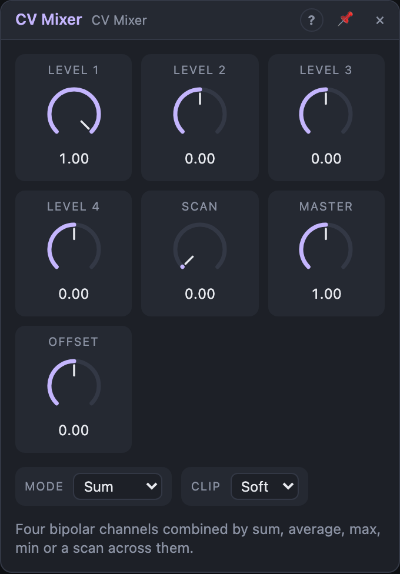

# CV Mixer

## Introduction

The CV Mixer combines up to four modulation signals into one. Adding them up
is only one way: it can also average them, follow whichever is highest or
lowest, or scan across them with one knob. Simple shapes combined like this
become complex, living modulation.

## How does it work?

Each channel's input is multiplied by its *Level* (−1 … +1, so it can also
invert). Then *Mode* decides how the four channels combine:

- **Sum:** all channels added.
- **Average:** the sum divided by the number of channels in use.
- **Max:** the highest channel at every moment.
- **Min:** the lowest channel at every moment.
- **Scan:** a crossfade from channel 1 to channel 4, set by the *Scan* knob.

The result is multiplied by *Master*, *Offset* is added, and *Clip* keeps it
in range. *Inv* is the same signal upside down; *Abs* is its absolute value.

A channel counts as "in use" when its input is patched. Channel 1 also
counts when unpatched with a *Level* other than 0: its input then reads +1,
so *Level 1* works as a manual offset. *Max*, *Min* and *Average* ignore
unused channels.

## How to use it?

- **Blend two LFOs:** a slow and a fast LFO into *In 1* and *In 2*, mixed by
  their levels. Two simple waves give a much less predictable shape.
- **A floor for an envelope:** envelope and a slow LFO into two channels,
  *Mode* *Max*. The output follows the envelope, but never falls below the LFO.
- **Pick a modulator with one knob:** four different sources, *Mode*
  *Scan*, and patch an LFO or a macro onto *Scan* to move between them.
- **Bipolar to unipolar:** *Abs* turns a −1 … +1 LFO into a 0 … 1 shape at
  twice the rate.

<!-- generated:demos -->
## Demo patches

Five whole patches show what CV Mixer does. In the standalone app open **File → Presets…** (⌘P) and pick *CV Mixer* under *Demos by module*; on the website, **Run in Play** opens one in your browser. Loading one replaces the project and starts the transport.

| Patch | What it shows |
|---|---|
| **CV Mixer: Three Waves Summed** | A sine, a triangle and a stepped random line are added by the CV Mixer in Sum mode, and the result sweeps the arpeggio's filter in a pattern that takes a long time to come round. Pull a channel's Level to zero to hear its share disappear. |
| **CV Mixer: Averaged Drift** | Four smooth random lines are averaged into one gentle, never-settling signal that detunes a two-voice pad, so the chord drifts in and out of tune with itself. Change Mode to Sum for a wilder drift, or raise Master to deepen it. |
| **CV Mixer: Max Swells** | Two unipolar LFOs at different speeds go into Max mode, which always passes the larger one, so the pad swells whenever either wave rises and the volume rarely falls to silence. Switch to Min to hear it only when both are high. |
| **CV Mixer: Min as a Gate Maker** | Two square LFOs of different lengths go into Min mode, which only stays high while both are high, an AND of the two, and the result opens the envelope on a held chord to cut it into a shifting rhythm. Change either LFO's sync to rewrite the pattern. |
| **CV Mixer: Scanning Four Notes** | Four stepped random lines sit in the four channels and Scan, swept by a slow triangle, fades from one to the next; the result is snapped to a scale to play the oscillator, so the tune walks between four moving lines. Move Scan by hand to pick which channel you hear. |
<!-- /generated -->

## Reference

### Knobs and settings

| Control | Range | Default |
|---|---|---|
| Level 1–4 | −1 … +1 | +1 (channel 1), 0 (others) |
| Scan | 0 … 1 | 0 |
| Master | 0 … 2 | 1 |
| Offset | −1 … +1 | 0 |
| Mode | Sum, Average, Max, Min, Scan | Sum |
| Clip | Off, Soft, Hard | Soft |

- **Level:** each channel's level; negative values invert it.
- **Scan:** only used in *Scan* mode. 0 is channel 1, 1/3 channel 2, 2/3
  channel 3, 1 channel 4; in between, the two neighbours crossfade.
- **Master:** gain on the combined signal.
- **Offset:** added after *Master*.
- **Clip:** *Soft* leaves values up to ±0.8 untouched and bends smoothly into
  ±1; *Hard* cuts off at ±1; *Off* doesn't limit. Soft is the default because
  four full-scale signals added up easily leave the range.

### Inputs

| Input | Signal | What it does |
|---|---|---|
| In 1–4 | control | The channels. In 1 unpatched reads +1; In 2–4 read 0. |

### Outputs

| Output | Signal | What it does |
|---|---|---|
| Out | control | The mix |
| Inv | control | −Out |
| Abs | control | the absolute value of Out |
