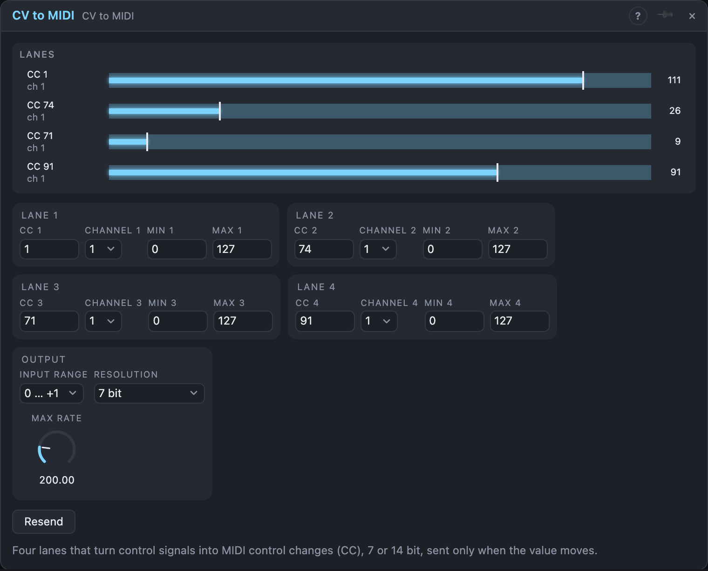

# CV to MIDI

## Introduction

CV to MIDI turns control signals into **MIDI control changes** (CC). Patch an
LFO, an envelope or an *Envelope Follower* into one of its four lanes, and the
value goes out as a CC message that other modules, plugins in Live or outside
hardware can use to move a parameter.

Its *Notes* output carries the messages, as any notes cable does: patch it
into a MIDI output, a Voice Cell's neighbour or the *Monitor* to see what is sent.

## How does it work?

Each lane has an input and its own **CC** number (0–127) and **Channel**
(1–16). Only patched lanes send anything.

The signal is read as 0 … +1 (or −1 … +1, see *Input Range*) and mapped onto
the lane's **Min … Max** data range, which you can use to limit a parameter's
travel or, with Min above Max, to invert it. A message is sent **only when the
7-bit value changes**, so a still input is silent and a slow LFO sends a
handful of messages per second, not thousands.

**Max Rate** caps how often one lane may send. When the signal moves faster
than that, in-between values are skipped, but the latest one always arrives.
When a lane is patched, or when you press **Resend**, its current value is sent
at once, so the receiver starts in sync.

With **Resolution** set to *14 bit*, lanes on CC 0–31 send the high part on the
CC number and the low part on CC + 32, the MIDI standard for fine control.
Lanes on higher CCs stay 7 bit.

## How to use it?

- **Filter sweep in Live:** an *LFO* into *In 1*, CC 74 on the channel your
  instrument listens to, then map CC 74 to the cutoff.
- **Loudness to a parameter:** *Envelope Follower*'s *Env* into a lane: the
  audio moves a MIDI-mapped control.
- **Bipolar sources:** set *Input Range* to −1 … +1 so an LFO's centre sends
  64.
- **Smooth controls:** use 14 bit on CC 0–31 for receivers that support it.

## Reference

### Settings

| Setting | Values | Default |
|---|---|---|
| CC 1–4 | 0 – 127 | 1, 74, 71, 91 |
| Channel 1–4 | 1 – 16 | 1 |
| Min 1–4, Max 1–4 | 0 – 127 | 0, 127 |
| Input Range | 0 … +1, −1 … +1 | 0 … +1 |
| Resolution | 7 bit, 14 bit (CC 0–31) | 7 bit |
| Max Rate | 10 – 1000 per second per lane | 200 |

### Buttons

| Button | What it does |
|---|---|
| Resend | sends every patched lane's value again |

### Inputs

| Input | Signal | What it does |
|---|---|---|
| In 1–4 | control | the value for each lane |

### Outputs

| Output | Signal | What it carries |
|---|---|---|
| Notes | notes | the control change messages |
