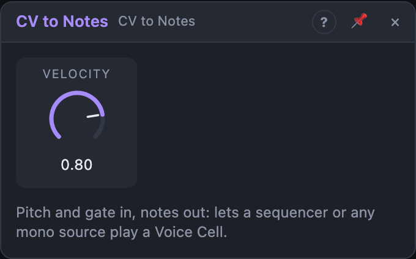

# CV to Notes

## Introduction

CV to Notes turns a **pitch** and a **gate** into **notes**. Voice Cells and
note outputs take notes, while sequencers, Random and other mono sources make
pitch and gate signals. Put CV to Notes in between, and any mono source can
play a polyphonic synth or a MIDI instrument.

## How does it work?

The module watches the *Gate* and the *Pitch* inputs:

- **Gate goes high:** a note-on is sent. The note number is the pitch rounded
  to the nearest semitone (0.0 = C4 = MIDI note 60). The exact pitch, including
  any fraction of a semitone, travels with the note. Velocity comes from the
  *Velocity* knob.
- **Gate goes low:** a note-off for that note.
- **Pitch moves to another semitone while the gate is high:** a legato change.
  The new note starts first and the old one is released right after. A
  mono or legato Voice Cell glides without restarting its envelopes; a poly
  cell plays the new note on another voice.

**No pitch cable?** When nothing is patched into *Pitch*, the *Note* knob
sets the note instead. Patch only a gate (a clock, a button, a drum pattern) and
CV to Notes plays that one note on every gate.

Pitch changes smaller than a semitone don't start a new note. Only one note
sounds at a time.

## How to use it?

- **Sequencer into a synth:** patch the sequencer's *Pitch* and *Gate* here,
  and *Notes* into a Voice Cell's *Notes* input.
- **Generative melodies:** Random *Out* (with *Semitones* on) → *Pitch*, and a
  Function's *A* (or Random *Trig* through a short envelope) → *Gate*.
- **Accent and dynamics:** patch a control signal onto the *Velocity* knob to
  vary the velocity of each note.
- **Legato lines:** keep the gate high and move the pitch. Set the Voice
  Cell's *Mode* to *Legato* and add some *Glide* for slides.
- Need a gate from a trigger? A short ADSR or a Function in envelope mode
  turns a trigger into a gate.

## Reference

### Knobs

| Knob | Range | Default |
|---|---|---|
| Note | 0 – 127 (MIDI note) | 60 (C4) |
| Velocity | 0 – 100 % | 80 % |

- **Note:** the note to play while *Pitch* has no cable. It is ignored as soon
  as a cable is patched into *Pitch*. It is a modulation destination.

- **Velocity:** the velocity of each new note, read at the moment the note
  starts. It's a modulation destination: patch a Random or an LFO onto it for
  changing dynamics.

### Inputs

| Input | Signal | What it does |
|---|---|---|
| Pitch | pitch, 1 V/oct | the note's pitch (when unpatched, the *Note* knob is used); 0.0 = C4, +1.0 = one octave up; notes are limited to MIDI 0 – 127 |
| Gate | gate | high (≥ 0.5) plays a note, low releases it |

### Outputs

| Output | Signal | What it does |
|---|---|---|
| Notes | notes | note-on and note-off events; connects to any notes input |
