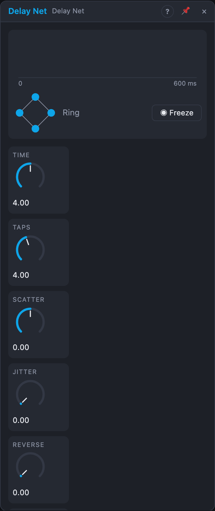

# Delay Net

## Introduction

Delay Net is a network of up to eight delay lines whose repeats feed each
other. One *Time* knob sets the span of the network, *Taps* how many lines
take part and *Scatter* how they're spaced, from even rhythmic echoes to
clustered bursts. Some lines can play backwards, every pass through the
network can be filtered, saturated or worn down, and *Routing* decides how
the lines feed each other. Small settings give multi-tap rhythms; large ones
turn a single hit into an evolving texture.

## How does it work?

**Taps.** Each tap is its own delay line. The last one sits at *Time*; the
others are spread before it. With *Scatter* at 0 they're evenly spaced (4 taps
over 1 s: 250, 500, 750, 1000 ms); turning it up bunches them towards the end,
down towards the start. *Jitter* moves every tap away from its place by a
seeded random amount (up to half the gap to its neighbours), so the groove is
loose but the same every time. *Taps* is continuous: between two whole
numbers the next tap fades in and the others slide to their new places, so
modulating it is smooth.

**Time.** In *Free*, *Time* is 5 ms – 8 s. With a note value in *Sync*, the
network spans that note at the song's tempo and the *Time* knob scales it by
¼, ½, 1 or 2 (four zones of the knob): 4 taps over 1/2 give straight eighths.
With a cable in **Clock**, the span is the pulse interval × ¼, ½, 1, 2, 3 or 4.
*Time Change* picks how time changes sound: **Crossfade** (the default; a
second head jumps to the new time and the two crossfade over 40 ms, the pitch
stays) or **Tape** (the heads glide, the repeats bend in pitch).

**Reverse** turns a share of the active taps around: they play the last
stretch of audio backwards (windows as long as the tap's own time, up to about
5 s). Which taps turn follows a seeded order, so raising *Reverse* adds them
one at a time.

**Character** processes every repeat before it goes back into the network,
so later repeats are darker, dirtier or more worn than early ones:

| Character | Each pass |
|---|---|
| 0 % Clean | nothing |
| 20 % Warm | 6 kHz low-pass, 60 Hz high-pass, soft saturation |
| 40 % Filter | a band-pass per tap, spread over ±1 octave around 1.2 kHz: every echo its own colour |
| 60 % Drive | asymmetric saturation (+12 dB), 4 kHz low-pass |
| 80 % Crush | 8 kHz sample rate, 8 bits |
| 100 % Wear | wow and flutter, a little noise, 3 kHz low-pass, a little level loss: an old tape loop |

Positions in between blend two neighbours. *Tone* moves every filter up or
down by up to two octaves.

**Routing** decides where each repeat goes:

| Routing | Where | Sound |
|---|---|---|
| Parallel | each line into itself | independent multi-tap echoes |
| Chain | line 1 → 2 → 3 …, the last nowhere | a cascade that grows longer, then stops |
| Ring | 1 → 2 → … → last → 1 | repeats walk around the network |
| Mesh | all into all (Hadamard) | dense, diffuse, reverb-like build-up |

*Feedback* at 100 % is the edge of stability for every routing; above it the
loop's soft limiter holds the level. Switching *Routing* crossfades over 50 ms.

**Stereo.** The taps alternate left and right, spread by *Width* (0 % is
centred). *Tap 1 … Tap 4* put out those lines on their own, before panning.
*Pulse* fires at each tap's time after every input onset: a rhythm of the
echoes to clock other modules with.

**Freeze** (the button or the gate) fades the input out, sets the feedback to
exactly 1 and bypasses the character: the network circulates without loss
(Ring and Mesh keep the material moving; Chain loops back to its start while
frozen). **Clear** empties every line with a short fade.

**Tails and renders.** Stopping the transport leaves the network ringing.
With *Clear on Play* the lines are emptied when the transport starts; Jitter,
the reverse order and Wear's wow and noise come from *Seed*, so renders
repeat.

## How to use it?

- **Multi-tap rhythm:** Parallel, Sync 1/2, 4 taps, Feedback 30 %, Jitter
  20 % for a human feel.
- **Rotating echoes:** Ring, Sync 1 bar, 3 taps, Scatter +0.5, Width 100 %.
- **Instant ambience:** Mesh, Time 150 ms, 8 taps, Feedback 85 %, Character
  20 %.
- **Reverse swells:** Reverse 50 %, Time 1.5 s, Feedback 50 %.
- **Lo-fi tape loop:** Character 100 %, Feedback 95 %, then Freeze.
- **Echo clock:** patch *Pulse* into a drum's trigger: it plays along with
  the repeats of whatever you feed in.

## Demo patches

Five whole patches show what Delay Net does. In the standalone app open **File → Presets…** (⌘P) and pick *Delay Net* under *Demos by module*; loading one replaces the project and starts the transport.

| Patch | What it shows |
|---|---|
| **Delay Net: Ring Pad** | Six taps in *Ring* routing with a dark *Character* and high *Feedback* smear soft notes into a slowly turning pad. |
| **Delay Net: Dotted Pluck Grid** | *Sync* on a dotted eighth and *Parallel* routing place four taps on a rhythmic grid around plucks; *Scatter* nudges them off it. |
| **Delay Net: Reverse Mesh** | *Mesh* routing with *Reverse* and *Jitter* blooms every note into reversed clouds; a slow LFO drifts *Time*. |
| **Delay Net: Drum Echoes** | A beat through a synced *Chain* with *Jitter* and *Scatter*: a loose, dubby shadow of the groove. |
| **Delay Net: Overdriven Loop** | *Feedback* near its limit turns the network into a self-sustaining drone; an LFO on *Character* moves it from clean to gritty. |

## Reference

### Knobs

| Knob | Range | Default |
|---|---|---|
| Time | 5 ms – 8 s | 600 ms |
| Taps | 1 – 8 (continuous) | 4 |
| Scatter | −1 … +1 | 0 |
| Jitter | 0 – 100 % | 0 % |
| Reverse | 0 – 100 % | 0 % |
| Feedback | 0 – 110 % | 45 % |
| Character | 0 – 100 % | 20 % |
| Tone | −1 … +1 | 0 |
| Width | 0 – 100 % | 70 % |
| Mix | 0 – 100 % | 40 % |

Every knob is a modulation destination.

### Settings

| Setting | Values | Default |
|---|---|---|
| Routing | Parallel, Chain, Ring, Mesh | Ring |
| Sync | Free, 4 bars … 1/16T | Free |
| Time Change | Tape, Crossfade | Crossfade |
| Clear on Play | Off, On | Off |
| Seed | 0 – 999 | 1 |

### Inputs

| Input | Signal | What it does |
|---|---|---|
| In L, In R | audio | the input (mixed to mono into the lines); *In L* alone feeds both |
| Clock | trigger | the span is a multiple of the pulse interval |
| Freeze | gate | the network circulates without loss while high |
| Clear | trigger | empties all lines |

### Outputs

| Output | Signal | What it does |
|---|---|---|
| Out L, Out R | audio | dry and wet mixed by *Mix* |
| Wet L, Wet R | audio | the network only |
| Tap 1 … Tap 4 | audio | lines 1 – 4 on their own |
| Pulse | trigger | each tap's time after an input onset |

The lines hold 8 seconds each (about 16 MB at 48 kHz), so put Delay Net after
a Voice Cell rather than inside one.
