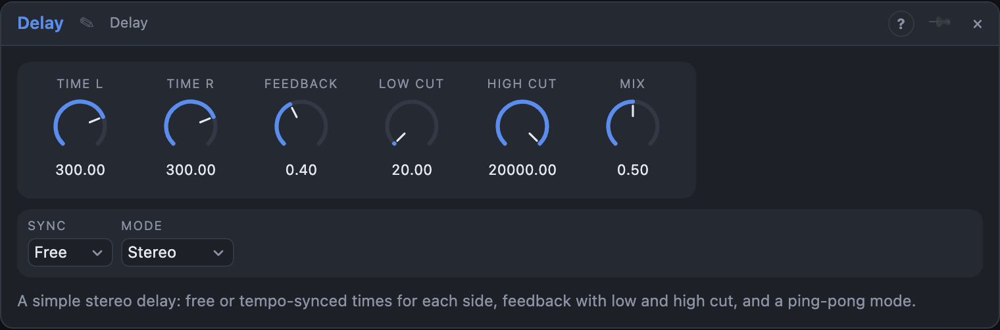

# Delay

## Introduction

Delay is a simple stereo echo. Each side has its own time, either free in
milliseconds or locked to the song's tempo. The echoes return through a low
cut and a high cut, so they can get thinner or darker with every repeat, and
**Ping-Pong** bounces them from side to side. Put it after anything that needs
echoes: a lead, a drum bus, a vocal. For long, strange or reversed delays use
Zone Delay instead.

## How does it work?

The input goes into one delay line per side. What comes out of the line is
mixed with the dry signal (*Mix*), and a part of it (*Feedback*) goes back in,
after the filters, so every echo is a little quieter than the one before.

- **Free:** *Time L* and *Time R* in milliseconds.
- **Tempo:** *Rate L* and *Rate R* are note values (1/32 … 1/1, straight, dotted
  `.` and triplet `T`) at the song's tempo. Change the tempo and the echoes
  follow.
- **Link L/R:** with this on, the right side uses the left side's time (or rate),
  in both Free and Tempo. Turn one knob and both sides follow.
- **Stereo:** both sides are independent. A mono source patched into *In L* only
  is heard in both ears, and with different times on the two sides you get a
  wide stereo echo.
- **Ping-Pong:** the first echo is on the left, the second on the right, the
  third on the left again. The input is mixed to mono first.

Changing a time while the sound plays, by hand, with a modulator or by
changing the tempo, makes the echoes slide in pitch like a tape echo. They
never click. Turn *Time* quickly for a classic dub effect.

*Feedback* at 100 % repeats forever without getting louder. *Low Cut* and
*High Cut* only work on the repeats, so the first sound stays untouched.

## How to use it?

- **Slapback:** *Free*, both times 80–120 ms, *Feedback* 0–10 %.
- **Dotted eighth:** *Tempo*, *Rate* 1/8., *Feedback* 40 %. The classic rhythm
  echo that fills the gaps.
- **Wide echo:** *Tempo* with *Rate L* 1/8 and *Rate R* 1/8., Mode *Stereo*.
- **Ping-pong:** Mode *Ping-Pong*, both rates 1/4, *High Cut* around 4 kHz.
- **Dub:** *Feedback* 70–90 %, *Low Cut* 200 Hz, *High Cut* 2 kHz and turn *Time*.
- **Send effect:** *Mix* 100 % on an effect track or a send; keep the dry
  signal in the mixer.

<!-- generated:presets -->
## Presets

The preset bar of the Delay view has 14 factory presets. Pick one to set the knobs, then change them to taste; your own presets sit next to them.

| Preset | What it does |
|---|---|
| **Eighth Echo** | A clean tempo-synced eighth-note echo. |
| **Dotted Eighth** | The rhythmic dotted echo that fills gaps. |
| **Tape Slap** | Short slapback with a dull top. |
| **Ping-Pong Bounce** | Repeats bounce left and right. |
| **Stereo Offset** | Different times per side widen the echo. |
| **Dub Echo** | Filtered, long repeats that darken as they fade. |
| **Triplet Ping-Pong** | Rolling triplet bounce. |
| **Quarter Note Wash** | Spacious quarter-note repeats. |
| **Chorus Doubler** | Very short times thicken a sound like a double-track. |
| **Comb Resonance** | Millisecond delays with feedback ring as a metallic comb. |
| **Long Haunt** | Slow, distant repeats for ambience. |
| **Half Note Ping-Pong** | Wide, slow bounces. |
| **Thin Radio Echo** | Band-limited, small-speaker echo. |
| **Endless Repeat** | Near-infinite feedback; the filters keep it from blowing up. |
<!-- /generated -->

## Reference

### Knobs and settings

| Control | Range | Default |
|---|---|---|
| Time L | 1 … 2000 ms | 300 ms |
| Time R | 1 … 2000 ms | 300 ms |
| Feedback | 0 … 100 % | 40 % |
| Low Cut | 20 … 2000 Hz | 20 Hz (off) |
| High Cut | 500 … 20000 Hz | 20 kHz (off) |
| Mix | 0 … 100 % | 50 % |
| Sync | Free, Tempo | Free |
| Rate L | 1/32 … 1/1 | 1/8 |
| Rate R | 1/32 … 1/1 | 1/8 |
| Mode | Stereo, Ping-Pong | Stereo |
| Link L/R | Off, On | Off |

*Time* shows with *Sync* on *Free*, *Rate* with *Sync* on *Tempo*. The longest
time is 4 seconds.

### Inputs

| Input | Signal | What it does |
|---|---|---|
| In L | audio | Left input |
| In R | audio | Right input; unpatched it follows *In L* |

### Outputs

| Output | Signal | What it does |
|---|---|---|
| Out L | audio | Dry and echoes, left |
| Out R | audio | Dry and echoes, right |
