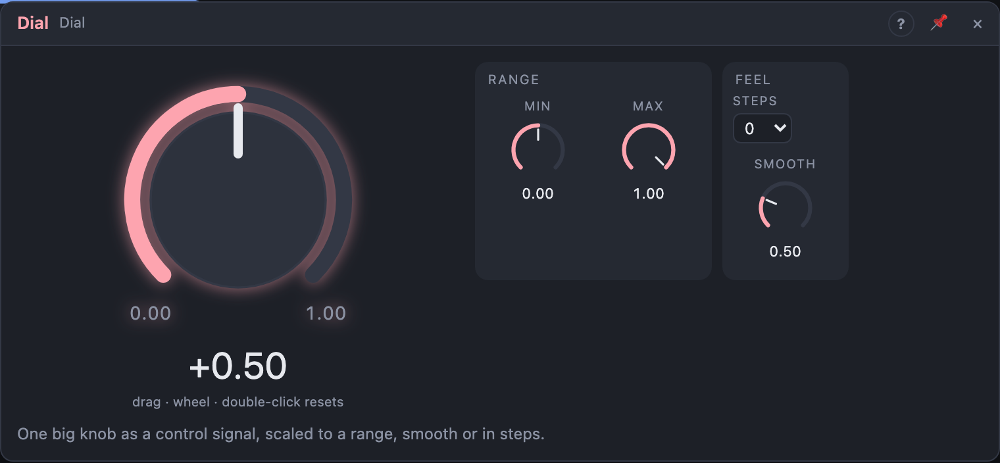

# Dial

## Introduction

The Dial is **one big knob** whose position comes out of a jack as a control
signal. Patch *Out* onto several knobs at once, at different cable amounts,
and one turn moves them all together: a macro for the filter, the mix and the
decay of a sound.

## How does it work?

Turn the dial (drag up and down, Shift for fine, or use the wheel;
double-click resets it). *Out* goes from **Min** with the dial fully left to
**Max** fully right. Set *Max* below *Min* to turn the dial around, or *Min* to
−1 for a bipolar dial that moves its destinations both ways.

**Steps** gives the dial detents: with 4, it only stops at four positions,
evenly spaced, and each wheel notch moves one step. Handy for choosing
between a few settings, or for octave jumps on a pitch.

**Smooth** glides *Out* to a new position instead of jumping, so fast turns
don't click. At 0 it follows the dial exactly.

A cable into *Value* moves the dial like a hand would: the big dial shows the
modulation as a ring.

## How to use it?

- **Macro:** *Out* onto a Multi Filter's **Cutoff**, a VCA's **Gain** and an
  LFO's **Rate**; set each cable's amount for how far each one moves.
- **Morph between two sounds:** *Out* onto a Crossfader's **Mix**.
- **Octave switch:** *Min* −1, *Max* +1 and *Steps* 3 into an Oscillator's
  **Pitch** input: an octave down, unchanged, an octave up.
- **Slow manual sweep:** *Smooth* at 1 s turns any quick move into a sweep.

<!-- generated:demos -->
## Demo patches

Five whole patches show what Dial does. In the standalone app open **File → Presets…** (⌘P) and pick *Dial* under *Demos by module*; on the website, **Run in Play** opens one in your browser. Loading one replaces the project and starts the transport.

| Patch | What it shows |
|---|---|
| **Dial: Filter Sweep** | One Dial, set to the middle of its range, opens the cutoff of a dark saw riff. Drag the big knob up and down while it plays to sweep the filter, or raise Smooth to make the knob glide between positions. |
| **Dial: Stepped Transpose** | With Steps set to 12 the Dial jumps between fixed positions instead of sliding, and it feeds the sequencer's Transpose input so the whole tune moves up and down in whole notes. Set Steps to 0 to get a smooth slide, or change Steps to 5 for coarser jumps. |
| **Dial: Reverb Blend** | The Dial rides the Mix knob of a very long reverb behind a slow bell tune: at the bottom you hear the dry notes, at the top only their wash. Move it slowly and listen to the tune sink into the room. |
| **Dial: Flipped Range** | Min is higher than Max, so turning the Dial up closes the filter and eases off the drive while the bass sits on a beat. Swap Min and Max to turn the action around, or narrow them to limit how far the knob can go. |
| **Dial: Morph Macro** | One Dial fans out to three destinations at different strengths: the oscillator shape, the filter cutoff and the delay mix, so a single gesture takes a soft sine pluck to a bright, echoing saw. Change the cable amounts to rebalance the macro. |
<!-- /generated -->

## Reference

### Knobs

| Knob | Range | Default |
|---|---|---|
| Value | 0 – 100 % | 50 % |
| Min | −1 – +1 | 0 |
| Max | −1 – +1 | +1 |
| Smooth | 0 – 2 s | 20 ms |

Every knob is a modulation destination.

### Settings

| Setting | Values | Default |
|---|---|---|
| Steps | 0 (continuous), 2 – 24 | 0 |

### Outputs

| Output | Signal | What it does |
|---|---|---|
| Out | control | the dial's position, scaled from *Min* to *Max* |
