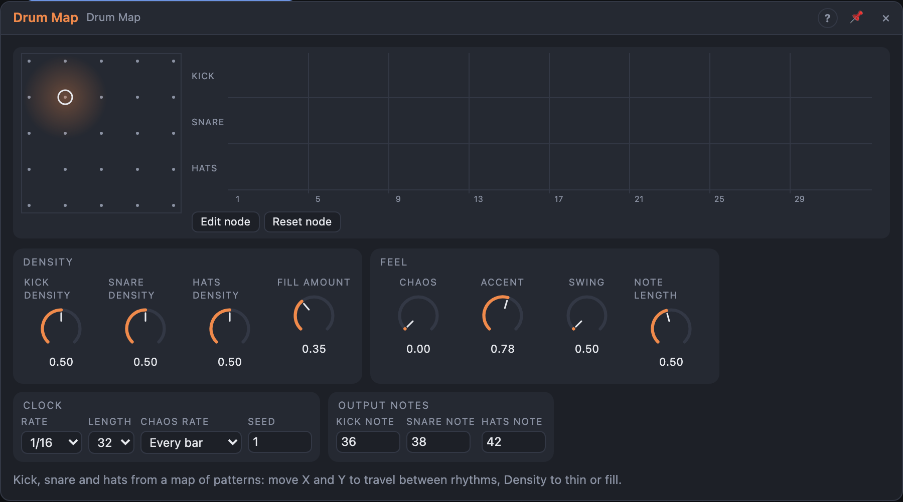

# Drum Map

## Introduction

The Drum Map plays **kick**, **snare** and **hats** from a **map of
patterns**. Move **X** and **Y** and the beat travels smoothly between
rhythms: from straight to broken along X, from sparse to busy along Y. One
**Density** knob per voice thins a part out or fills it up, and **Chaos**
adds seeded variation that comes back the same in every render.

There's nothing to draw. Patch its triggers into drum modules (*Trig* and
*Velocity*), or *Notes* into a drum rack in Live, press play, and *perform*
the beat — by hand on the map, or with an LFO or a Random on X and Y.

## How does it work?

**The map.** The map is a 5 × 5 grid of **nodes**. Each node holds, for each
voice, 32 **levels** (two bars of 16ths). A level says how much a step wants
to be a hit: the backbone is high, ghost notes and fills are low. X and Y
pick a point between four nodes and mix their levels. They're read once per
step, so a fast LFO changes the pattern step by step, never mid-step.

The factory map is built from rhythmic rules, not taken from any machine:

- **Kick:** on every beat at the straight edge; toward *broken* it moves off
  beats 2 and 4 to pushed 16ths and a 3 + 3 + 2 feel. Busier rows add pickups.
- **Snare:** a backbeat on 2 and 4, turning into a half-time snare on 3 and
  then a displaced backbeat toward the broken edge. Busier rows add ghost notes.
- **Hats:** quarters at the sparse edge, 8ths in the middle, 16ths at the
  busy edge; toward broken the strong hats move to the off-beats.
- The last beat of every second bar is lighter, with rising kick and snare
  pickups, so raising Density or *Fill* reveals a fill.

**Density.** A step plays when its level is above `(1 − Density) · 255`. At
0 % nothing plays, at 100 % everything above zero. Because the important
steps have the highest levels, turning Density up adds hits from the
backbone outward and never takes one away.

**Accent and velocity.** Louder levels play louder (*Vel* = 30 % … 100 %); a
level above *Accent* also fires the voice's *Acc* output.

**Fill.** While the *Fill* gate is high, *Fill Amount* is added to every Density.

**Chaos** nudges every step's level up or down by a seeded amount, so weak
hits come and go while the backbone stays. The nudges change every bar (or
every 2, 4, 8 bars — *Chaos Rate* — or never: *Frozen*), counted from the
song position, and they're the same every time you play that bar.

**Timing.** With nothing in *Clock*, steps follow the transport at *Rate*
and land on the right step after a loop jump; with a trigger in *Clock*,
each pulse is a step. At 1/8 the two-bar map becomes four bars, at 1/32
it's double time. *Length* shortens the pattern; *End* fires when it starts
over. Every hit is also a note at the voice's note number, ending after
*Note Length*; no note is left hanging on stop, Reset or a note change.

## How to use it?

- **Drums on the board:** *Kick* into a kick's *Trig* and *Kick Vel* into its
  *Velocity*; the same for snare and hats.
- **Drums in Live:** *Notes* into a MIDI Out port with a drum rack (36, 38
  and 42 are kick, snare and closed hat).
- **Performing:** drag the puck on the map. The ring is where the knobs are;
  the dot (with its trail) is where X and Y really are, cables included.
- **Evolving beats:** a slow LFO on X and a Random on Y: the groove wanders
  through the map and stays musical.
- **Fills:** a gate from a clock divider or another sequencer's *End* into
  *Fill* gives a fill every 4 or 8 bars.
- **Your own map:** press **Edit node**, click a node on the map and draw its
  levels in the lanes. Edited nodes show as larger dots; **Reset node** brings
  back the factory node.
- The lanes show what plays right now: level bars, a threshold line per voice
  and the hits (accents bolder).

## Demo patches

Five whole patches show what Drum Map does. In the standalone app open **File → Presets…** (⌘P) and pick *Drum Map* under *Demos by module*; loading one replaces the project and starts the transport.

| Patch | What it shows |
|---|---|
| **Drum Map: Straight Four** | The straight corner of the map: kick on every beat, backbeat snare and eighth hats; move *X* and *Y* or the *Density* knobs. |
| **Drum Map: Wandering Groove** | A slow LFO on *X* and a Random on *Y* walk the beat over the whole map, with *Chaos* adding ghost notes. |
| **Drum Map: Fill Every Four** | A square LFO on the *Fill* gate adds *Fill Amount* to every density for one bar in four. |
| **Drum Map: Half-Time Dub** | *Rate* 1/8 stretches the map into a sparse half-time beat; the snare and hats feed a delay through the mixer sends. |
| **Drum Map: Chaos Shuffle** | *Rate* 1/16T, *Swing* and *Chaos* at 60 % make a rolling shuffle whose ghost notes change every bar. |

## Reference

### Knobs

| Knob | Range | Default |
|---|---|---|
| X | 0 – 100 % | 25 % |
| Y | 0 – 100 % | 25 % |
| Kick, Snare, Hats Density | 0 – 100 % | 50 % |
| Fill Amount | 0 – 100 % | 35 % |
| Chaos | 0 – 100 % | 0 % |
| Accent | 50 – 100 % | 78 % |
| Swing | 50 – 75 % | 50 % |
| Note Length | 10 – 100 % of a step | 50 % |

- **X / Y:** the position on the map (straight → broken, sparse → busy).
- **Density:** how many of a voice's possible hits play.
- **Fill Amount:** added to every Density while *Fill* is high.
- **Chaos:** how far the seeded variation moves the levels.
- **Accent:** the level above which a hit is accented.
- **Swing:** delays every second step.
- **Note Length:** how long the notes on *Notes* last.

Every knob is a modulation destination.

### Settings

| Setting | Values | Default |
|---|---|---|
| Length | 1 – 32 steps | 32 |
| Rate | 1/8, 1/8T, 1/16, 1/16T, 1/32 | 1/16 |
| Chaos Rate | Every bar, Every 2 / 4 / 8 bars, Frozen | Every bar |
| Seed | 0 – 999 | 1 |
| Kick Note, Snare Note, Hats Note | 0 – 127 | 36, 38, 42 |

### Inputs

| Input | Signal | What it does |
|---|---|---|
| Clock | trigger | each pulse is a step; unpatched, the transport drives the steps |
| Reset | trigger | the next step is step 1 |
| Fill | gate | while high, every Density is raised by Fill Amount |

### Outputs

| Output | Signal | What it does |
|---|---|---|
| Kick, Snare, Hats | trigger | a pulse per hit |
| Kick Acc, Snare Acc, Hats Acc | trigger | a pulse with an accented hit |
| Kick Vel, Snare Vel, Hats Vel | control, 0 – 1 | the hit's velocity, held until the next hit |
| Notes | notes | every hit as a note at the voice's note number |
| Step | control, 0 – 1 | the playhead: first step 0, last step 1 |
| End | trigger | a pulse when the pattern starts over |
