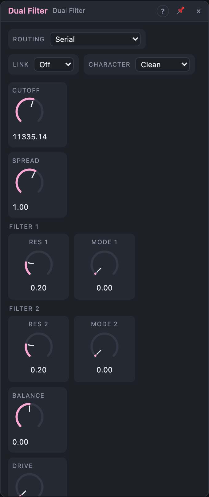

# Dual Filter

## Introduction

The Dual Filter is two multimode filters under one **Cutoff**. A **Spread**
knob pulls their cutoffs apart, symmetrically around the centre. Routed in
series, in parallel or one per stereo channel, the pair becomes a band-pass
with two independent edges, a vowel-like two-peak formant filter, a
band-reject, or a stereo filter whose left and right sit at different
frequencies. One cable on *Cutoff* moves both filters; one on *Spread* opens
and closes the gap.

Use the Multi Filter when you want a particular character (ladders, shelves,
phasers). Use the Dual Filter for shapes that need two filters working
together.

## How does it work?

Both filters are zero-delay-feedback state-variable filters (12 dB/oct), the
same as the Multi Filter's *SVF Multimode* and *SVF Saturating (Rough)*.
They stay in tune and click-free under fast modulation, even at audio rate.

- **Cutoff** is the centre between the two cutoffs. **Spread** is their
  distance in octaves: at +2 oct and 1 kHz, filter 1 sits at 500 Hz and
  filter 2 at 2 kHz. Negative Spread puts filter 2 below filter 1. Both work
  in octaves, so modulation sounds even across the range.
- **Res 1**, **Res 2** set each filter's resonance (Q 0.5 to 25, the Multi
  Filter's curve).
- **Mode 1**, **Mode 2** morph each response: LP → BP → HP → Notch.
- **Routing** decides how the two work together:

      Serial            in ─► F1 ─► F2 ─► out   (Balance > 0 lets part of F1 bypass F2)
      Parallel          in ─► F1 + F2 ─► out    (Balance: level of F1 vs F2)
      Parallel (inv.)   in ─► F1 − F2 ─► out
      Stereo            in L ─► F1 ─► out L,  in R ─► F2 ─► out R

  Changing the routing crossfades over 10 ms, so it's safe while playing.
- **Link** ties the modes together. *Same*: Mode 2 becomes an offset from
  Mode 1 (at LP, both filters have the same response), so one cable on
  Mode 1 morphs both. *Mirror*: filter 2 moves the opposite way (Mode 1 LP →
  Notch makes filter 2 go Notch → LP), plus the Mode 2 offset.
- **Character**: *Clean* never self-oscillates; *Saturating* growls when
  driven and with high resonance. In Serial, the saturation of filter 1
  shapes what filter 2 sees, like an overdriven two-stage filter.
- **Drive** saturates the input (tanh) before the filters.
- **Key Track** moves both cutoffs with the *Pitch* input.
- **Mix** blends the dry input back in.

Two resonant peaks at the same frequency in series could get very loud. In
*Clean* Serial, filter 2's input is turned down while the cutoffs are within
a semitone of each other (back to full over the next octave of Spread), and
every output passes a soft limiter that is linear up to ±2 and never exceeds
±8.

The view draws each filter's response (thin) and the result of the routing
(bright; in Stereo, left and right). Drag the centre marker for *Cutoff*,
the f1 and f2 markers for *Spread* (hold Alt to move only that cutoff), and
drag a marker up or down for that filter's resonance.

## How to use it?

- **Wide band-pass with two edges:** Serial, Mode 1 HP, Mode 2 LP, Spread
  +2 oct. Each edge has its own resonance; *Cutoff* moves the band, *Spread*
  sets its width.
- **Steep low-pass:** Serial, both LP, Spread 0: 24 dB/oct with two
  coinciding resonance peaks.
- **Vowels / formants:** Parallel, both BP, Spread around +1.5 oct, Res 60–80 %.
  Modulate *Spread* (and *Cutoff* a little) to change the vowel.
- **Band-reject with steep sides:** Parallel (F2 inverted), both BP.
- **Band-pass from two low-passes:** Parallel (F2 inverted), both LP: what
  lies between the two cutoffs.
- **Stereo filter:** Stereo routing with a mono source on *In L*. Spread
  places the left and right cutoffs apart; an LFO on *Spread* makes the
  stereo image breathe.
- **One-knob morph:** Serial, Link Mirror, sweep *Mode 1*: from two
  low-passes through band-pass to two notches.
- **Separate processing:** take *F1 Out* and *F2 Out* to different effects.

<!-- generated:demos -->
## Demo patches

Five whole patches show what Dual Filter does. In the standalone app open **File → Presets…** (⌘P) and pick *Dual Filter* under *Demos by module*; on the website, **Run in Play** opens one in your browser. Loading one replaces the project and starts the transport.

| Patch | What it shows |
|---|---|
| **Dual Filter: Vowel Pad** | A saw pad runs through two band-pass filters in parallel, a formant pair that a slow LFO on Spread slides between vowels. Try Res 1 and Res 2 for a sharper or breathier voice. |
| **Dual Filter: Wide Band Bass** | A growly saw bass in Serial with a high-pass on filter 1 and a low-pass on filter 2: a band whose width is Spread and whose position is Cutoff. A beat keeps time; try Spread and Drive. |
| **Dual Filter: Stereo Breath** | One mono arpeggio goes in on the left; in Stereo routing each filter takes a channel and Spread places their cutoffs apart, so an LFO on Spread makes the image breathe left and right. Change Resonance for more ring. |
| **Dual Filter: Notch Sweep** | Parallel with the second filter inverted turns two band-passes into a steep notch. It sweeps through a bright saw riff over a beat; Spread widens the hole in the sound. |
| **Dual Filter: Mirror Morph** | With Link on Mirror, one slow LFO on Mode 1 morphs the pair from two low-passes through band-pass to two notches, mirrored on the other filter, while Saturating Character adds bite. Sweep Mode 1 and Mode 2 by hand. |
<!-- /generated -->

<!-- generated:presets -->
## Presets

The preset bar of the Dual Filter view has 13 factory presets. Pick one to set the knobs, then change them to taste; your own presets sit next to them.

| Preset | What it does |
|---|---|
| **Warm Serial LP** | Two low-passes in a row: a steep, smooth roll-off. |
| **Wide Band-Pass** | High-pass into low-pass: an adjustable band you widen with Spread. |
| **Formant Pair** | Two resonant band-passes side by side, like vowel formants. |
| **Vowel Sweep** | Sweep Cutoff with an LFO for a talking vowel movement. |
| **Stereo Split** | Left and right get different cutoffs for a wide, shifting image. |
| **Phase Notch** | Inverted parallel sum: moving, hollow notches. |
| **Dark Pad Filter** | Closed, soft low-pass to tuck a pad behind a mix. |
| **Thin Radio** | Lo-fi band-limited voice. |
| **Mirror Morph** | Linked modes move opposite ways: sweep Mode 1 to morph. |
| **Resonant Bass** | Round, resonant low end with a bit of drive. |
| **Acid Twin** | Squelchy two-stage low-pass; envelope on Cutoff. |
| **Crossed Filters** | Negative spread swaps the filters: low-pass above, high-pass below. |
| **Ringing Pair** | Highly resonant pings: pluck or noise input rings like a bell. |
<!-- /generated -->

## Reference

### Knobs and settings

| Control | Range | Default |
|---|---|---|
| Cutoff | 20 Hz – 20 kHz | 1 kHz |
| Spread | −5 … +5 oct | +1 oct |
| Res 1, Res 2 | 0 – 100 % | 20 % |
| Mode 1, Mode 2 | LP → BP → HP → Notch | LP |
| Balance | −100 … +100 % | 0 % |
| Drive | 0 – 100 % | 0 % |
| Key Track | 0 – 100 % | 0 % |
| Mix | 0 – 100 % | 100 % |
| Routing | Serial, Parallel, Parallel (F2 inverted), Stereo | Serial |
| Link | Off, Same, Mirror | Off |
| Character | Clean, Saturating | Clean |

- **Cutoff:** the centre, exponential over ten octaves; 10 % of modulation ≈
  one octave. f1 = Cutoff × 2^(−Spread/2), f2 = Cutoff × 2^(+Spread/2),
  each kept between 5 Hz and just below half the sample rate.
- **Spread:** distance between the cutoffs in octaves.
- **Res 1 / Res 2:** resonance of each filter.
- **Mode 1 / Mode 2:** each filter's response. With *Link* on, *Mode 2* is
  an offset (shown as *Mode 2 Offset*).
- **Balance:** Serial: the share of filter 1 that bypasses filter 2 (0 to
  100 %; negative values do nothing extra). Parallel: the level of filter 1
  (negative) vs filter 2 (positive). Stereo: a left/right balance.
- **Drive:** tanh saturation before the filters.
- **Key Track:** how far *Pitch* moves both cutoffs (100 % = one octave per
  octave).
- **Mix:** dry/wet.
- **Routing, Link, Character:** see above. Not modulatable. Changing
  *Character* starts the filters from silence.

All knobs are modulation destinations.

### Inputs

| Input | Signal | What it does |
|---|---|---|
| In L | audio | left input; also feeds the right channel when *In R* is not patched |
| In R | audio | right input |
| Pitch | pitch, 1 V/oct | moves both cutoffs, scaled by *Key Track* |

### Outputs

| Output | Signal | What it does |
|---|---|---|
| Out L, Out R | audio | the routed result, after *Balance* and *Mix* |
| F1 Out | audio | filter 1 alone, mono (Stereo: the left channel's filter) |
| F2 Out | audio | filter 2 alone, mono (Serial: after filter 1; Stereo: the right channel's filter) |
| Env | control, 0 – 1 | envelope follower on *Out* (5 ms attack, 120 ms release) |
