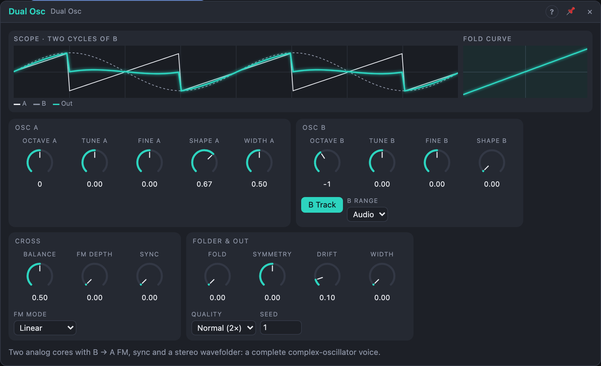

# Dual Osc

## Introduction

The Dual Osc is two analog-style oscillators, *A* and *B*, wired together
for the sounds that need two oscillators talking to each other. B can
frequency-modulate A, A can sync to B, and the pair runs into a wavefolder
that turns soft waves into bright, moving spectra. It is a complete
complex-oscillator voice in one module, and still two ordinary oscillators
when that's all you need.

## How does it work?

**Two cores.** Each core reads sine, triangle, saw and pulse from one phase
and morphs between them with its *Shape* knob (as the Oscillator). Saw,
pulse, triangle and every sync jump are band-limited at their exact moment
in time, so even hard-synced and frequency-modulated waves stay clean.

**Pitch.** A plays C4 × 2^(Octave A + Tune A/12 + Fine A/1200 + Pitch).
B follows the same *Pitch* input while *B Track* is on, plus its own
*Pitch B* input; with *B Track* off only *Pitch B* moves it. *B Range Low*
divides B by 100 (about 0.03–200 Hz), turning it into a vibrato or
growl-rate modulator.

**FM (B → A).** B's sine (whatever *Shape B* is), plus the *FM* input,
modulates A's frequency by *FM Depth*:

- *Linear* is through-zero: A's frequency is f × (1 + 4 × depth × m). When
  it goes negative the phase runs backwards, so the note stays in tune at any
  depth. Integer ratios between A and B give harmonic, bell- and brass-like
  tones.
- *Exponential* is analog-style: f × 2^(4 × depth × m), ±4 octaves at 100 %.
  The pitch drifts upward with depth: the classic growl and siren.

**Sync (A → B).** Each time B finishes a cycle it acts on A. Up to 50 % this
is a *reversing* soft sync: if A is in the last part of its cycle it changes
direction instead of jumping, a gentle, vocal colour. From 50 % to 100 % the
reset gets harder until, at 100 %, A restarts with every cycle of B: the
classic tearing sync lead when you sweep A's pitch.

**Folder.** The A/B mix (*Balance*) is driven by *Fold* (gain 1 to 12) plus
the *Fold CV* input, biased by *Symmetry*, and folded back into ±1 by four
stages. At *Fold* 0 the folder is transparent; the first quarter of the knob
moves it from clean to a soft sine fold, and further stages join as you turn
it up. *Symmetry* adds even harmonics and makes the folds move. A DC blocker
follows (Symmetry adds DC).

**Oversampled.** Cores, FM, sync and folder run at 2× (*Normal*) or 4×
(*High*) and every output is decimated by the same filter, so A, B, Mix,
Ring, Sub and Out stay in phase with each other.

**Stereo.** With *Width* above 0, Out L and Out R fold slightly different
mixes (Balance ∓ Width/4) and R's Symmetry is mirrored at full width. The
image collapses cleanly to mono. At *Width* 0 both outputs are identical.

**Drift.** A seeded slow wander of each core's pitch, up to ±8 cents at
100 %. The same *Seed* gives the same drift on every render; it restarts when
the transport starts.

## How to use it?

- **Complex voice:** Pitch from Voice In, *Out L/R* → VCA. Raise *Fold* and
  modulate it with an envelope for plucked, west-coast tones.
- **FM bell:** *Shape A* 0 % (sine), *Octave B* +1 or *Tune B* +7, *FM
  Depth* 30–60 %, Linear. Put an envelope on *FM Depth*.
- **Sync lead:** *Sync* 100 %, *Octave B* −1, sweep *Tune A* or modulate
  *Pitch* of A only (patch into *Pitch* with *B Track* off and feed B from
  *Pitch B*).
- **Growl:** *B Range* Low, *FM Mode* Exponential, *FM Depth* 20 %.
- **Two oscillators:** use *A* and *B* outputs separately; *Ring* gives A × B.
- **Wide pad:** *Width* 60 %, a little *Fold* and *Symmetry*, *Drift* 30 %.

<!-- generated:demos -->
## Demo patches

Five whole patches show what Dual Osc does. In the standalone app open **File → Presets…** (⌘P) and pick *Dual Osc* under *Demos by module*; on the website, **Run in Play** opens one in your browser. Loading one replaces the project and starts the transport.

| Patch | What it shows |
|---|---|
| **Dual Osc: Complex Lead** | Oscillator B frequency-modulates A while an envelope opens FM Depth and Fold on every note: each note starts bright and metallic and settles to a clearer tone. Change Tune B to pick different FM ratios, or raise Fold for more edge. |
| **Dual Osc: Sync Sweep** | A is hard-synced to B and the Sync amount is swept by a slow ramp, so the tone tears from a clean saw into a growling, harmonic-rich buzz. Turn Sync by hand to stop the sweep where you like it. |
| **Dual Osc: Drifting Pad** | Two softly detuned cores with Drift and Width turned up make a slowly moving stereo pad, with a hint of Fold from a slow LFO. Raise Drift for more instability or pull Tune B further from A for a thicker chord. |
| **Dual Osc: Ring Bells** | The Ring output multiplies A and B, giving clangorous, bell-like sidebands that die away with each note. Tune B moves the bell from soft and hollow to harsh and tuneless; choose a fifth or a tritone to hear the difference. |
| **Dual Osc: Folded Bass** | A low note from both cores is driven into the wavefolder; Fold rides a slow LFO and Symmetry shifts the odd and even folds, so the bass flips between mellow and snarling. Try the Exponential FM Mode or a different Symmetry for other growls. |
<!-- /generated -->

<!-- generated:presets -->
## Presets

The preset bar of the Dual Osc view has 15 factory presets. Pick one to set the knobs, then change them to taste; your own presets sit next to them.

| Preset | What it does |
|---|---|
| **Fat Saw Pair** | Two slightly detuned saws: the classic fat analog voice. |
| **Octave Bass** | A saw over a square sub octave for a solid bass. |
| **Hollow Pulse Duo** | Two pulses with different widths and slight detune: hollow and wide. |
| **Sync Lead** | Hard sync: sweep Tune A for the classic tearing lead. |
| **Soft Sync Voice** | Gentle reversing sync: a vocal, slightly nasal colour. |
| **FM Bell** | Sine FM with a non-integer ratio: patch an envelope on FM Depth. |
| **Electric Piano** | Soft 1:1 FM: a warm, tine-like electric piano tone. |
| **Brass FM** | Harmonic FM with a touch of fold: a punchy brass-like tone. |
| **Growl** | Exponential FM from a low sine: growling, siren-like bass. |
| **West Coast Fold** | A sine pushed into the wavefolder: bright, harmonic. Modulate Fold. |
| **Folded Pad** | Soft waves with gentle folding and wide drift: a moving pad. |
| **Wide Stereo Saw** | Wide, drifting saw pair for pads and chords. |
| **Slow Growl Mod** | B in Low range as a slow vibrato-rate FM for wobbling tone. |
| **Metallic Clang** | Strong inharmonic FM and fold: metal, gongs and noise-like hits. |
| **Drifting Duo** | Two soft waves with strong analog drift: unstable, vintage. |
<!-- /generated -->

## Reference

### Knobs and settings

| Control | Range | Default |
|---|---|---|
| Octave A, Octave B | −4 … +4 (stepped) | 0, −1 |
| Tune A, Tune B | −12 … +12 st | 0 st |
| Fine A, Fine B | −100 … +100 ct | 0 ct |
| Shape A, Shape B | 0 – 100 % | 67 % (saw), 0 % (sine) |
| Width A | 5 – 95 % | 50 % |
| FM Depth | 0 – 100 % | 0 % |
| Sync | 0 – 100 % | 0 % |
| Balance | 0 – 100 % | 50 % |
| Fold | 0 – 100 % | 0 % |
| Symmetry | −1 … +1 | 0 |
| Drift | 0 – 100 % | 10 % |
| Width | 0 – 100 % | 0 % |
| FM Mode | Linear, Exponential | Linear |
| B Track | On, Off | On |
| B Range | Audio, Low (÷ 100) | Audio |
| Quality | Normal (2×), High (4×) | Normal |
| Seed | 0 – 999 | 1 |

- **Shape A / Shape B:** 0 % sine, 33 % triangle, 67 % saw, 100 % pulse.
- **Width A:** pulse width of A's pulse end.
- **FM Depth:** smoothed over 5 ms, so it can be swept without clicks.
- **Balance:** 0 % only A, 100 % only B into *Mix* and the folder.
- **Quality:** High costs about twice the CPU and lowers aliasing of synced
  and folded sounds further.

All knobs are modulation destinations; the settings are not.

### Inputs

| Input | Signal | What it does |
|---|---|---|
| Pitch | pitch, 1 V/oct | both cores (B only while *B Track* is on); 0.0 = C4 |
| Pitch B | pitch, 1 V/oct | added to B only |
| FM | audio | added to B's sine as the modulator of A, scaled by *FM Depth* |
| Sync | trigger | a rising edge restarts both cores (one per note, for example) |
| Fold CV | audio | added to the folder's input at audio rate |

### Outputs

| Output | Signal | What it does |
|---|---|---|
| A | audio | core A with FM and sync, shaped by *Shape A* |
| B | audio | core B, shaped by *Shape B* |
| Mix | audio | A and B by *Balance*, before the folder |
| Out L, Out R | audio | the folded mix; identical at *Width* 0 |
| Ring | audio | A's sine × B's sine |
| Sub | audio | square an octave below A; it flips on every cycle of A, also after a hard sync reset |

A, B, Mix, Ring and Sub run between about −1 and +1; Out L/R stay within
about ±1.2 (band-limited folds overshoot slightly). Unpatched outputs cost
no CPU for their decimation.
