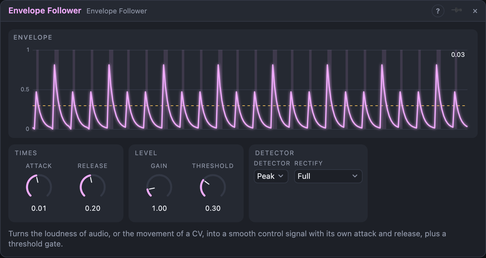

# Envelope Follower

## Introduction

The Envelope Follower turns **how loud a signal is** into a smooth control
signal. Patch a drum loop or a voice in, and the *Env* output rises with every
hit and falls back between them, ready to move a filter, a VCA or anything
else. It works on **audio** and on **CV** alike: followed CV becomes a slew
limiter with separate rise and fall times.

For a meter with bars and a clip light use the *Level Meter*; the Envelope
Follower is the tool when you want the shape of the signal, with your own
attack and release.

## How does it work?

The detector looks at the size of each sample. When the signal gets bigger
than the current envelope, the envelope rises with the **Attack** time; when it
gets smaller, it falls with the **Release** time. Times are the time to cover
63 % of the way, as on any one-pole smoother. Short attack and release follow
every wave; a short attack with a long release follows the peaks of a drum
pattern.

**Detector** picks how the size is measured:

- **Peak** follows the absolute value of the signal (or one half of it, see
  *Rectify*): fast and punchy.
- **RMS** follows the average power: smoother and closer to how loud the
  signal sounds. Attack and Release apply to the power, and *Rectify* has no
  effect.

**Gain** multiplies the result, so a quiet source can still reach 1.

The **Gate** output opens when *Env* reaches **Threshold** and closes again
when it falls under 80 % of it, so a hovering level does not chatter. *Trigger*
sends one short pulse every time the gate opens.

## How to use it?

- **Ducking:** a kick into *In*, *Inverted* into a VCA's *Gain* on the pad. A
  short attack and a release of 150–300 ms gives the pump.
- **Loudness to brightness:** *Env* into a filter's **Cutoff**.
- **Audio to triggers:** a drum loop into *In*, *Trigger* into another
  module's trigger input: it plays on every hit above *Threshold*.
- **Slew a CV:** set *Rectify* to *None (signed)* and patch a stepped CV in:
  *Env* follows it with *Attack* going up and *Release* going down, and
  *Inverted* is the same signal upside down.
- **Only the positive part of an LFO:** *Rectify* = *Positive*.

<!-- generated:presets -->
## Presets

The preset bar of the Envelope Follower view has 12 factory presets. Pick one to set the knobs, then change them to taste; your own presets sit next to them.

| Preset | What it does |
|---|---|
| **Smooth Follow** | General loudness follower for modulation. |
| **Fast Peak** | Snappy peak tracking that catches every hit. |
| **Drum Trigger** | Use the trigger output to fire envelopes from drums. |
| **Ducker** | Use the inverted output to duck a pad under a kick. |
| **Slow Swell** | Slow average level for gentle, musical movement. |
| **RMS Level** | Smooth perceived-loudness meter. |
| **Hot Gain** | Boosts quiet signals to a strong control range. |
| **Gate Sense** | High threshold gate for loud passages only. |
| **Low Threshold Gate** | Gate that opens on almost any signal. |
| **Positive Half** | Follows only positive swings of the input. |
| **Signed Follow** | Passes the signal with smoothing, handy for CV. |
| **Long Tail** | Slowly falling level for lingering effects. |
<!-- /generated -->

<!-- generated:demos -->
## Demo patches

Five whole patches show what Envelope Follower does. In the standalone app open **File → Presets…** (⌘P) and pick *Envelope Follower* under *Demos by module*; on the website, **Run in Play** opens one in your browser. Loading one replaces the project and starts the transport.

| Patch | What it shows |
|---|---|
| **Envelope Follower: Auto Wah** | A plucked bass line is followed by the Envelope Follower, and the result opens a resonant filter on every note, so the tone speaks with the playing. Try a longer Release for a lazier wah, or more Gain for a wider sweep. |
| **Envelope Follower: Kick Ducker** | The kick drum is followed and its Inverted output closes a VCA on a sustained pad, so the pad ducks on every beat and swells back in between. Lengthen Release for a slower pump, or shorten it for a tight, subtle push. |
| **Envelope Follower: Notes Fire Claps** | The follower listens to a melody and its Trigger output fires a clap every time a note rises above the Threshold, so the drum part is written by the tune. Raise Threshold to skip the softer notes, or change Detector to RMS. |
| **Envelope Follower: Drone Swell** | A slow Attack and long Release turn a sparse drum loop into a gentle level that fades a drone in and out, so the drone breathes with how busy the drums are. Shorten both times to make it follow each hit instead. |
| **Envelope Follower: Slewed Pitch** | With Rectify set to None (signed), the follower becomes a slew limiter: stepped random values glide into one another and bend a voice's pitch. Raise Attack for slow climbs and Release for slow falls, or play with the Gain. |
<!-- /generated -->

## Reference

### Knobs

| Knob | Range | Default |
|---|---|---|
| Attack | 0 – 2 s | 10 ms |
| Release | 0 – 5 s | 200 ms |
| Gain | 0 – 8 × | 1 × |
| Threshold | 0 – 100 % | 30 % |

Every knob is a modulation destination.

### Settings

| Setting | Values | Default |
|---|---|---|
| Detector | Peak, RMS | Peak |
| Rectify (Peak only) | Full, Positive, Negative, None (signed) | Full |

### Inputs

| Input | Signal | What it does |
|---|---|---|
| In | audio | the signal to follow; control signals work as well |

### Outputs

| Output | Signal | What it does |
|---|---|---|
| Env | control | the followed level times *Gain*; with *None (signed)* it can go negative |
| Inverted | control | 1 − *Env*, limited to 0…1; with *None (signed)*, −*Env* |
| Gate | gate | high from *Threshold* up (closes at 80 % of it) |
| Trigger | trigger | one sample when the gate opens |
