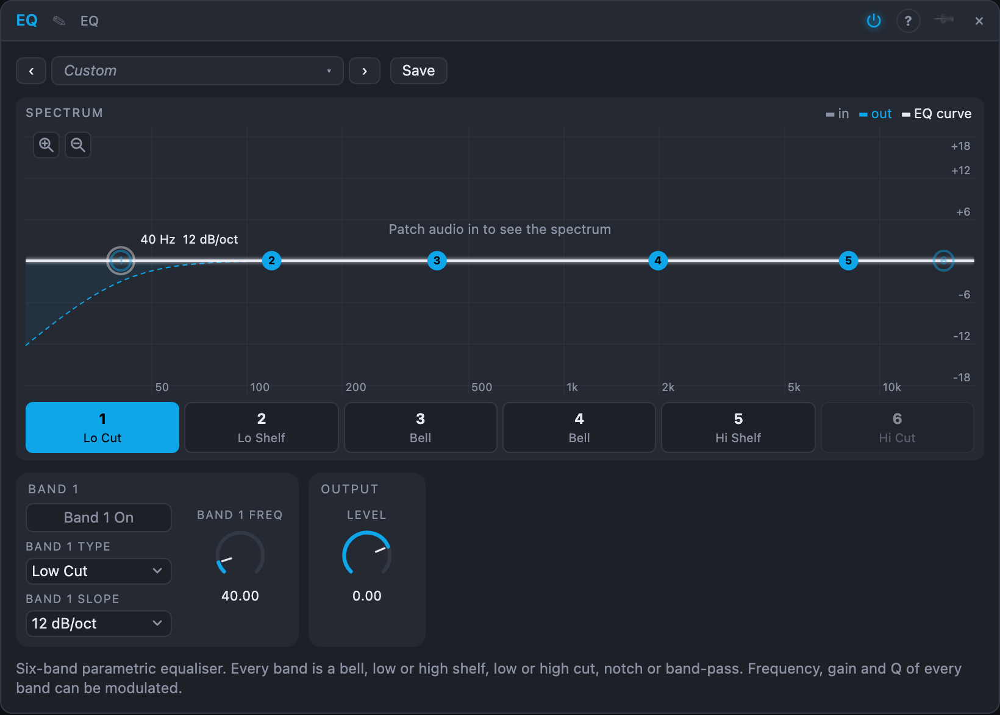

# EQ

## Introduction

The EQ turns parts of the spectrum up or down: more bass, less mud around 300 Hz, a cut of harsh 3 kHz, more air above 8 kHz. It has six bands, each of which can be a bell, a shelf, a cut, a notch or a band-pass, in stereo.

## How does it work?

Every band is a *biquad* filter (the formulas of the well-known "Audio EQ Cookbook"), calculated with the band's settings and applied one after another. The display shows the spectrum going in (grey) and coming out (blue) with the EQ curve on top, and one numbered point per band.

- **Select a band** by clicking its point in the display or its tab (1–6) under the display. The controls below show that band, with its *Type* and *Algorithm*. The power button in a tab's corner switches the band on or off.
- **Drag a point** sideways to change its *Freq*, up and down to change its *Gain*. Hold **Cmd**, **Ctrl** or **Alt** while dragging to change its *Q* instead (or the *Slope* of a cut): up is narrower. Hold Shift for fine movement, double-click a point to set its gain back to 0 dB, and turn the mouse wheel over a point to change its *Q* (or the *Slope* of a cut). Dragging a point of a band that is off switches it on. A band that is off is drawn hollow, with its response dashed, so you can see what it would do.
- **The display:** the frequency under the pointer is shown at the bottom left. The dB scale is at the left, next to two magnifiers that zoom it (±3 to ±24 dB). A cut's response leaves the chart where it falls below the scale. Click *in*, *out* or *EQ curve* in the legend to hide or show that drawing; the zoom and the legend choices are remembered.
- **Type** of a band:
  - **Bell**: boosts or cuts around *Freq* by *Gain* (±18 dB). *Q* sets the width: 0.1 is very broad (a gentle tonal tilt), 1 is a typical bell, 18 is a narrow spike for a single ringing frequency.
  - **Low Shelf** / **High Shelf**: raises or lowers everything below / above *Freq* by *Gain*. *Q* sets how steep the shelf is (0.7 is smooth; higher values overshoot a little before the corner).
  - **Low Cut** / **High Cut**: removes everything below / above *Freq*, 3 dB down at *Freq*. *Slope* sets how steeply: 6, 12, 18, 24, 36 or 48 dB per octave (Butterworth, so no ringing).
  - **Notch**: removes a narrow band around *Freq*; *Q* sets how narrow.
  - **Band Pass**: keeps a band around *Freq* and removes the rest; *Q* sets how narrow.
- **Algorithm** of a band chooses how its filter is designed. The sound of an existing patch does not change: the default is *Clean*.
  - **Clean**: the textbook "Audio EQ Cookbook" filter. Transparent and predictable.
  - **Modern**: a *bell* whose *Q* is measured 3 dB below the peak, designed so it is not cramped towards the top of the spectrum. A big boost or cut stays broad and musical: at +12 dB with *Q* 1 it still gives +3 dB an octave away, where the Clean bell gives +1 dB. Small moves are close to Clean, and a boost and a cut of the same size and *Freq* cancel exactly. Shelves, cuts, notch and band-pass are the same as in Clean.
  - **Vintage**: analog-style. A bell or shelf is *proportional-Q*: a small boost or cut is broad (about a third of the *Q* you set) and a large one gets narrow (1.8 times the *Q* from ±17 dB), as on classic consoles. The band's output is also saturated by a soft clip that grows with the boost or cut (unity for small signals; at +12 dB a loud signal gets a few percent of odd harmonics), adding warmth. Cuts get a light saturation but keep their Butterworth response. The curve in the display shows the Vintage widths, not the saturation.
- **On** (the power button in the band's tab) switches a band off without losing its settings. Bands 1 and 6 start as switched-off cuts, bands 2 and 5 as shelves and bands 3 and 4 as bells at 400 Hz and 2 kHz; any band can be changed to any type. A bell or shelf at 0 dB is bypassed, so unused bands cost nothing.
- **Level** (−18 to +6 dB) is the gain after the equaliser, to make up for boosts.

*Freq*, *Gain* and *Q* of every band can be modulated; the filters are updated every 16 samples, which is smooth for sweeps. Modulating the *Freq* of a bell with an LFO or envelope while boosting 10 dB gives a wah-wah. The band's type, algorithm, slope and on switch, and the band being edited, are settings. With only *In L* patched, the signal feeds both sides.

## How to use it?

- **Remove rumble:** band 1 on, Low Cut at 40 Hz, 24 dB/oct.
- **Clean up mud:** a bell at 300 Hz, −4 dB, Q 1.
- **Add presence:** a bell at 3 kHz, +3 dB, Q 0.8.
- **Air:** band 5, High Shelf at 10 kHz, +4 dB.
- **Telephone voice:** Low Cut at 400 Hz and High Cut at 4 kHz, both 24 dB/oct, and a bell at 1.5 kHz, +6 dB.
- **Find a resonance:** boost a bell +12 dB with Q 6 and sweep its frequency (drag the point sideways) until the problem sticks out, then cut it, or turn the band into a Notch.
- **Wah:** a bell, +12 dB, Q 3, an envelope or LFO onto its frequency.

<!-- generated:presets -->
## Presets

The preset bar of the EQ view has 16 factory presets. Pick one to set the knobs, then change them to taste; your own presets sit next to them.

| Preset | What it does |
|---|---|
| **Smile Curve** | Boosted lows and highs: instant polish. |
| **Bass Boost** | More weight below 80 Hz. |
| **Low Cut Lite** | Removes rumble below 90 Hz and clears a little mud. |
| **Mud Remover** | Cuts the boxy low-mids. |
| **Presence Lift** | Brings the sound forward. |
| **Air** | Open, airy top end. |
| **Warm Darkness** | Rolls off the top and warms the bottom. |
| **Vocal Clarity** | Cuts the rumble, cleans up and brightens a voice. |
| **Telephone** | Steep cuts below 400 Hz and above 4 kHz, a nasal band in between. |
| **Hollow Notch** | Two deep notches for a phase-like, hollow tone. |
| **Resonant Peaks** | Narrow, ringing boosts: formant-like colour. |
| **Kick Shaper** | Weight and click for kick drums. |
| **Lo-Fi Radio** | Small-speaker colouration. |
| **Tilt Down** | Dark tilt; tames harsh sources. |
| **Rumble Remover** | A steep cut below 35 Hz: clears sub-bass rumble and DC drift. |
| **De-Harsh** | Two narrow dips and a soft top cut tame a piercing source. |
<!-- /generated -->

<!-- generated:demos -->
## Demo patches

Five whole patches show what EQ does. In the standalone app open **File → Presets…** (⌘P) and pick *EQ* under *Demos by module*; on the website, **Run in Play** opens one in your browser. Loading one replaces the project and starts the transport.

| Patch | What it shows |
|---|---|
| **EQ: Small Radio** | A full-range saw riff and a beat are squeezed through a steep Low Cut, a steep High Cut and a Bell boost in the midrange: the sound shrinks to a tiny speaker. Switch bands 1 and 6 off to open the sound again, or move the Bell around. |
| **EQ: Sweeping Bell Wah** | A narrow Bell boosted by 14 dB glides up and down the spectrum under an LFO on its Freq, so the riff sings like a wah pedal. Widen Q for a gentler vowel, or give the LFO a faster rate. |
| **EQ: Warm Bus Tilt** | A mix of bass, riff and drums gets a Low Shelf lift, a small Bell cut in the muddy low mids and a High Shelf cut: a darker, rounder balance. Flip the Shelf gains to the other side for a bright, thin version. |
| **EQ: Twin Notch Phaser** | Two Notch bands moved in opposite directions by one slow LFO carve gaps in a sustained saw line, giving a hollow, phaser-like sweep without any feedback. Raise Q for thinner, sharper gaps. |
| **EQ: 48 dB Cutoff Rise** | A High Cut with the steepest 48 dB/oct slope is pushed open by a slow LFO over a riff and beat, like a filter riser. Choose a gentler Slope for a softer glide, or turn the sweep depth down. |
<!-- /generated -->
