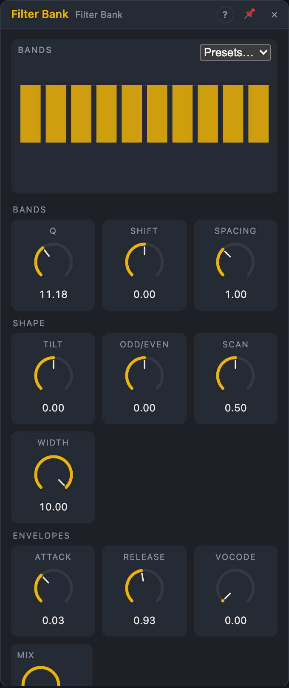

# Filter Bank

## Introduction

The Filter Bank splits a sound into ten bands with fixed band-pass filters.
Each band has its own level, its own audio output and its own envelope
output. Shape the spectrum by hand or with modulation (a *Tilt* knob, an
odd/even balance, a window that scans across the bands), send single bands
to different effects, or let the envelopes make other sounds follow this
one's spectrum. With a voice on the *Sidechain* input and the **Vocode**
knob up, it's a ten-band vocoder.

## How does it work?

Ten band-pass filters (zero-delay-feedback state-variable filters) sit on
fixed frequencies. Each has unit gain at its centre: a sine on a band's
frequency comes out of that band at the level it went in.

- **Tuning** sets the frequencies:
  - *Spectral:* spread evenly in octaves from 55 Hz to 14 kHz (55, 102,
    188, 349, 645, 1194, 2209, 4088, 7565, 14000 Hz): the classic
    fixed filter bank.
  - *Harmonic:* the first ten partials of a note, 65.4 Hz (C2) × 1 … 10,
    transposed by the *Pitch* input: a resonant bank that plays in tune.
  - *Scale:* ten consecutive notes of **Scale** from **Root** in octave 2,
    transposed by *Pitch* (snapped to the scale): a chord-like resonator.
- **Shift** moves all bands together (±2 octaves). **Spacing** stretches or
  squeezes them around the middle (between bands 5 and 6). Both work in
  octaves, so an LFO on *Shift* sweeps the whole bank like a phaser.
  Bands pushed above the top of the audio band are muted.
- **Q** sets how narrow every band is. The default (2.2) gives an almost
  flat sum: with all levels at 0 dB the bank sounds like the input.
  Higher values make the bands ring (great in Harmonic and Scale tuning).
- **Slope** *24 dB/oct* uses two filter sections per band: steeper bands and
  an even flatter sum (every other band is polarity-inverted, as in a
  crossover, so the overlaps add up).
- **Edge Bands** *Low-pass/High-pass* lets band 1 also carry everything
  below it and band 10 everything above it, so the bank covers the whole
  spectrum.

The gain of each band is the product of:

1. **Level** (−60 dB = silent … +12 dB; 0 dB at 75 % of the knob),
2. **Tilt** (dB per octave around 1 kHz: positive is brighter),
3. **Odd/Even** (−100 %: only odd bands, +100 %: only even bands),
4. the **Scan** window: a window **Width** bands wide, centred on band
   1 + 9 × *Scan*, with soft edges. At *Width* 10 the window is off; with
   *Width* 1, sweeping *Scan* plays one band after the other,
5. **Vocode** (below).

Gains glide over 5 ms, so even fast modulation doesn't click.

**Envelopes.** Each band has an envelope follower (**Attack**, **Release**)
fed by the band's signal *before* its gain, so the envelopes describe the
source and don't change when you turn levels. **Env From** picks the source:
the input, or the *Sidechain* signal through its own ten filters. A
full-scale sine in one band reads about 1.

**Vocode** multiplies each band by its envelope: at 100 % a band is as loud
as the matching band of the sidechain (×4, up to +12 dB); lower values blend
the unvocoded sound back in. With *Env From* = *Input*, it works as a
per-band expander (loud bands get louder).

**Stereo.** The filters run per channel. With **Stereo** = *Odd/Even split*,
*Sum L* carries the odd bands and *Sum R* the even bands: a spectral widener
for mono sources. The *Band*, *Odd* and *Even* outputs are mono.

**Jacks** chooses which of the many outputs the node shows: just the sums,
also the ten band outputs, also the ten envelopes, or the envelopes only.
Hidden jacks keep their cables. Bands that are silent and whose outputs are
not patched cost nothing.

The view shows the ten levels as sliders (drag across them to draw a curve,
double-click a band for 0 dB), the effective gain of each band as an
outline, the live envelopes below, and the band frequencies (or note names).
The *Presets* menu sets all ten levels at once: *Flat*, *Smile*,
*Telephone*, *Odd only*, *Comb*.

## How to use it?

- **Spectral EQ:** draw a curve on the sliders, or use *Tilt* for a quick
  brighter/darker.
- **Vocoder:** a voice (audio input port) into *Sidechain*, a bright synth
  (saw chords, noise) into *In L*, *Env From* = Sidechain, *Vocode* 100 %.
  *Attack* 2–5 ms, *Release* 50–150 ms. Try *Slope* 24 dB/oct for clearer
  words.
- **Scanning filter:** *Width* 2, an LFO or a sequencer on *Scan*.
- **Phaser-like sweep:** an LFO on *Shift*, some *Q*.
- **Resonator:** Tuning *Harmonic* or *Scale*, *Q* 15–30, noise or drums in,
  Voice In *Pitch* into *Pitch*: the bank rings in tune.
- **Stereo widening:** a mono pad in, *Stereo* = Odd/Even split.
- **Multiband effects:** *Jacks* = Bands, send *Band 1–3* to a distortion
  and the rest elsewhere.
- **Spectral follower:** *Jacks* = Envs, *Env 2* onto a kick-related
  modulation, *Env 8* onto hi-hat-related ones.
- **Vocoder with cables:** two banks, *Env k* of the first into *Level k* of
  the second (levels at 0, amount 100 %). Swap cables to shift formants.

<!-- generated:demos -->
## Demo patches

Five whole patches show what Filter Bank does. In the standalone app open **File → Presets…** (⌘P) and pick *Filter Bank* under *Demos by module*; on the website, **Run in Play** opens one in your browser. Loading one replaces the project and starts the transport.

| Patch | What it shows |
|---|---|
| **Filter Bank: Drum Vocoder** | A held saw chord goes into the bank while a drum loop drives the Sidechain: with Vocode up, each band opens only when the drums have energy in that range, so the chord chatters in the rhythm of the beat. Change Vocode, Release or Q to tighten or smear it. |
| **Filter Bank: Scanning Window** | A bright, buzzy drone passes through only a few neighbouring bands; an LFO on Scan slides that window up and down the spectrum like a slow wah. Widen Width for a fuller sound, or raise Q for whistling. |
| **Filter Bank: Noise Chimes** | Plain noise goes into ten very narrow bands tuned to a minor pentatonic scale (Tuning set to Scale), so it rings as a soft, wind-like chord. Change Root or Scale, move Shift to transpose the whole set, or lower Q to lose the pitch. |
| **Filter Bank: Odd-Even Stereo** | Odd bands go left and even bands go right, so one saw arpeggio is pulled apart into two interlocking halves. Swing Odd/Even with the LFO and the sound moves between the speakers; set Stereo to Normal to hear it fold back to the middle. |
| **Filter Bank: Band Split Mixer** | Jacks is set to Bands: four of the ten band outputs go to their own mixer channels, panned from left to right, so the low end of a drum-and-bass loop sits in the middle and brighter bands spread out. Change the mixer levels to rebalance the spectrum, or tilt the bank with Tilt. |
<!-- /generated -->

<!-- generated:presets -->
## Presets

The preset bar of the Filter Bank view has 15 factory presets. Pick one to set the knobs, then change them to taste; your own presets sit next to them.

| Preset | What it does |
|---|---|
| **Flat Bank** | All ten bands at unity: a transparent starting point. |
| **Warm Tilt** | Tilts the spectrum darker. |
| **Bright Tilt** | Tilts the spectrum brighter. |
| **Scooped Mids** | Classic smile curve: mids pulled down. |
| **Telephone Bands** | Only the speech range survives. |
| **Odd Harmonics** | Only odd bands: hollow, clarinet-like colour. |
| **Even Harmonics** | Only even bands: octave-ish, reedy colour. |
| **Scanning Window** | Two-band window: sweep Scan with an LFO or sequencer. |
| **Single Band Pinger** | One band at a time: sequence Scan for a melodic filter. |
| **Phaser Sweep** | Modulate Shift with an LFO to slide the bands like a phaser. |
| **Harmonic Comb** | Bands on harmonics of the pitch input: resonant comb tones. |
| **Scale Chimes** | Bands snapped to a scale: noise and pads ring with chords. |
| **Robot Vocoder** | Patch a voice into the sidechain and a buzzy synth into the input. |
| **Soft Vocoder** | Smoother vocoder for pads and choirs. |
| **Stretched Bands** | Wider band spacing: inharmonic, metallic resonances. |
<!-- /generated -->

## Reference

### Knobs and settings

| Control | Range | Default |
|---|---|---|
| Level 1 … 10 | −60 (silent) … +12 dB | 0 dB |
| Q | 0.5 – 30 | 2.2 |
| Tilt | −6 … +6 dB/oct | 0 |
| Odd/Even | −100 … +100 % | 0 % |
| Scan | 0 – 100 % | 50 % |
| Width | 1 – 10 bands | 10 |
| Shift | −2 … +2 oct | 0 |
| Spacing | 50 – 200 % | 100 % |
| Attack | 0.5 – 100 ms | 3 ms |
| Release | 5 ms – 2 s | 80 ms |
| Vocode | 0 – 100 % | 0 % |
| Mix | 0 – 100 % | 100 % |
| Tuning | Spectral, Harmonic, Scale | Spectral |
| Root | C … B | C |
| Scale | the Step Sequencer's scales | Minor Pentatonic |
| Slope | 12 dB/oct, 24 dB/oct | 12 dB/oct |
| Edge Bands | Band-pass, Low-pass/High-pass | Low-pass/High-pass |
| Env From | Input, Sidechain | Input |
| Stereo | Normal, Odd/Even split | Normal |
| Jacks | Sums, Bands, Bands + Envs, Envs | Sums |

- **Level k:** the gain of band k.
- **Q:** the sharpness of every band. Low values blur the bands into each
  other; high values ring.
- **Tilt:** spectral slope around 1 kHz.
- **Odd/Even:** fades out the even (negative) or odd (positive) bands.
- **Scan / Width:** the window over the bands.
- **Shift / Spacing:** move and stretch the band frequencies, in octaves.
- **Attack / Release:** the envelope followers' times.
- **Vocode:** how much the envelopes multiply the band gains.
- **Mix:** dry ↔ bank for *Sum L/R*.
- **Root / Scale:** only in *Scale* tuning.
- The settings are not modulatable; all knobs are modulation destinations,
  including the ten levels. Gains and frequencies update every 8 samples
  and glide in between.

### Inputs

| Input | Signal | What it does |
|---|---|---|
| In L | audio | left input; also feeds the right channel when *In R* is not patched |
| In R | audio | right input |
| Sidechain | audio | analysis input for the envelopes when *Env From* = Sidechain (the voice in a vocoder) |
| Pitch | pitch, 1 V/oct | transposes the bands in *Harmonic* and *Scale* tuning (shown only there) |

### Outputs

| Output | Signal | What it does |
|---|---|---|
| Sum L, Sum R | audio | all bands after their gains, plus the dry signal per *Mix* |
| Odd | audio | bands 1, 3, 5, 7, 9, mono |
| Even | audio | bands 2, 4, 6, 8, 10, mono |
| Band 1 … 10 | audio | each band alone, mono, after its gain (shown with *Jacks* = Bands or Bands + Envs) |
| Env 1 … 10 | control, 0 – 1 | each band's envelope (shown with *Jacks* = Bands + Envs or Envs) |

All audio outputs pass a soft limiter (linear up to ±2, never beyond ±8):
+12 dB levels, steep tilt and vocoding can stack up.
