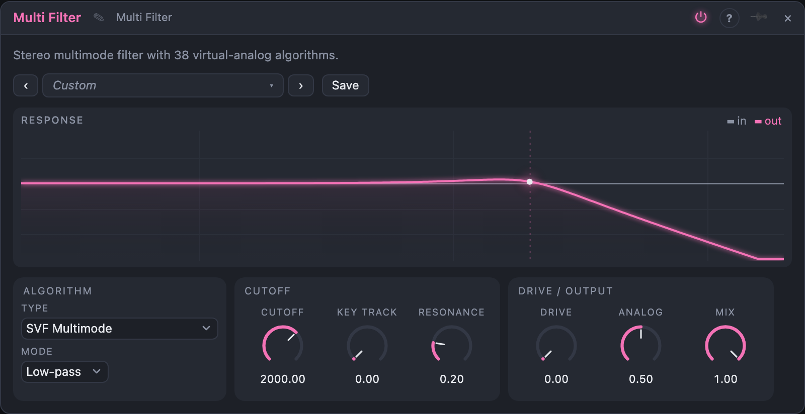

# Multi Filter

## Introduction

The Multi Filter shapes the tone of a sound by removing or emphasising
frequencies. It's stereo and offers 38 filter algorithms, from clean
state-variable and ladder filters to shelves, phasers and a flanger, and on
to a Sallen-Key filter with a hard wall, a vowel filter, a tuned comb, a
staircase of 1-pole sections and models of classic circuits: slewing op-amps,
a diode clipper in the resonance, diode pairs, OTAs and CMOS inverters. Most of
them have a low-pass, band-pass, high-pass and notch response to pick from.
Every type has its own drive, saturating where its circuit would, an *Analog*
knob for the imperfections of real parts, and key tracking. An envelope
output tells the rest of the patch how loud the filtered signal is.

## How does it work?

The algorithms follow Vadim Zavalishin's book *The Art of VA Filter Design*.
They are "zero-delay feedback" models of analog circuits: they stay in tune
up to high frequencies and stay click-free under fast modulation, even at
audio rate. **Type** picks the algorithm; the dropdown groups them by family.

- **Cutoff** sets where the filter acts. The knob is exponential: 20 Hz at the
  bottom, 20 kHz at the top, about ten octaves in total. Modulation therefore
  works in octaves: a cable at 10 % moves the cutoff by about one octave,
  whatever the cutoff is.
- **Resonance** (not shown for the 1-pole types) boosts the frequencies
  around the cutoff. On the ladder and allpass types it's the feedback amount;
  some types self-oscillate near the top (see the table).
- **Drive** saturates each type in its own way, where its circuit would (see
  *Drive per type* below): the ladders in their stages, the Sallen-Key against
  its amplifier's wall, the phasers and combs in their feedback. It changes
  the sound, not the loudness: the level stays within a few dB.
- **Analog** adds what real circuits do beyond their equations (see
  *Analog* below). At 0 % the filter is the ideal circuit.
- **Mode** (only shown for the types it acts on) is a dropdown that picks the
  response of the multimode types: Low-pass, Band-pass, High-pass or Notch. A
  cable sets it (0 Low-pass … 3 Notch). On the phasers and the flanger it does
  something else (see below).
- **Gain** (only shown for the shelving types and the vowel filter) sets the
  boost or cut of the shelves, in dB. On the vowel filter it stretches or
  squeezes the spacing of the formants.
- **Vowel** (only shown for the vowel filter) moves through A, E, I, O, U.
- **Damping** (only shown for the comb types) dulls the loop, so the upper
  peaks die away.
- **Slope** (only shown for the staircase types) sets the steepness, 6 to
  48 dB per octave.
- **Key Track** moves the cutoff with the *Pitch* input, so high notes are as
  bright as low ones.
- **Mix** blends the dry input with the filtered signal.

### Drive per type

| Types | Where Drive acts | Sound |
|---|---|---|
| Transistor ladders | a soft input stage, then every one of the four stages saturates (tanh, like the transistor pairs) | the classic ladder overdrive: the bass stays fat, the resonance gets squeezed and rounder the harder you drive |
| Diode ladders | an asymmetric input stage, then an asymmetric saturator in the loop at the ladder's input | even and odd harmonics, squelchy; the resonance tilts and smears rather than shrinking |
| Sallen-Key | into the amplifier, whose wall turns asymmetric | hard and screaming: the resonance bites harder with Drive, the opposite of the ladder |
| Nonlinear SVFs | into their own nonlinearity (the damping, or the integrators of *Rough*) | the resonance breaks up and growls |
| SVF types, Biquad | a warm, slightly asymmetric input stage before the filter | a clean filter fed by a driven preamp |
| 1-Pole types | a tape-like stage after the filter | warmth that keeps the overtones (they are not filtered away) |
| Phasers, Flanger, Combs | a saturator in the feedback loop | grainier feedback that limits itself, like a tape flanger; plucked combs get bite |
| Staircase | every section saturates (low-pass) or is driven into (high-pass) | denser with more sections |
| Vowel | an asymmetric stage before the formants | a driven voice: the formants get more harmonics to shape |
| Naive 1-Pole | hard digital clipping before the filter | deliberately raw |
| Op-Amp Slew SVF | into the slewing integrators | loud highs turn into ramps: gnarly, rasping |
| Diode-Feedback LP / HP | into the amplifier and the diode clipper in its resonance path | soft but screaming; the clipper turns asymmetric |
| Diode Pair | into the diode pairs at the integrators | a harsh, buzzy resonance |
| OTA 4-Pole | a soft input stage, then into the four OTA stages | smoother than the transistor ladder, rounder resonance |
| CMOS Inverter SVF | into the inverters | very dirty and asymmetric, early |

### Analog

*Analog* (0 – 100 %, default 50 %) brings in the imperfections of real
parts. Together they make the filter breathe:

- **Warmth:** a circuit is never quite linear. The type's own saturation
  (see *Drive per type*) always works a little: at 100 % as if *Drive* were
  at least 40 % (20 % at the default 50 %). The level stays the same.

- **Tolerances:** the two channels' cutoffs differ (up to ±6 %), so a
  stereo signal widens and a resonant peak beats between left and right, and
  the stages of the ladders, the OTA cascade and the staircase each sit at a
  different cutoff (up to ±8 %).
  Every filter on the board gets its own spread.
- **Drift:** the cutoff wanders (up to ±6 %, about a semitone), on each
  channel on its own; most audible on a resonant peak.
- **Noise floor:** a faint hiss around −80 dB. It also lets a
  self-oscillating filter start on its own, from silence, as a circuit does.
- **Mismatched pairs:** the transistor and OTA stages turn asymmetric,
  adding even harmonics when they saturate.
- **Bass loss:** the transistor ladders and the OTA cascade lose bass as
  the resonance rises (up to half the compensation is given up), as on the
  circuit.
- **Coupling high-pass:** the diode ladder's feedback runs through a
  coupling high-pass (up to 90 Hz), so low notes keep less resonance.
- **Living ladders:** *Ladder Tanh* and *Ladder Hyperbolic* get a touch of
  stage saturation, so their self-oscillation drops a little in pitch as it
  gets louder, like the real thing.

*Analog* is not shown for the two digital types (*Naive 1-Pole*, *Biquad*).

### The algorithms

**State Variable (12 dB/oct)** — the all-round filter: smooth, clean, every
response at once.

| Type | What it is | Mode | Gain |
|---|---|---|---|
| SVF Multimode | low-pass, band-pass, high-pass or notch, picked by *Mode* | ✓ | |
| SVF Bandpass (unit gain) | band-pass with 0 dB at the cutoff, whatever the resonance; resonance makes the band narrower | | |
| SVF Band Shelf | boosts or cuts a band around the cutoff; resonance narrows it | | ✓ |
| SVF Peaking | low-pass minus high-pass: a resonant peak with full bass and treble | | |
| SVF Allpass | flat level, phase turns around the cutoff (resonance makes the turn steeper) | | |

**1-Pole (6 dB/oct)** — gentle tone shaping. There is no *Resonance*.

| Type | What it is | Gain |
|---|---|---|
| 1-Pole Low-pass / High-pass | the softest possible slopes | |
| 1-Pole Allpass | flat level, 180° phase turn | |
| 1-Pole Low Shelf / High Shelf | tilt the lows or highs by *Gain*; *Cutoff* is the middle of the slope | ✓ |

**Transistor Ladder (24 dB/oct)** — four low-passes in a feedback loop: the
classic fat, steep synth filter. *Mode* picks LP, BP, HP or notch, all
built from the ladder's taps. In low-pass mode the input is boosted with the
resonance, so the bass doesn't thin out (with *Analog* only partly, as on the
circuit). Whenever the stages saturate (*Nonlinear Stages*, Drive, Analog),
the whole loop is solved exactly, every stage inside the feedback.

| Type | What it is | Self-oscillates |
|---|---|---|
| Ladder Linear | the clean, ideal ladder | no (stops just short) |
| Ladder Feedback HP | a high-pass at 250 Hz in the feedback: no resonance below it, full bass at any resonance | no |
| Ladder Tanh | a tanh saturator at the feedback point: warm overdrive, bounded self-oscillation | above ~80 % |
| Ladder Hyperbolic | the same with a softer x / (1 + abs x) saturator: rounder, quieter oscillation | above ~80 % |
| Ladder Nonlinear Stages | every stage saturates, like the real circuit: the cutoff sags on loud signals | above ~80 % |

**Diode Ladder (24 dB/oct)** — the coupled stages of a diode ladder give a
squelchier, less predictable resonance than the transistor ladder.
Low-pass only (no *Mode*).

| Type | What it is | Self-oscillates |
|---|---|---|
| Diode Ladder Linear | the clean model | no |
| Diode Ladder Tanh | with a saturator at the feedback point | above ~80 % |

**Allpass Effects** — the dry signal plus allpass-filtered copies: notches
and peaks that move with *Cutoff*. Patch a slow Function onto *Cutoff* for
the classic sweep. *Resonance* is feedback (sharper peaks). Set *Mix* to
100 %: the dry signal is already part of the effect.

| Type | What it is | Mode |
|---|---|---|
| Phaser 1-Pole ×4 | four 1-pole allpasses: two notches, around 0.4× and 2.4× the cutoff | Low-pass, Band-pass: normal; High-pass, Notch: inverted (peaks and notches swap) |
| Phaser 2-Pole ×2 | two 2-pole allpasses: two notches whose spacing you set | notch spacing: widest at Low-pass, closest at Notch; from High-pass also inverted |
| Flanger | a short delay of 1 / *Cutoff* (20 Hz = 50 ms, 1 kHz = 1 ms): a comb of evenly spaced notches | as the 1-pole phaser |

**Classic Digital** — the textbook digital filters the book improves on,
kept for comparison and for their sound.

| Type | What it is |
|---|---|
| Naive 1-Pole Low-pass | the simplest digital low-pass; above a few kHz the cutoff no longer tracks and it opens fully; no *Resonance* |
| Biquad (Direct Form I) | the classic biquad of the SVF multimode (*Mode* works); same sound when static, but fast cutoff modulation at high resonance can make it misbehave (a safety limit keeps it bounded) |

**Nonlinear State Variable (12 dB/oct)** — the SVF with saturation inside.
*Mode* picks LP, BP, HP or notch.

| Type | What it is |
|---|---|
| SVF Atanh Damping | the damping grows on loud signals: resonance that compresses itself, bounded self-oscillation at the top |
| SVF Hyperbolic Damping | the same with a harder-acting curve: gentler, quieter oscillation |
| SVF Saturating (Rough) | saturating integrators: growls when driven, gritty and bounded |

**Sallen-Key (12 dB/oct)** — a two-pole filter modelled on the
Sallen-Key topology: two resistors, two capacitors and an amplifier whose
gain sets the resonance. *Resonance* raises that gain towards the edge of
self-oscillation (a peak of Q = 1/(3 − gain)), with Q following the same
curve as the SVF (0.5 … 25), so the whole knob is heard; over the last 15 % it
goes past the edge. The twist here: the amplifier
clips against a hard-knee wall, so quiet signals ring cleanly but the
resonance bites as soon as it hits the wall, and at 100 % the filter holds a
bounded, self-sustaining tone. There is no *Mode*.

| Type | What it is |
|---|---|
| Sallen-Key Low-pass | 12 dB/oct, half level at the cutoff when *Resonance* is 0 |
| Sallen-Key High-pass | the mirrored topology |

**Formant**

| Type | What it is |
|---|---|
| Vowel A-E-I-O-U | four parallel resonators placed like the first four formants of a voice. *Vowel* morphs A → E → I → O → U (the positions move smoothly, in pitch and level). *Cutoff* is the size of the throat: 2 kHz leaves the formants where they are, an octave up makes a smaller mouth, an octave down a larger one. *Resonance* narrows them (low: breathy, high: ringing). *Gain* stretches (+) or squeezes (−) the spacing of the formants. There is no *Mode*. Feed it a bright, harmonic source: a saw or a pulse |

**Tuned Comb** — a delay line fed back on itself, tuned by the *Cutoff*:
the peaks sit at the cutoff frequency and its multiples. Patch Voice In
*Pitch* into *Pitch* with *Key Track* at 100 % and it plays in tune, like a
string or a pipe. *Resonance* is the feedback (0 – 98.5 %); the output is
scaled so the peaks stay at unity. *Damping* lowers the cutoff of a low-pass
inside the loop, so highs die faster, like a plucked string. Set *Mix* to 100 %.

| Type | What it is |
|---|---|
| Comb Positive | positive feedback: peaks at 1×, 2×, 3× … the cutoff, a full harmonic ring |
| Comb Negative | negative feedback: peaks at 1×, 3×, 5× … the cutoff, hollow like a closed pipe. The cutoff is still the pitch you hear |

**Circuit models** — classic circuits with their own way of breaking up.
All self-oscillate near the top of *Resonance*.

| Type | What it is | Mode |
|---|---|---|
| Op-Amp Slew SVF (12 dB/oct) | a state-variable filter built from slow op-amps: each integrator can only change so fast (a full-scale sine above about 4 kHz is limited) and clips at its supply rails. Clean when quiet; loud, high or resonant signals turn into ramps and rasp | ✓ |
| Diode-Feedback Low-pass / High-pass (12 dB/oct) | the Sallen-Key structure with a diode clipper in the resonance path instead of a hard wall: the resonance is soft-limited early, so it screams without getting much louder | |
| Diode Pair Multimode (12 dB/oct) | the integrators are fed through diode pairs: harsh and buzzy as the resonance rises | ✓ |
| OTA 4-Pole (24 dB/oct) | four OTA stages, each integrating tanh(in − out), in a feedback loop: smoother than the transistor ladder, and it loses bass with resonance | ✓ |
| CMOS Inverter SVF (12 dB/oct) | logic inverters as integrators: asymmetric gain, lopsided rails, very dirty even without Drive | ✓ |

**Staircase** — a cascade of 1-pole sections, 1 to 8 of them (*Slope*:
6, 12, … 48 dB/oct). The cutoff is always the −3 dB point, whatever the slope.
*Resonance* is not a feedback here but the **spread**: at 0 % all sections
share the cutoff (the steepest, tightest corner), at higher values their
corners fan out up to an octave apart, so the slope builds up step by step
from the cutoff and the shoulder softens. No resonant peak.

| Type | What it is |
|---|---|
| Staircase Low-pass | the cascade of low-passes |
| Staircase High-pass | the cascade of high-passes |

The **Env** output follows the level of the filtered signal (fast 5 ms
attack, 120 ms release).

The view shows the filter's response curve for the selected type. It is drawn
from the modulated values, so you can see it move. For the saturating types
it shows the quiet-signal (linear) response.

## How to use it?

- **Subtractive synth:** Oscillator *Out* → Filter *In L* → VCA. Start with
  *SVF Multimode* or *Ladder Tanh*, *Mode* at LP, *Cutoff* around 1 kHz and
  some *Resonance*.
- **Self-oscillating sine:** pick *Ladder Tanh* or *SVF Atanh Damping*, turn
  *Resonance* to 100 %, patch Voice In *Pitch* into *Pitch* with *Key Track*
  at 100 %. The filter rings at the cutoff and plays in tune.
- **Phaser / flanger:** pick a type from *Allpass Effects*, *Mix* at 100 %,
  some *Resonance*, and a slow Function on *Cutoff*.
- **EQ:** a *1-Pole Low Shelf* or *High Shelf* with *Gain* tilts a track's
  tone; *SVF Band Shelf* boosts or cuts a band.
- **Filter envelope:** patch an ADSR's *Env* onto **Cutoff**. The cable amount
  sets how many octaves the envelope opens: 30 % ≈ 3 octaves.
- **Key tracking:** patch Voice In *Pitch* into *Pitch* and set *Key Track*
  to 100 %. The cutoff then follows the keyboard one octave per octave.
- **Talking pad:** *Vowel A-E-I-O-U*, a saw chord in, a slow Random or an
  LFO onto *Vowel*; *Resonance* around 30 %.
- **Plucked string from noise:** *Comb Positive*, *Mix* 100 %, *Resonance*
  90 %, *Damping* 50 %, a short noise burst in, *Pitch* patched with *Key
  Track* at 100 %.
- **Squealing resonance:** *Sallen-Key Low-pass* with *Resonance* at 85 – 100 %
  and an envelope on *Cutoff*; the wall keeps it bounded.
- **Filter sweeps:** patch a slow Function or Random onto *Cutoff*. For a
  smooth sweep from low-pass to high-pass, use the Dual Filter, whose *Mode*
  morphs.
- **Process a track:** route a track's audio onto the board with an input
  port, through the filter, and back out with an output port.
- **Sidechain-style movement:** patch *Env* onto another module, e.g. a pad's
  cutoff or a VCA's gain with a negative amount, so it reacts to this signal.

<!-- generated:presets -->
## Presets

The preset bar of the Filter view has 20 factory presets. Pick one to set the knobs, then change them to taste; your own presets sit next to them. In the board a click on a name below shows it in **Open Project**, where **Load into** sets the Filter; on the website it leads to the module's entry in the Bleep Library.

| Preset | What it does |
|---|---|
| **[Warm Low-Pass](/library/detail/?kind=module&slug=filter#preset-1)** | Gentle, round low-pass for taking the fizz off a saw. |
| **[Dark Room](/library/detail/?kind=module&slug=filter#preset-2)** | A soft 6 dB slope that darkens everything without a peak. |
| **[Ladder Bass](/library/detail/?kind=module&slug=filter#preset-3)** | Fat ladder low-pass with some bite from the resonance. |
| **[Acid Squelch](/library/detail/?kind=module&slug=filter#preset-4)** | Screaming diode ladder: sweep the cutoff and add an envelope. |
| **[Self-Oscillating Ladder](/library/detail/?kind=module&slug=filter#preset-5)** | Resonance at the top makes the ladder ring as a sine; play it with Key Track. |
| **[Telephone](/library/detail/?kind=module&slug=filter#preset-6)** | Narrow band-pass: a thin, nasal voice. |
| **[Thin Air](/library/detail/?kind=module&slug=filter#preset-7)** | High-pass that leaves just the sparkle. |
| **[Rumble Cut](/library/detail/?kind=module&slug=filter#preset-8)** | Clears out the sub-bass below 90 Hz. |
| **[Notch Sweep](/library/detail/?kind=module&slug=filter#preset-9)** | A notch you can sweep for a hollow, phasing colour. |
| **[Vocal Peak](/library/detail/?kind=module&slug=filter#preset-10)** | A resonant peak with the lows and highs still intact. |
| **[Presence Boost](/library/detail/?kind=module&slug=filter#preset-11)** | Lifts the upper mids by 6 dB. |
| **[Bass Shelf](/library/detail/?kind=module&slug=filter#preset-12)** | Adds weight under 200 Hz. |
| **[Air Shelf](/library/detail/?kind=module&slug=filter#preset-13)** | A little air on top. |
| **[Slow Phaser](/library/detail/?kind=module&slug=filter#preset-14)** | Notches that sound best when you modulate the cutoff with an LFO. |
| **[Jet Flanger](/library/detail/?kind=module&slug=filter#preset-15)** | Comb filtering: sweep the cutoff slowly for a jet sound. |
| **[Gritty Drive](/library/detail/?kind=module&slug=filter#preset-16)** | Overdriven, saturating state-variable filter. |
| **[Wall Squeal](/library/detail/?kind=module&slug=filter#preset-17)** | A two-pole low-pass whose resonance rings clean, then bites against the wall when pushed. |
| **[Vowel Mouth](/library/detail/?kind=module&slug=filter#preset-18)** | Four formants: sweep Vowel from A to U, or move Cutoff to change the size of the throat. |
| **[Hollow Tube](/library/detail/?kind=module&slug=filter#preset-19)** | A tuned comb with negative feedback: only the odd harmonics ring, like a closed pipe. |
| **[Terraced Lows](/library/detail/?kind=module&slug=filter#preset-20)** | Six 1-pole sections with staggered corners: a steep, stepped slope without a resonant peak. |
<!-- /generated -->

<!-- generated:demos -->
## Demo patches

Five whole patches show what Filter does. In the standalone app open **File → Presets…** (⌘P) and pick *Filter* under *Demos by module*; on the website they are in the [Filter entry of the Bleep Library](/library/detail/?kind=module&slug=filter#examples), where **Load in Play** opens one in your browser. Loading one replaces the project and starts the transport.

| Patch | What it shows |
|---|---|
| **[Multi Filter: Ladder Bass Sweep](/library/detail/?kind=module&slug=filter#demo-1)** | A raw saw bass runs through a warm ladder-style low-pass whose Cutoff is opened by an envelope on every note, then closes again for a classic squelch. Raise Resonance or Drive for more bite, or switch Type to another ladder. |
| **[Multi Filter: Phaser Pad](/library/detail/?kind=module&slug=filter#demo-2)** | The Type is set to a four-stage phaser: a slow LFO sweeps Cutoff through a held, slightly detuned saw chord so the notches drift up and down. Try the 2-Pole phaser, more Resonance, or a faster LFO. |
| **[Multi Filter: Telephone Drums](/library/detail/?kind=module&slug=filter#demo-3)** | A whole drum loop goes through the unit-gain band-pass type while an LFO sweeps Cutoff: the beat shrinks to a thin radio sound, then opens up again. Move Mix to blend the original back in, or lower Resonance for a wider band. |
| **[Multi Filter: Key-Tracked Pluck](/library/detail/?kind=module&slug=filter#demo-4)** | The sequencer's pitch also goes into the filter, and Key Track at full makes Cutoff follow every note, so high and low notes keep the same brightness. Lower Key Track to hear the low notes go dull, or switch Mode to Band-pass or High-pass. |
| **[Multi Filter: Flanger Jet](/library/detail/?kind=module&slug=filter#demo-5)** | Type is the flanger algorithm: a long single note rings through a sweeping comb of resonances that rise and fall with a slow LFO on Cutoff. Push Resonance for a metallic jet sound, or pull Mix back for a gentle swirl. |
<!-- /generated -->

## Reference

### Knobs and settings

| Control | Range | Default |
|---|---|---|
| Cutoff | 20 Hz – 20 kHz | 2 kHz |
| Resonance | 0 – 100 % | 20 % |
| Drive | 0 – 100 % | 0 % |
| Mode | LP · BP · HP · Notch (dropdown) | LP |
| Mix | 0 – 100 % | 100 % |
| Key Track | 0 – 100 % | 0 % |
| Gain | −24 – +24 dB | 0 dB |
| Vowel | A · E · I · O · U (only with the vowel filter) | A |
| Damping | 0 – 100 % (only with the comb types) | 30 % |
| Analog | 0 – 100 % (not with the two digital types) | 50 % |
| Slope | 6 dB – 48 dB, in steps of 6 (only with the staircase types) | 24 dB |
| Type | 38 algorithms in 16 groups | SVF Multimode |

- **Cutoff:** the corner (LP, HP) or centre (BP, notch) frequency. Exponential
  over ten octaves; 10 % of modulation ≈ one octave.
- **Resonance:** emphasis at the cutoff (Q from 0.5 to 25 on the SVF types,
  feedback on the ladders, phasers and flanger). Low values are smooth; high
  values ring and whistle. Self-oscillating types sing on their own near the
  top. Not on the 1-pole types.
- **Drive:** how hard the type saturates, up to about +30 dB into its
  nonlinearity; the output is lowered again, so the level stays about the
  same (a quiet source gets a little louder at high Drive, a loud one a
  little quieter). At 0 % the signal is untouched. A quarter is a gentle
  colour, half clearly driven, full is grit. A louder source drives harder.
  Drive and the filter run at four times the sample rate, so drive stays
  clean, without the harsh, out-of-tune overtones of aliasing. Only a loud,
  very high tone at full Drive folds a little back (about −30 dB).
- **Mode:** the response: Low-pass (removes highs), Band-pass (keeps a band
  around the cutoff), High-pass (removes lows) or Notch (removes a band).
  Applies to *SVF Multimode*, the transistor ladders, the biquad, the
  nonlinear SVFs, *Op-Amp Slew SVF*, *Diode Pair*, *OTA 4-Pole* and
  *CMOS Inverter SVF*. On *Phaser 1-Pole ×4* and *Flanger* it flips the effect's
  polarity from High-pass on; on *Phaser 2-Pole ×2* it sets the notch spacing.
- **Gain:** boost or cut of *1-Pole Low Shelf*, *1-Pole High Shelf* and
  *SVF Band Shelf*; the formant spacing of *Vowel A-E-I-O-U* (±24 dB = ±50 %
  spacing). No effect on the other types.
- **Resonance** on the new types: the amplifier gain of the Sallen-Key
  (Q up to ∞), the formant bandwidth of the vowel filter (10× narrower at the
  top), the feedback of the comb (up to ±98.5 %), the corner spread of the
  staircase (up to 1 octave per section).
- **Analog:** tolerances, drift, noise floor, mismatched pairs, bass loss
  and coupling (see *Analog* above). 0 % is the ideal circuit.
- **Mix:** dry/wet. 100 % is only the filter; lower values mix the
  unfiltered input back in. The response curve shows the result.
- **Key Track:** how far the cutoff follows the *Pitch* input. At 100 % the
  cutoff moves one octave per octave of pitch; at 50 %, half an octave. No
  effect when *Pitch* is unpatched.
- **Type:** the filter algorithm (see above). Not modulatable. Switching
  type starts the new algorithm from silence.

All knobs are modulation destinations.

### Inputs

| Input | Signal | What it does |
|---|---|---|
| In L | audio | left input; also feeds the right channel when *In R* is not patched |
| In R | audio | right input |
| Pitch | pitch, 1 V/oct | moves the cutoff, scaled by *Key Track* |

### Outputs

| Output | Signal | What it does |
|---|---|---|
| Out L | audio | filtered left channel |
| Out R | audio | filtered right channel |
| Env | control, 0 – 1 | envelope follower on the filtered output |

The outputs lag the inputs by 71 samples (about 1.5 ms at 48 kHz), the cost
of oversampling. The dry signal of *Mix* lags by the same amount, so the two
stay in phase.
