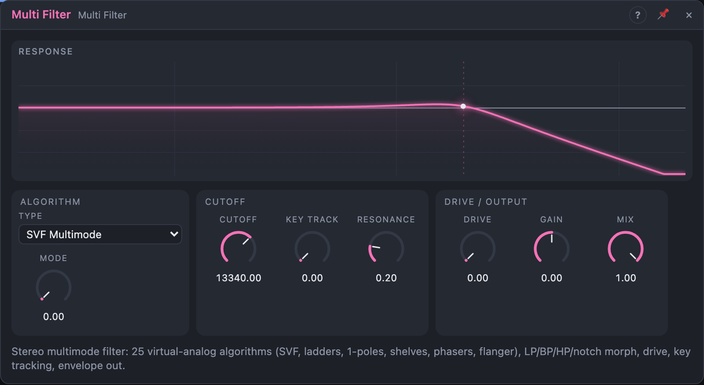

# Multi Filter

## Introduction

The Multi Filter shapes the tone of a sound by removing or emphasising
frequencies. It's stereo and offers 25 filter algorithms, from clean
state-variable and ladder filters to shelves, phasers and a flanger. Most of
them have a low-pass, band-pass, high-pass and notch response that you can
morph between continuously. It comes with drive and key tracking. An envelope
output tells the rest of the patch how loud the filtered signal is.

## How does it work?

The algorithms follow Vadim Zavalishin's book *The Art of VA Filter Design*.
They are "zero-delay feedback" models of analog circuits: they stay in tune
up to high frequencies and stay click-free under fast modulation, even at
audio rate. **Type** picks the algorithm; the dropdown groups them by family.

- **Cutoff** sets where the filter acts. The knob is exponential: 20 Hz at the
  bottom, 20 kHz at the top, about ten octaves in total. Modulation therefore
  works in octaves: a cable at 10 % moves the cutoff by about one octave,
  whatever the cutoff is.
- **Resonance** boosts the frequencies around the cutoff. On the ladder and
  allpass types it's the feedback amount; some types self-oscillate near the
  top (see the table).
- **Drive** saturates the input before the filter (a soft tanh curve) for
  warmth and grit. The saturating types add their own distortion on top.
- **Mode** morphs the response on the multimode types:

      LP (0 %) → BP (33 %) → HP (67 %) → Notch (100 %)

  On the phasers and the flanger it does something else (see below).
- **Gain** sets the boost or cut of the shelving types, in dB.
- **Key Track** moves the cutoff with the *Pitch* input, so high notes are as
  bright as low ones.
- **Mix** blends the dry input with the filtered signal.

### The algorithms

**State Variable (12 dB/oct)** — the all-round filter: smooth, clean, every
response at once.

| Type | What it is | Mode | Gain |
|---|---|---|---|
| SVF Multimode | LP / BP / HP / notch morph | ✓ | |
| SVF Bandpass (unit gain) | band-pass with 0 dB at the cutoff, whatever the resonance; resonance makes the band narrower | | |
| SVF Band Shelf | boosts or cuts a band around the cutoff; resonance narrows it | | ✓ |
| SVF Peaking | low-pass minus high-pass: a resonant peak with full bass and treble | | |
| SVF Allpass | flat level, phase turns around the cutoff (resonance makes the turn steeper) | | |

**1-Pole (6 dB/oct)** — gentle tone shaping. *Resonance* has no effect.

| Type | What it is | Gain |
|---|---|---|
| 1-Pole Low-pass / High-pass | the softest possible slopes | |
| 1-Pole Allpass | flat level, 180° phase turn | |
| 1-Pole Low Shelf / High Shelf | tilt the lows or highs by *Gain*; *Cutoff* is the middle of the slope | ✓ |

**Transistor Ladder (24 dB/oct)** — four low-passes in a feedback loop: the
classic fat, steep synth filter. *Mode* morphs LP → BP → HP → notch, all
built from the ladder's taps. In low-pass mode the input is boosted with the
resonance, so the bass doesn't thin out.

| Type | What it is | Self-oscillates |
|---|---|---|
| Ladder Linear | the clean, ideal ladder | no (stops just short) |
| Ladder Feedback HP | a high-pass at 250 Hz in the feedback: no resonance below it, full bass at any resonance | no |
| Ladder Tanh | a tanh saturator at the feedback point: warm overdrive, bounded self-oscillation | above ~80 % |
| Ladder Hyperbolic | the same with a softer x / (1 + abs x) saturator: rounder, quieter oscillation | above ~80 % |
| Ladder Nonlinear Stages | every stage saturates, like the real circuit: the cutoff sags on loud signals | above ~80 % |

**Diode Ladder (24 dB/oct)** — the coupled stages of a diode ladder give a
squelchier, less predictable resonance than the transistor ladder.
Low-pass only (*Mode* has no effect).

| Type | What it is | Self-oscillates |
|---|---|---|
| Diode Ladder Linear | the clean model | no |
| Diode Ladder Tanh | with a saturator at the feedback point | above ~80 % |

**Allpass Effects** — the dry signal plus allpass-filtered copies: notches
and peaks that move with *Cutoff*. Patch a slow Function onto *Cutoff* for
the classic sweep. *Resonance* is feedback (sharper peaks). Set *Mix* to
100 %: the dry signal is already part of the effect.

| Type | What it is | Mode |
|---|---|---|
| Phaser 1-Pole ×4 | four 1-pole allpasses: two notches, around 0.4× and 2.4× the cutoff | below 50 %: normal; from 50 %: inverted (peaks and notches swap) |
| Phaser 2-Pole ×2 | two 2-pole allpasses: two notches whose spacing you set | notch spacing: wide at 0 %, close at 100 % |
| Flanger | a short delay of 1 / *Cutoff* (20 Hz = 50 ms, 1 kHz = 1 ms): a comb of evenly spaced notches | as the 1-pole phaser |

**Classic Digital** — the textbook digital filters the book improves on,
kept for comparison and for their sound.

| Type | What it is |
|---|---|
| Naive 1-Pole Low-pass | the simplest digital low-pass; above a few kHz the cutoff no longer tracks and it opens fully |
| Biquad (Direct Form I) | the classic biquad of the SVF multimode (*Mode* works); same sound when static, but fast cutoff modulation at high resonance can make it misbehave (a safety limit keeps it bounded) |

**Nonlinear State Variable (12 dB/oct)** — the SVF with saturation inside.
*Mode* morphs LP → BP → HP → notch.

| Type | What it is |
|---|---|
| SVF Atanh Damping | the damping grows on loud signals: resonance that compresses itself, bounded self-oscillation at the top |
| SVF Hyperbolic Damping | the same with a harder-acting curve: gentler, quieter oscillation |
| SVF Saturating (Rough) | saturating integrators: growls when driven, gritty and bounded. Drives harder than the others at the same *Drive* |

The **Env** output follows the level of the filtered signal (fast 5 ms
attack, 120 ms release).

The view shows the filter's response curve for the selected type. It is drawn
from the modulated values, so you can see it move. For the saturating types
it shows the quiet-signal (linear) response.

## How to use it?

- **Subtractive synth:** Oscillator *Out* → Filter *In L* → VCA. Start with
  *SVF Multimode* or *Ladder Tanh*, *Mode* at LP, *Cutoff* around 1 kHz and
  some *Resonance*.
- **Self-oscillating sine:** pick *Ladder Tanh* or *SVF Atanh Damping*, turn
  *Resonance* to 100 %, patch Voice In *Pitch* into *Pitch* with *Key Track*
  at 100 %. The filter rings at the cutoff and plays in tune.
- **Phaser / flanger:** pick a type from *Allpass Effects*, *Mix* at 100 %,
  some *Resonance*, and a slow Function on *Cutoff*.
- **EQ:** a *1-Pole Low Shelf* or *High Shelf* with *Gain* tilts a track's
  tone; *SVF Band Shelf* boosts or cuts a band.
- **Filter envelope:** patch an ADSR's *Env* onto **Cutoff**. The cable amount
  sets how many octaves the envelope opens: 30 % ≈ 3 octaves.
- **Key tracking:** patch Voice In *Pitch* into *Pitch* and set *Key Track*
  to 100 %. The cutoff then follows the keyboard one octave per octave.
- **Filter sweeps:** patch a slow Function or Random onto *Cutoff*, or onto
  *Mode* for a sweep from low-pass to high-pass.
- **Process a track:** route a track's audio onto the board with an input
  port, through the filter, and back out with an output port.
- **Sidechain-style movement:** patch *Env* onto another module, e.g. a pad's
  cutoff or a VCA's gain with a negative amount, so it reacts to this signal.

<!-- generated:presets -->
## Presets

The preset bar of the Filter view has 16 factory presets. Pick one to set the knobs, then change them to taste; your own presets sit next to them.

| Preset | What it does |
|---|---|
| **Warm Low-Pass** | Gentle, round low-pass for taking the fizz off a saw. |
| **Dark Room** | A soft 6 dB slope that darkens everything without a peak. |
| **Ladder Bass** | Fat ladder low-pass with some bite from the resonance. |
| **Acid Squelch** | Screaming diode ladder: sweep the cutoff and add an envelope. |
| **Self-Oscillating Ladder** | Resonance at the top makes the ladder ring as a sine; play it with Key Track. |
| **Telephone** | Narrow band-pass: a thin, nasal voice. |
| **Thin Air** | High-pass that leaves just the sparkle. |
| **Rumble Cut** | Clears out the sub-bass below 90 Hz. |
| **Notch Sweep** | A notch you can sweep for a hollow, phasing colour. |
| **Vocal Peak** | A resonant peak with the lows and highs still intact. |
| **Presence Boost** | Lifts the upper mids by 6 dB. |
| **Bass Shelf** | Adds weight under 200 Hz. |
| **Air Shelf** | A little air on top. |
| **Slow Phaser** | Notches that sound best when you modulate the cutoff with an LFO. |
| **Jet Flanger** | Comb filtering: sweep the cutoff slowly for a jet sound. |
| **Gritty Drive** | Overdriven, saturating state-variable filter. |
<!-- /generated -->

## Reference

### Knobs and settings

| Control | Range | Default |
|---|---|---|
| Cutoff | 20 Hz – 20 kHz | 2 kHz |
| Resonance | 0 – 100 % | 20 % |
| Drive | 0 – 100 % | 0 % |
| Mode | LP → BP → HP → Notch | LP |
| Mix | 0 – 100 % | 100 % |
| Key Track | 0 – 100 % | 0 % |
| Gain | −24 – +24 dB | 0 dB |
| Type | 25 algorithms in 7 groups | SVF Multimode |

- **Cutoff:** the corner (LP, HP) or centre (BP, notch) frequency. Exponential
  over ten octaves; 10 % of modulation ≈ one octave.
- **Resonance:** emphasis at the cutoff (Q from 0.5 to 25 on the SVF types,
  feedback on the ladders, phasers and flanger). Low values are smooth; high
  values ring and whistle. Self-oscillating types sing on their own near the
  top. No effect on the 1-pole types.
- **Drive:** how hard the input is saturated before filtering. At 0 % the
  signal is untouched. Turn down the source level if you want drive without
  much extra loudness.
  Drive and the filter run at four times the sample rate, so even hard drive
  and the saturating types stay clean, without the harsh, out-of-tune
  overtones of aliasing.
- **Mode:** the response, morphed continuously:
  0 % low-pass (removes highs), 33 % band-pass (keeps a band around the
  cutoff), 67 % high-pass (removes lows), 100 % notch (removes a band).
  Applies to *SVF Multimode*, the transistor ladders, the biquad and the
  nonlinear SVFs. On *Phaser 1-Pole ×4* and *Flanger* it flips the effect's
  polarity at 50 %; on *Phaser 2-Pole ×2* it sets the notch spacing.
- **Gain:** boost or cut of *1-Pole Low Shelf*, *1-Pole High Shelf* and
  *SVF Band Shelf*. No effect on the other types.
- **Mix:** dry/wet. 100 % is only the filter; lower values mix the
  unfiltered input back in. The response curve shows the result.
- **Key Track:** how far the cutoff follows the *Pitch* input. At 100 % the
  cutoff moves one octave per octave of pitch; at 50 %, half an octave. No
  effect when *Pitch* is unpatched.
- **Type:** the filter algorithm (see above). Not modulatable. Switching
  type starts the new algorithm from silence.

All knobs are modulation destinations.

### Inputs

| Input | Signal | What it does |
|---|---|---|
| In L | audio | left input; also feeds the right channel when *In R* is not patched |
| In R | audio | right input |
| Pitch | pitch, 1 V/oct | moves the cutoff, scaled by *Key Track* |

### Outputs

| Output | Signal | What it does |
|---|---|---|
| Out L | audio | filtered left channel |
| Out R | audio | filtered right channel |
| Env | control, 0 – 1 | envelope follower on the filtered output |

The outputs lag the inputs by 71 samples (about 1.5 ms at 48 kHz), the cost
of oversampling. The dry signal of *Mix* lags by the same amount, so the two
stay in phase.
