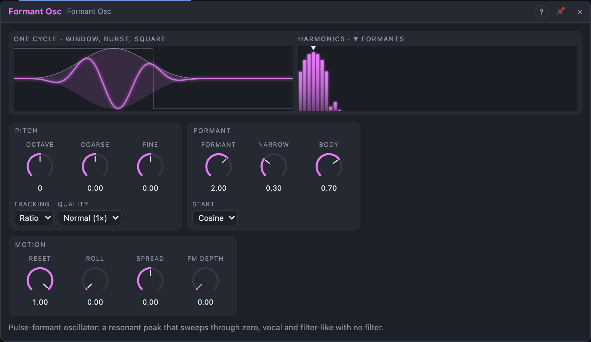

# Formant Osc

## Introduction

The Formant Osc is a pulse-formant oscillator. Every cycle of the note fires
one short burst of a second, higher oscillation: the *formant*. The note
sets the pitch; the formant sets a resonant peak in the spectrum, like the
mouth shape of a voice or the body of an instrument. Sweeping *Formant*
gives vocal, filter-like sweeps with no filter in the patch, and *Narrow*
makes the sound brighter and buzzier.

## How does it work?

**Fundamental.** The note is C4 × 2^(Octave + Coarse/12 + Fine/1200 +
Pitch). A band-limited square and a sub (one octave down) run on the same
cycle.

**Formant.** The formant frequency comes from the *Formant* knob in octaves:

- *Ratio* tracking: relative to the note (+1 = twice the note, +2 = four
  times). The timbre is the same on every key.
- *Fixed* tracking: relative to C4. The peak stays put while the note moves,
  like a vowel sung on different notes.

The knob goes **through zero**: around 0 the formant slows to 0 Hz and then
runs backwards for negative values. With *Start* on *Cosine* a 0 Hz formant
is the window itself, so a sweep from −1 to +1 goes formant → soft pulse →
formant without a gap. *Formant CV* adds octaves; *Formant FM* modulates the
formant frequency linearly (±4× at *FM Depth* 100 %, through zero).

**The burst.** Each cycle the formant plays under a smooth window. *Narrow*
shortens the window (from the whole cycle to 5 % of it) and sharpens it:
fewer formant cycles per burst, a wider peak and a brighter, buzzier tone.
At high notes the window is kept at least 12 samples long, so the bursts
never alias; *Narrow* then has less range.

**Reset.** At 100 % every burst starts identically: the spectrum is purely
harmonic and the formant is a clean peak. Lower values let the formant
drift against the note for inharmonic, ring-modulated and chorused colours;
0 % is a free-running formant gated by the window.

**Roll** moves the window inside the cycle. It wraps, so turning it never
cuts a burst; modulated, it gives a phasing movement against the square,
best heard with *Body* around 50 %.

**Second formant.** Out R plays a second formant *Spread* octaves away from
the first, sharing the cycle and the window. At *Spread* 0 L and R are
identical; small values give width, larger ones two peaks, one per ear.

**Body** mixes the square (at half level) and the formant at *Out*.

*Roll* and *Narrow* glide over 2 ms, so fast modulation doesn't click. A
*Sync* edge restarts the cycle with a very short crossfade from the old one.

## How to use it?

- **Talking bass:** *Octave* −1, an envelope on *Formant* (up 2–3 octaves),
  *Narrow* 40 %.
- **Vowel on a melody:** *Tracking* Fixed, *Formant* +1.5, play notes on
  *Pitch*: the peak stays like a sung vowel.
- **Wah:** an LFO on *Formant* (or *Formant CV*), *Body* 90 %.
- **Wide pad:** *Spread* ±0.1, *Reset* 80 % for slow beating.
- **Pinging modulation:** *Octave* −4 and below: the bursts become rhythmic
  pings, useful as an odd modulation source.
- Put *Quality* on High for bright patches above C6.

<!-- generated:demos -->
## Demo patches

Five whole patches show what Formant Osc does. In the standalone app open **File → Presets…** (⌘P) and pick *Formant Osc* under *Demos by module*; on the website, **Run in Play** opens one in your browser. Loading one replaces the project and starts the transport.

| Patch | What it shows |
|---|---|
| **Formant Osc: Vowel Sweep** | A flowing melody on the Formant Osc while a slow LFO sweeps the Formant peak, so the tone opens and closes like a voice changing vowels, without a filter anywhere. Move Formant by hand, or raise Narrow for a more nasal peak. |
| **Formant Osc: Squelch Bass** | A decaying envelope sweeps the formant peak up and down on every note, giving a squelchy bass that behaves like a resonant filter although there is none. Change Narrow for a sharper squelch, or lengthen the decay for a longer wow. |
| **Formant Osc: Wide Choir** | Slow chord roots on the Formant Osc with Spread and Body opened up make a breathy, choir-like pad that sits wide in the stereo field. Turn Spread to zero for mono, or Roll up to soften the upper end. |
| **Formant Osc: Random Vowels** | A fast arpeggio while a Random module picks a new smooth Formant position every few beats: each note wears a different vowel. Raise Random's Smooth for glides between vowels, or Spread for bolder jumps. |
| **Formant Osc: Fixed Resonance** | With Tracking on Fixed, the formant peak stays put while the notes move, as in a real vowel across a sung tune, instead of rising with the pitch. Switch Tracking back to Ratio and the whole tone shifts with each note. |
<!-- /generated -->

<!-- generated:presets -->
## Presets

The preset bar of the Formant Osc view has 15 factory presets. Pick one to set the knobs, then change them to taste; your own presets sit next to them.

| Preset | What it does |
|---|---|
| **Vowel Tone** | A sung vowel: the peak stays fixed while the note moves. |
| **Talking Bass** | Bass with a resonant peak: put an envelope on Formant. |
| **Wah Lead** | Sweep Formant with an LFO for a wah-pedal lead. |
| **Filter-less Squelch** | Acid-like squelch with no filter: envelope the Formant. |
| **Hollow Ghost** | Formant near zero: a hollow, soft pulse; sweep through it. |
| **Reverse Formant** | Negative formant runs backwards: a different, hollow colour. |
| **Wide Choir** | Spread and drifting reset: a wide, breathy choir pad. |
| **Two Peaks** | Left and right ears get different formants for a two-peak sound. |
| **Buzzy Saw** | Narrow, bright bursts: a buzzy, sawlike tone. |
| **Soft Sine Voice** | A wide, smooth burst: mellow and almost sinelike. |
| **Phasing Roll** | Roll moves the window; modulate it for phasing against the square. |
| **Inharmonic Ring** | Low reset lets the formant drift: ring-modulated, bell-like colours. |
| **FM Formant** | Open FM depth: patch an audio source to Formant FM for growling timbre. |
| **Pinging Sub** | Very low note turns into rhythmic pings: odd modulation or percussion. |
| **Bright Bell High** | Clean high register thanks to High quality. |
<!-- /generated -->

## Reference

### Knobs and settings

| Control | Range | Default |
|---|---|---|
| Octave | −4 … +4 (stepped) | 0 |
| Coarse | −12 … +12 st | 0 st |
| Fine | −100 … +100 ct | 0 ct |
| Formant | −6 … +6 oct (through zero) | +2 oct |
| Narrow | 0 – 100 % | 30 % |
| Body | 0 – 100 % | 70 % |
| Reset | 0 – 100 % | 100 % |
| Roll | 0 – 100 % (wraps) | 0 % |
| Spread | −1 … +1 oct | 0 |
| FM Depth | 0 – 100 % | 0 % |
| Tracking | Ratio, Fixed | Ratio |
| Start | Sine, Cosine | Cosine |
| Quality | Normal (1×), High (2×) | Normal |

All knobs are modulation destinations; the settings are not.

### Inputs

| Input | Signal | What it does |
|---|---|---|
| Pitch | pitch, 1 V/oct | the note; 0.0 = C4 |
| Formant CV | pitch | moves the formant in octaves (1.0 = one octave) |
| Formant FM | audio | linear, through-zero FM of the formant, scaled by *FM Depth* |
| Sync | trigger | restarts the cycle (and a new burst) |

### Outputs

| Output | Signal | What it does |
|---|---|---|
| Out L, Out R | audio | square and formant mixed by *Body*; R uses the second formant |
| Formant | audio | the burst train alone (first formant) |
| Square | audio | band-limited square at the note, ±1 |
| Sub | audio | square one octave below |

The formant peaks at about ±1 (up to ±1.6 with very narrow bursts).
