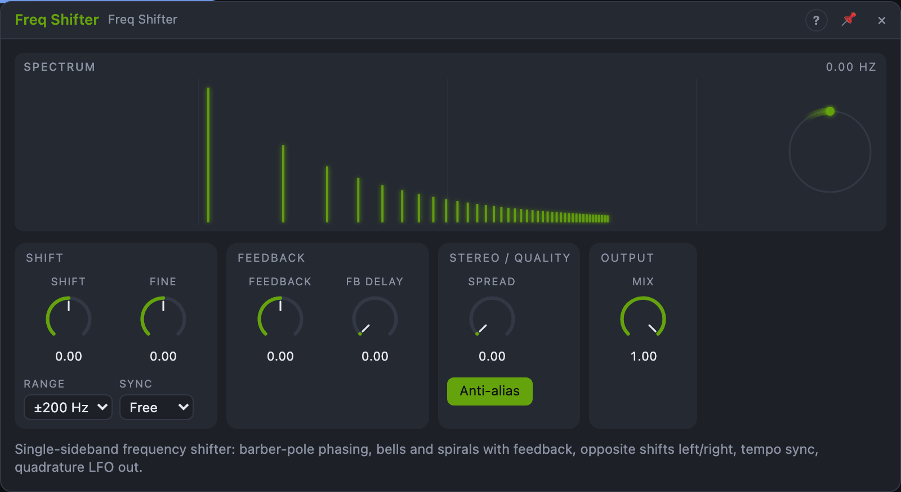

# Freq Shifter

## Introduction

The Freq Shifter moves every frequency of a sound up or down by the same
number of hertz. That's different from a pitch shift: a pitch shift keeps the
ratios between the partials, a frequency shift breaks them. A few tenths of a
hertz give slow phasing and beating; tens or hundreds of hertz turn harmonic
sounds into bells, metal and detuned radio. With feedback the shifted signal
spirals up or down endlessly (the barber-pole effect).

It's stereo, can shift the two channels in opposite directions, locks to the
song's tempo, and its quadrature oscillator is available as a two-phase LFO.

## How does it work?

Each channel goes through a *Hilbert transformer*: two allpass chains whose
outputs are 90° apart at every frequency from 15 Hz up. Multiplied with a sine
and cosine oscillator at the shift frequency, they give the two *sidebands*:

- **Up** moves every component up by the shift (1 kHz + 100 Hz = 1.1 kHz).
- **Down** moves it down (1 kHz − 100 Hz = 900 Hz).

The other sideband is suppressed by about 40 dB. A negative shift swaps the
two. Components pushed below 0 Hz come back up as positive frequencies
(through-zero shifting), which is part of the sound.

- **Shift** sets the amount, as a percentage of **Range**: at ±200 Hz range,
  50 % is +100 Hz. The knob is linear and bipolar (centre = no shift), so an
  LFO or an audio-rate cable on it is through-zero modulation of the shift.
- **Fine** adds −10…+10 Hz, for slow phasing at a wide range.
- **Feedback** sends the *Up* signal back into the input, optionally through
  a delay (**FB Delay**). At 0 ms (one sample) and a small shift you get the
  barber-pole phaser: a comb of notches that moves endlessly up or down.
  With 50–500 ms every echo is shifted a little further: rising or falling
  spirals. Negative values invert the fed-back signal. A soft limiter keeps
  ±100 % loud but bounded.
- **Spread** moves the right channel's shift from the same as the left (0 %)
  through stopped (50 %) to the opposite (100 %). With a mono input, Spread
  at 100 % and a 0.3 Hz shift, the phasing turns in opposite directions in
  the two ears.
- **Mix** blends the dry input with the *Up* signal for *Out*. The shifted
  signal is delayed a little by the allpass chains, so 50 % gives some extra
  phasing of its own.
- **Sync** locks the shift rate to the tempo: one cycle per note value, from
  1/32 to 8 bars. The direction follows the sign of *Shift*; *Fine* is not
  used. With the transport playing, the oscillator phase follows the song
  position, so a barber-pole phaser lands in the same place after a loop
  jump.
- **Anti-alias** filters the input (6-pole low-pass at 0.42 × the sample rate
  minus the shift) so content shifted past the top of the audio band doesn't
  fold back as noise. *Down* loses the same top end.

**Reset** jumps the oscillator to phase 0 (with a 2 ms fade to hide the
jump). The **Sin** and **Cos** outputs carry the left oscillator: at
sub-audio shifts a two-phase LFO, at audio shifts two sines 90° apart.

The view shows the spectrum of the input (grey) and of *Out* (colour): the
shift shows up as a translation. The dial shows both oscillators turning.

## How to use it?

- **Barber-pole phaser:** Shift 0, Fine +0.3 Hz, Feedback 70 %, FB Delay 0,
  Mix 50 %. Negative Fine for a falling phaser.
- **Bells from a pad:** Range ±200 Hz, Shift 20–60 %, Mix 100 %. Harmonic
  sounds become inharmonic and metallic.
- **Spirals:** FB Delay 250 ms (or a dotted eighth by ear), Feedback 60 %,
  Shift ±10 % at ±200 Hz: each echo climbs or falls by 20 Hz.
- **Stereo rotation:** a mono source on *In L*, Spread 100 %, Fine 0.2 Hz.
- **Through-zero FM:** an LFO or an audio oscillator onto *Shift* with Shift
  at 0.
- **Two-phase LFO:** Range ±10 Hz, Shift a few percent, patch *Sin* and
  *Cos* to two destinations (e.g. the pan of two voices) for circular motion.
- **Rhythmic phaser:** Sync 1 bar, Shift slightly positive, Feedback 50 %.

## Demo patches

Five whole patches show what Freq Shifter does. In the standalone app open **File → Presets…** (⌘P) and pick *Freq Shifter* under *Demos by module*; loading one replaces the project and starts the transport.

| Patch | What it shows |
|---|---|
| **Freq Shifter: Barber-Pole Phaser** | A tiny positive *Fine*, strong *Feedback* and half *Mix*: a phaser sweep that always rises. |
| **Freq Shifter: Pad to Bells** | *Shift* at about +30 % of ±200 Hz and *Mix* 100 % make a harmonic pad inharmonic and metallic. |
| **Freq Shifter: Spiral Echoes** | *Feedback* through *FB Delay* shifts every repeat up by the same step, so notes spiral upward. |
| **Freq Shifter: Stereo Rotation** | *Spread* at 100 % shifts left and right in opposite directions so a mono arpeggio rotates. |
| **Freq Shifter: Tempo Phaser** | *Sync* on one bar locks the shifter to the song for a slow phaser over drums and bass. |

## Reference

### Knobs and settings

| Control | Range | Default |
|---|---|---|
| Shift | −100 … +100 % of *Range* | 0 % |
| Fine | −10 … +10 Hz | 0 Hz |
| Feedback | −100 … +100 % | 0 % |
| FB Delay | 0 – 1000 ms | 0 ms |
| Spread | 0 – 100 % | 0 % |
| Mix | 0 – 100 % | 100 % |
| Range | ±10 Hz, ±200 Hz, ±2 kHz, ±10 kHz | ±200 Hz |
| Sync | Free, 1/32 … 8 bars | Free |
| Anti-alias | Off, On | On |

- **Shift:** the shift of the left channel, linear. The view shows it in Hz.
- **Fine:** added to *Shift*. Hidden while *Sync* is on.
- **Feedback:** the delayed *Up* signal mixed back into the input. A DC
  blocker in the loop stops offsets from building up.
- **FB Delay:** the delay in the feedback loop. 0 is one sample; changes
  glide like tape (the echoes bend in pitch).
- **Spread:** right shift = left shift × (1 − 2 × Spread).
- **Mix:** dry ↔ *Up* for *Out*. *Up* and *Down* are always 100 % wet.
- **Range:** the span of *Shift*. Changing it keeps the knob position, so the
  shift jumps. Not modulatable.
- **Sync:** Free, or one cycle per note value. Not modulatable.
- **Anti-alias:** the input low-pass against aliasing. Not modulatable.

All knobs are modulation destinations.

### Inputs

| Input | Signal | What it does |
|---|---|---|
| In L | audio | left input; also feeds the right channel when *In R* is not patched |
| In R | audio | right input |
| Reset | trigger | sets both oscillators to phase 0 (ignored while synced to a playing transport) |

### Outputs

| Output | Signal | What it does |
|---|---|---|
| Out L, Out R | audio | dry/wet mix of the *Up* signal |
| Up L, Up R | audio | input shifted by +Shift |
| Down L, Down R | audio | input shifted by −Shift |
| Sin, Cos | control, −1 … +1 | the left oscillator, 90° apart |
