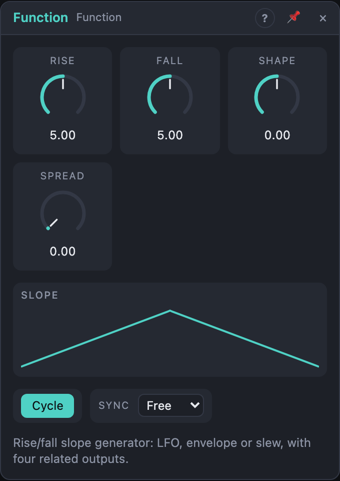

# Function

## Introduction

The Function is a **slope generator**: it rises to 1 and falls back to 0. That
one gesture covers a lot of jobs. Left running in a loop it's an LFO. Started
by a trigger it's an attack/decay envelope. It can lock to Live's tempo. Its
four outputs are related copies of the same slope, shifted in phase or
stretched in time, so one module can move several things in a coordinated way.

## How does it work?

Each cycle has two parts: a **rise** from 0 to 1 that takes *Rise* seconds and
a **fall** back to 0 that takes *Fall* seconds. *Shape* bends both slopes:
straight at 0, exponential toward +1, logarithmic toward −1. The view draws the resulting slope live.

**Cycle on (LFO).** The slope repeats. One cycle lasts *Rise* + *Fall*, so
equal values give a triangle and lopsided values give a ramp or a saw. A
rising edge at *Trig* restarts the cycle from the beginning (hard reset). *EOC*
fires at the end of every cycle.

**Cycle off (envelope).** The Function waits. A rising edge at *Trig* starts
the rise from wherever the output is, then the fall follows on its own. How
long the trigger stays high doesn't matter. *EOC* fires when output A has
fallen back to 0.

**Sync.** With a note value selected, the cycle (or the whole envelope) lasts
exactly that long at the current tempo. *Rise* and *Fall* then only set the
proportion between rise and fall, not the time. While Live's transport is
playing, a cycling Function is locked to the song position, so it lines up
with the bar wherever you start playback. With the transport stopped it runs
at the tempo without the lock. Starting the transport always restarts it.

**Spread** derives outputs B, C and D from A:

- **Cycling:** B, C and D are shifted in phase by Spread × ¼ cycle each. At
  100 % the four outputs are a quarter cycle apart (0°, 90°, 180°, 270°).
- **Envelope:** B, C and D take longer, each by a factor of (1 + Spread) more
  than the one before. At 100 % B is twice as long as A, C four times and D
  eight times.

At 0 % Spread all four outputs are identical.

## How to use it?

- **LFO:** leave *Cycle* on, set *Rise* and *Fall*, and patch *A* onto any
  knob, e.g. a filter's cutoff. Set the depth with the cable's amount.
- **Tempo-synced LFO:** choose a *Sync* value such as 1/4 or 1 bar. Set *Rise*
  short and *Fall* long for a ramp down on every beat.
- **Envelope:** turn *Cycle* off and patch a gate or trigger into *Trig*. Short
  rise and longer fall gives a pluck; *Shape* toward +1 makes it snappier.
- **Movement across several voices or parameters:** with *Spread* up, patch A,
  B, C and D to four different destinations. They move together but not in
  lockstep: four phases of one LFO, or four envelopes of growing length.
- **Sequencing events:** *EOC* fires once per cycle or at the end of the
  envelope. Use it as a clock for Random or to trigger another envelope.
- **Self-cycling with a twist:** with *Cycle* off, patch *EOC* back into *Trig*.
  It loops, and you can patch other triggers in as well.

## Reference

### Knobs and settings

| Control | Range | Default |
|---|---|---|
| Rise | 1 ms – 10 s | 250 ms |
| Fall | 1 ms – 10 s | 250 ms |
| Shape | −1 … +1 | 0 (linear) |
| Spread | 0 – 100 % | 0 % |
| Cycle | on / off | on |
| Sync | Free, 1/32, 1/16, 1/8, 1/4, 1/2, 1 bar, 2 bars, 4 bars, 8 bars | Free |

- **Rise:** duration of the rising part. Its knob centre is 250 ms. In sync
  mode only the ratio Rise : Fall counts.
- **Fall:** duration of the falling part, same range. With *Cycle* on, the
  frequency is 1 / (Rise + Fall): 250 ms + 250 ms = 2 Hz.
- **Shape:** the curve of both slopes. 0 is linear. Positive values are
  exponential: the rise starts slowly and speeds up, the fall drops fast and
  then eases out. This is the punchy, natural-sounding envelope. Negative
  values are logarithmic, the other way round: the rise shoots up and
  settles, the fall lingers and then drops away.
- **Spread:** how far B, C and D differ from A. Phase offsets when cycling,
  longer durations as an envelope (see above).
- **Cycle:** on loops the slope (LFO); off makes a one-shot envelope started
  by *Trig*.
- **Sync:** *Free* uses the times from *Rise* and *Fall*. A note value fixes
  the total length to that note at Live's tempo (4/4 assumed). Rise and Fall
  then share that time in their ratio.

*Rise*, *Fall*, *Shape* and *Spread* are modulation destinations. Modulating
*Rise* or *Fall* from another Function gives an LFO with a wandering rate.

### Inputs

| Input | Signal | What it does |
|---|---|---|
| Trig | gate | rising edge: restarts the cycle (Cycle on) or starts the envelope (Cycle off) |

### Outputs

| Output | Signal | What it does |
|---|---|---|
| A | control, 0 – 1 | the slope |
| B | control, 0 – 1 | A shifted ¼ × Spread in phase, or stretched by (1 + Spread) |
| C | control, 0 – 1 | shifted ½ × Spread, or stretched by (1 + Spread)² |
| D | control, 0 – 1 | shifted ¾ × Spread, or stretched by (1 + Spread)³ |
| EOC | trigger | end of cycle: once per loop, or when A's envelope finishes |
