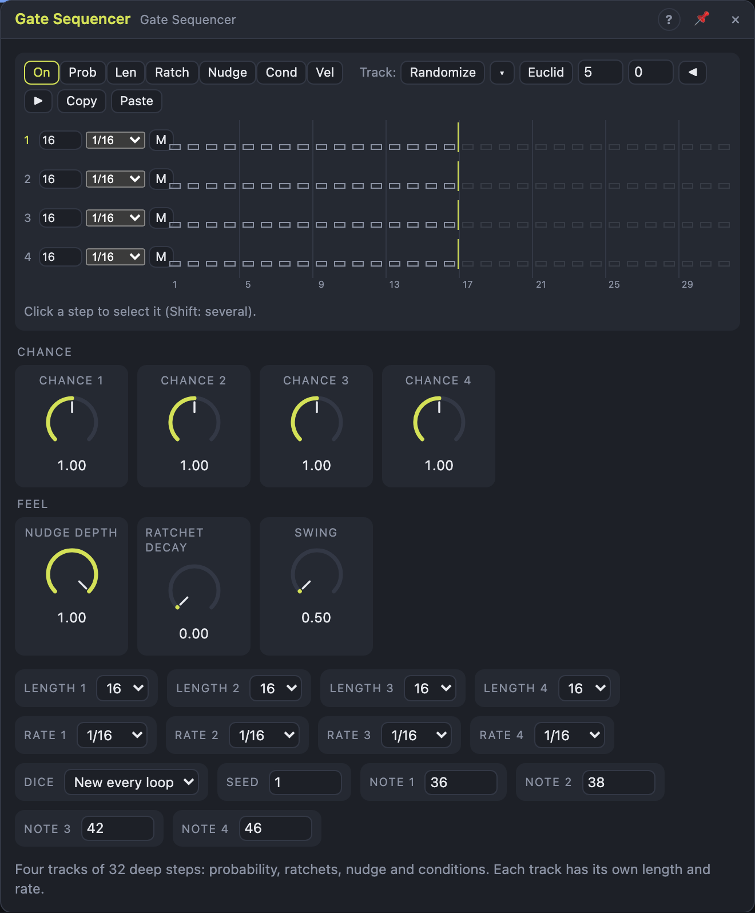

# Gate Sequencer

## Introduction

The Gate Sequencer is a rhythm sequencer with **deep steps**: four tracks of
up to 32 gates, where every step has its own **probability**, **gate length**
(or a tie), **ratchets** (fast repeats inside the step), **nudge** (playing a
little early or late) and a **condition** (every Nth loop, only the first
time, only during a fill …). Each track has its own **length** and **rate**,
so tracks drift against each other and still land on the bars.

It has no pitches: it's about *how* hits happen. Patch its gates and triggers
into drum modules or envelopes, or *Notes* into a drum rack. The chances are
seeded, so a pattern that "breathes" plays the same in every render.

A new module plays a small beat on tracks 1–3 straight away.

## How does it work?

**Timing.** With nothing in *Clock*, every track follows the transport on its
own grid (its *Rate*), worked out from the song position, so a loop jump
lands each track on the right step. A 16-step track against a 12-step track
lines up again every 3 bars; the *Cycle* output fires when all four are back
on step 1 together. With a cable in *Clock*, each pulse is a 1/16 tick and
the tracks run at their rates relative to it (a 1/32 track plays twice per
tick, spaced by the measured tick length).

**Whether a step plays.** A step that is *On* plays when:

1. its **condition** is true:
   - **A:B** — on the A-th of every B loops (2:4 = the second of every four);
   - **First / Not First** — on the first loop since the transport started
     (or since Reset), or on every other loop;
   - **Fill / Not Fill** — while the *Fill* input is high, or while it isn't;
   - **Prev / Not Prev** — when the last earlier chance-or-condition step on
     the track played (or didn't). Chain them for "if this, then that".
2. its **probability** wins the dice: 100 % always plays; below that the
   chance is scaled by the track's *Chance* knob (0 % leaves only the certain
   steps, 200 % doubles every chance). The dice come from *Seed*, the track,
   the step and the loop, so renders repeat and a jump replays the same
   choices. *Dice* decides how often they change: every loop, every 2/4/8
   loops, or never (*Fixed*).
3. the track isn't muted (the *M* button or the *Mute* input).

**Inside a step.**
- **Length** is the gate as a share of the step; **Tie** keeps the gate up
  until the next step on the track that doesn't play.
- **Ratchet** splits the step into 1–8 hits: *Even*, *Faster* (gaps shrink)
  or *Slower* (gaps grow). *Ratchet Decay* makes each repeat softer.
- **Nudge** moves the whole step up to half a step early or late, scaled by
  *Nudge Depth*. Early hits really are early: the module looks ahead.
- **Velocity** goes to the *Vel* output and the notes.

Two gates that touch drop for 1 ms, so the next one starts with a clean edge.

**Notes.** Each hit is a note at the track's *Note* number, ending with its
gate. No note is left hanging: stopping, Reset, Mute, changing a track's
length, rate or note, and editing the step that's sounding all end it.

## How to use it?

- **Drums on the board:** *Trig 1* into a kick's *Trig*, *Vel 1* into its
  *Velocity*; the same for tracks 2–4.
- **Drums in Live:** *Notes* into a MIDI Out port with a drum rack; *Note 1–4*
  default to kick, snare, closed and open hat.
- **Editing:** choose what a click edits with **On / Prob / Len / Ratch /
  Nudge / Cond / Vel**. *On*: click toggles, drag paints. *Prob*, *Len*,
  *Vel*, *Ratch*: drag up and down. *Nudge*: drag sideways. *Cond*: click
  cycles the condition. Click a step to select it (Shift: several) and set
  every field in the **inspector** line below. Steps drawn hollow won't play
  on this pass.
- **Length and rate:** at the start of each row, or drag the marker at the
  end of the row.
- **Track tools** act on the track you last clicked: *Randomize* (density,
  probability range, ratchet chance and nudge in ▾), *Euclid* (k hits spread
  evenly, with a rotation), ◀ ▶ rotate, *Copy* / *Paste*.
- **Fills:** patch a gate into *Fill* (every 4th bar from a Clock divider or
  another sequencer's *End*) and mark some steps *Fill* or *Not Fill*.
- **Thinning and filling:** a slow LFO on *Chance 3* makes the hats breathe.

## Demo patches

Five whole patches show what Gate Sequencer does. In the standalone app open **File → Presets…** (⌘P) and pick *Gate Sequencer* under *Demos by module*; loading one replaces the project and starts the transport.

| Patch | What it shows |
|---|---|
| **Gate Sequencer: Broken Beat** | Ghost notes, coin-flip hits, ratchets, *Swing* and *Ratchet Decay* make a loose beat that changes every few loops (*Dice*). |
| **Gate Sequencer: Bell Cycles** | Four tracks with *Length 1–4* of 5, 7, 9 and 11 steps each strike a bell: a slowly rearranging weave. |
| **Gate Sequencer: Four-Note Bass** | Each track's *Note* setting and rhythm are merged on the Notes output into one mono bass line. |
| **Gate Sequencer: Chance Rain** | Slow LFOs on *Chance 1–4* make the density of glassy drops rise and fall on four separate cycles. |
| **Gate Sequencer: Fill and Drop** | A square LFO holds *Fill* for the last bar of four, and another on *Mute 4* drops the percussion. |

## Reference

### Knobs

| Knob | Range | Default |
|---|---|---|
| Chance 1 … 4 | 0 – 200 % | 100 % |
| Nudge Depth | 0 – 100 % | 100 % |
| Ratchet Decay | 0 – 100 % | 0 % |
| Swing | 50 – 75 % | 50 % |

- **Chance:** scales the probabilities below 100 % of a track.
- **Nudge Depth:** scales every step's nudge; 0 % plays straight.
- **Ratchet Decay:** repeat *i* of *r* plays at `1 − Decay · i / r` of the velocity.
- **Swing:** delays every second step of each track, on its own grid.

Every knob is a modulation destination.

### Settings

| Setting | Values | Default |
|---|---|---|
| Length 1 … 4 | 1 – 32 steps | 16 |
| Rate 1 … 4 | 1/1 … 1/32, dotted (.) and triplet (T) | 1/16 |
| Dice | New every loop, Repeat every 2 / 4 / 8, Fixed | New every loop |
| Seed | 0 – 999 | 1 |
| Note 1 … 4 | 0 – 127 | 36, 38, 42, 46 |
| Sync To | Auto, Clock, Transport | Auto |

- **Sync To:** what steps the module. *Auto*: the clock pulses while *Clock* is patched, otherwise the transport. *Clock*: only the pulses step it. *Transport*: the song position steps it, and a patched *Clock* is ignored.

### Inputs

| Input | Signal | What it does |
|---|---|---|
| Clock | trigger | each pulse is a 1/16 tick; unpatched, the transport drives the tracks |
| Reset | trigger | every track's next step is step 1; loop counts restart |
| Fill | gate | while high, Fill steps play and Not Fill steps don't |
| Mute 1 … 4 | gate | while high, the track plays nothing (it keeps counting) |

### Outputs

| Output | Signal | What it does |
|---|---|---|
| Gate 1 … 4 | gate | high for each hit's gate |
| Trig 1 … 4 | trigger | a pulse at each hit, ratchets included |
| Vel 1 … 4 | control, 0 – 1 | the latest hit's velocity, held |
| Notes | notes | every hit as a note at the track's note number |
| Cycle | trigger | a pulse when all four tracks are on step 1 together |
