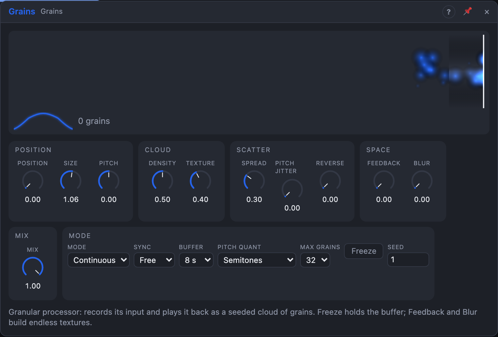

# Grains

## Introduction

Grains records its input into a buffer of a few seconds and plays it back as
many short, overlapping **grains**. Where the grains read, how long they are,
how high they play and how many there are turn any sound into shimmering
textures, stretched pads or stuttering rhythms. *Freeze* holds the buffer, so
the cloud plays on after the input has stopped. Every grain's random choices
come from *Seed*, so a texture renders the same way every time.

## How does it work?

**The buffer.** The input is recorded continuously into a stereo buffer of
*Buffer* seconds. **Position** says where grains read: 0 % is the newest
audio, 100 % the oldest. **Freeze** (the setting or the gate) stops recording;
Position then counts from the moment of the freeze, so the frozen sound stays
put. The seam where recording stopped is crossfaded, so a frozen buffer
loops cleanly.

**A grain** is a short piece of the buffer under a window. **Size** is its
length (5 ms – 2 s), **Texture** its window shape: 0 % nearly square, 25 %
trapezoid, 50 % smooth bell, 75 % narrow bell, 100 % percussive (a fast
attack and a decay). **Pitch** transposes every grain (−24 … +24 semitones);
the *Pitch* input adds 1 V per octave, so a sequencer plays the cloud
melodically. *Pitch Quant* snaps the result to semitones, octaves, or octaves
and fifths. **Reverse** is the chance that a grain plays backwards.

**How many.** In *Continuous* mode, **Density** sets the number of grains per
second, from one every two seconds to 200. Below 50 % they also come
irregularly; the middle of the knob is a smooth cloud. With a note value in
*Sync*, grains start on the song's grid instead: above 50 % Density adds
subdivisions, below it skips grid points. In *Triggered* mode each pulse at
**Trigger** starts a grain (above 50 % Density, a burst of up to 8); in
Continuous mode a pulse adds an extra grain. When the grains run into *Max
Grains*, the oldest one fades out quickly to make room. The level is
normalised to the overlap, so turning up Density or Size doesn't get louder.

**Scatter.** **Spread** gives every grain a random offset from Position (up
to ±25 % of the buffer) and a random place in the stereo field. **Pitch
Jitter** detunes each grain randomly by up to that many semitones (before
quantizing).

**Space.** **Feedback** writes the output back into the buffer with the
input (soft-clipped), building dense, evolving textures. **Blur** smears the
grains into a reverb-like wash; it sets both its level and its length (0.3 –
8 s). With Feedback, the blur's tail goes back into the buffer, so frozen pads
never end. **Mix** blends the dry input with the result.

*Grain* fires at each grain start; *Grain Env* follows the window of the
latest grain, to move something else along with the cloud.

**The view** shows the buffer (oldest on the left, the write head on the
right), the area grains read from, and each grain as a dot. Drag on it:
left/right sets Position, up/down sets Size. While frozen, **Keep frozen
buffer** saves the buffer to the media folder, so it comes back with the
board (the module then starts frozen on it); unfreezing lets it go.

## How to use it?

- **Pad from anything:** Size 400 ms, Density 60 %, Texture 50 %, Spread
  40 %, Blur 40 %. Freeze when you hear something you like.
- **Shimmer:** Pitch +12, Pitch Jitter 7 with *Octaves + fifths*, Feedback
  30 %, Blur 50 %.
- **Rhythmic stutter:** Sync 1/16, Size 60 ms, Texture 100 %, Density 50 %.
- **Melodic cloud:** a Step Sequencer's *Pitch* into *Pitch*, Pitch Quant
  Semitones.
- **Granular delay:** Position 30 %, Spread 5 %, Mix 40 %.
- **Scrubbing:** a slow LFO on Position while frozen.

## Demo patches

Five whole patches show what Grains does. In the standalone app open **File → Presets…** (⌘P) and pick *Grains* under *Demos by module*; loading one replaces the project and starts the transport.

| Patch | What it shows |
|---|---|
| **Grains: Frozen Cloud** | A slow square LFO on *Freeze* holds the buffer for a few bars at a time: one moment of a phrase becomes an endless pad. |
| **Grains: Stutter Rhythm** | *Triggered* mode synced to 1/16 chops a bass loop into a reversing, stuttering rhythm; *Position* jumps with a Random. |
| **Grains: Shimmer Leaps** | *Pitch Quant* on octaves and fifths, a little *Pitch Jitter* and *Feedback* make a halo around a slow melody. |
| **Grains: Melodic Cloud** | A sequencer drives the *Pitch* input of a noise cloud: the grains themselves play the tune. |
| **Grains: Backwards Garden** | Long, mostly reversed grains scattered by *Spread* and *Blur* into a swelling reverse wash. |

## Reference

### Knobs

| Knob | Range | Default |
|---|---|---|
| Position | 0 – 100 % | 0 % |
| Size | 5 ms – 2 s | 120 ms |
| Pitch | −24 … +24 semitones | 0 |
| Density | 0 – 100 % | 50 % |
| Texture | 0 – 100 % | 40 % |
| Spread | 0 – 100 % | 30 % |
| Pitch Jitter | 0 – 12 semitones | 0 |
| Feedback | 0 – 100 % | 0 % |
| Blur | 0 – 100 % | 0 % |
| Mix | 0 – 100 % | 100 % |
| Reverse | 0 – 100 % | 0 % |

Every knob is a modulation destination.

### Settings

| Setting | Values | Default |
|---|---|---|
| Mode | Continuous, Triggered | Continuous |
| Sync | Free, 1/4 … 1/64T | Free |
| Buffer | 2, 4, 8, 16 s | 8 s |
| Pitch Quant | Off, Semitones, Octaves, Octaves + fifths | Semitones |
| Max Grains | 16, 32, 64 | 32 |
| Freeze | Off, On | Off |
| Seed | 0 – 999 | 1 |

### Inputs

| Input | Signal | What it does |
|---|---|---|
| In L, In R | audio | recorded into the buffer; *In L* alone feeds both sides |
| Trigger | trigger | starts a grain (Triggered) or adds one (Continuous) |
| Freeze | gate | stops recording while high |
| Pitch | pitch | 1 V/oct, added to *Pitch* |

### Outputs

| Output | Signal | What it does |
|---|---|---|
| Out L, Out R | audio | dry and grains mixed by *Mix* |
| Grain | trigger | a pulse at each grain start |
| Grain Env | control | the window of the latest grain, 0 … 1 |

The buffer always holds 16 seconds (about 6 MB at 48 kHz, plus 2 MB for
Blur), so in a Voice Cell every voice has its own.
