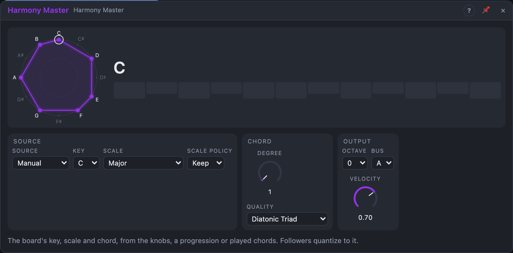

# Harmony Master

## Introduction

Harmony Master says what **key and chord** the music is in right now, for the
whole board. Modules that follow harmony (the Quantizer Suite and the Chord
Quantizer, set to the same *Bus*) quantize to it instead of their own Root and
Scale: change the chord here and every follower changes with it, on every
track of the Live set.

The chord comes from the knobs, from a **progression** that runs with the
song, or from **chords you play** into its *Notes* input. Its own outputs
carry the key, the root, the bass and the chord tones as pitches, and the
chord as notes.

## How does it work?

**Key and scale.** *Key* and *Scale* set the key. Every chord is built in it.

**Source** chooses where the chord comes from:

- **Manual:** the chord on scale degree *Degree* (1–7) with *Quality*.
  *Diatonic Triad* and *Diatonic Seventh* stack every other scale note, so
  degree 2 in C major is D minor, degree 5 with a seventh is G7. Any other
  quality (Sus4, Major 7, …) is built on the degree's note as it is. Patch a
  sequencer or a slow Random into *Degree* to walk through the key's chords.
- **Progression:** up to 16 slots, drawn in the view. Each slot has a root
  (a degree, or a fixed note C … B), a quality, an optional bass note (for
  slash chords) and a length in beats. *Advance* decides how it moves:
  *Transport* follows the song position, so loop jumps and renders always land
  on the right chord; *Trigger* moves one slot per pulse at *Next* (*Reset*
  goes back to slot 1); *Select* plays the slot the *Slot* knob points at.
  When the transport stops, the chord holds.
- **Detect:** the chord is recognised from the notes held at *Notes*. Notes
  must be stable for 30 ms, so a strummed chord counts once. The lowest note is
  the bass, so C E G A is A minor 7 over A and C6 over C. With *Latch* on the
  last chord stays when you let go; off, it falls back to the Manual chord.

**Scale Policy.** *Keep* publishes the scale as set. *Adapt* bends it to
contain the chord: in A minor, an E major chord turns the scale into A
harmonic minor while it lasts, so followers play the G♯.

**Transpose** shifts key and chord by the input, in semitones. In
Progression it takes effect at the next chord change (or Next/Reset), so a
sequencer on it changes key in time with the progression; otherwise at once.

**Bus.** The context goes to bus A, B, C or D. Followers pick the same bus.
If two Harmony Masters share a bus, the first one wins and the other shows a
warning and publishes nothing.

## How to use it?

- **One key for the whole set:** put a Harmony Master on the board, set the
  key, switch the followers' *Harmony* to *Bus A*.
- **A progression:** choose *Progression*. Click a slot to edit it, drag its
  right edge to change its length, **+** adds a slot.
- **Play the changes:** choose *Detect*, patch a MIDI input's *Notes* into
  *Notes* and play chords; the arpeggios and bass lines follow.
- **A pad that plays the chord:** patch *Notes* into a Voice Cell. Notes that
  stay in the next chord keep sounding.
- **A bass line:** *Root* or *Bass* into an oscillator; *Change* restarts its
  envelope at every chord change.

<!-- generated:demos -->
## Demo patches

Five whole patches show what Harmony Master does. In the standalone app open **File → Presets…** (⌘P) and pick *Harmony Master* under *Demos by module*; on the website, **Run in Play** opens one in your browser. Loading one replaces the project and starts the transport.

| Patch | What it shows |
|---|---|
| **Harmony Master: Four-Chord Loop** | The classic I – vi – IV – V in C major runs as a progression with the transport, four beats per chord. Tone 1 – 4 feed a soft pad and Bass a sine below. Click a slot in the view to change its chord or length, or switch Quality to Diatonic Seventh. |
| **Harmony Master: Jazz Changes** | A ii – V – I – VI progression written with fixed roots and rich qualities (minor 9, dominant 9, major 9, dominant 7♭9), one slot with a slash bass. Each change plucks the chord and the Bass output walks underneath, on a shuffle. Edit the qualities in the progression strip. |
| **Harmony Master: Rhythmic Changes** | Advance is set to Trigger: a syncopated step sequencer pulses Next, so the chord changes exactly when you want, cycling through five minor-key chords as short stabs over a pumping root bass. Try Advance Transport to hear it follow the slot lengths instead. |
| **Harmony Master: Adapting Scale** | In A minor the progression visits E major, whose G♯ is not in the scale. With Scale Policy on Adapt the published scale bends to A harmonic minor for that chord, so a Quantizer Suite following the bus plays the G♯ in its random pluck line. Switch Scale Policy to Keep and listen to the line lose it. |
| **Harmony Master: Wandering Key** | Manual source: a slow stepped Random walks the Degree knob through the Mixolydian chords while a sequencer on Transpose moves the whole key up a fourth and a fifth every few bars. Each change swells in a warm pad with a root drone below. Try Quality Diatonic Triad or another Scale. |
<!-- /generated -->

<!-- generated:presets -->
## Presets

The preset bar of the Harmony Master view has 15 factory presets. Pick one to set the knobs, then change them to taste; your own presets sit next to them.

| Preset | What it does |
|---|---|
| **C Major Home** | The board in C major on the tonic triad. |
| **A Minor Home** | A natural minor, tonic triad: a sad, simple centre. |
| **Seventh Colours** | Diatonic sevenths on the second degree: soft and jazzy. |
| **Dorian Groove** | D Dorian with a minor seventh chord. |
| **Lydian Lift** | A bright, floating Lydian centre. |
| **Phrygian Tension** | E Phrygian with a minor chord: dark and tense. |
| **Harmonic Minor Drama** | The dominant of A harmonic minor: ready to resolve. |
| **Blues Dominant** | Dominant seventh in an A blues scale. |
| **Pentatonic Open** | Open pentatonic sus2: nothing to resolve. |
| **Progression Stepper** | Plays its stored progression, moving with the song. |
| **Triggered Changes** | Steps the progression on each pulse into Next. |
| **Chord Detector** | Follows chords you play into Notes. |
| **Low Bass Root** | Fourth degree power chord, an octave down: a strong bass centre. |
| **Quartal Mood** | Stacked fourths over D Dorian for modern pads. |
| **Bus B Whole Tone** | Floating whole-tone harmony on bus B. |
<!-- /generated -->

## Reference

### Knobs

| Knob | Range | Default |
|---|---|---|
| Degree | 1 – 7 | 1 |
| Slot | 1 – 16 | 1 |
| Velocity | 1 – 100 % | 70 % |

- **Degree:** the scale degree of the chord in Manual (and in Detect with
  Latch off and nothing held).
- **Slot:** the slot that plays in Progression with *Advance* = *Select*;
  wraps round the number of slots.
- **Velocity:** the velocity of the *Notes* output.

### Settings

| Setting | Values | Default |
|---|---|---|
| Source | Manual, Progression, Detect | Manual |
| Key | C … B | C |
| Scale | the 17 scales | Major |
| Quality | Diatonic Triad, Diatonic Seventh, Unison … Major 7♯11 | Diatonic Triad |
| Advance | Transport, Trigger, Select | Transport |
| Scale Policy | Keep, Adapt | Keep |
| Latch | on / off | on |
| Octave | −3 … +3 | 0 |
| Bus | A, B, C, D | A |

### Inputs

| Input | Signal | What it does |
|---|---|---|
| Notes | notes | held notes for *Detect* |
| Next | trigger | *Trigger* advance: the next slot |
| Reset | trigger | slot 1 (*Trigger*), or the progression restarts on the next beat (*Transport*) |
| Transpose | pitch | shifts key and chord by whole semitones |

### Outputs

| Output | Signal | What it does |
|---|---|---|
| Key | pitch | the key's root (C … B = 0 … 11/12 V at Octave 0) |
| Root | pitch | the chord's root |
| Bass | pitch | the chord's lowest note, an octave below Root |
| Tone 1 … Tone 4 | pitch | the chord tones upwards from the root; triads repeat the root an octave up as Tone 4 |
| Notes | notes | the chord as notes; common tones held across changes |
| Change | trigger | a pulse at every chord change |
| Degree | control, 0 – 1 | (degree − 1) / 6; 0 when the root is not in the scale |
