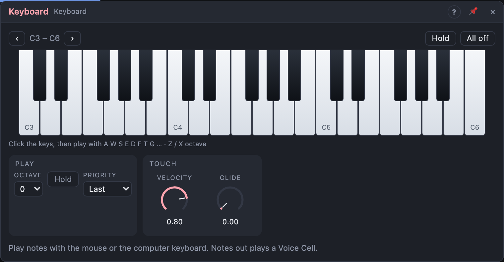

# Keyboard

## Introduction

The Keyboard is a **piano keyboard on the board**. Play it with the mouse, a
finger or your computer keyboard to try a sound without reaching for a MIDI
controller. Its *Notes* output plays a Voice Cell directly; *Pitch* and
*Gate* play a single oscillator and envelope.

## How does it work?

**Mouse and touch.** Press a key to play it; drag across the keys for a
glissando.

**Computer keyboard.** Click the keys once, then play: the row
**A S D F G H J K L** holds the white keys from C, the row above
(**W E T Y U O P**) the black ones, like a piano. **Z** and **X** move down and
up an octave. It goes by the keys' positions, so any keyboard layout works.

**Octave** (or the ‹ › buttons) chooses which three octaves the keys show.
**Velocity** sets how hard every key is played.

**Hold** latches keys: a click starts a note and it keeps playing until you
click it again. Switch *Hold* off, or press **All off**, to end them.

*Notes* sends every key you play, so a Voice Cell plays chords. *Pitch*,
*Gate*, *Velocity* and *Trigger* follow one note at a time, chosen by
**Priority** (the last key pressed, the lowest, the highest or the first),
and fall back to a key still held when you let go. **Glide** slides *Pitch*
from note to note.

## How to use it?

- **Try a synth:** *Notes* into a Voice Cell's **Notes**; the cell's output to
  Audio Out. Hold a few keys for a chord.
- **A mono synth without a cell:** *Pitch* into an Oscillator's **Pitch**,
  *Gate* into an ADSR, the ADSR onto a VCA. Raise *Glide* for slides.
- **A drone:** switch on *Hold* and click a few keys.

<!-- generated:demos -->
## Demo patches

Five whole patches show what Keyboard does. In the standalone app open **File → Presets…** (⌘P) and pick *Keyboard* under *Demos by module*; on the website, **Run in Play** opens one in your browser. Loading one replaces the project and starts the transport.

| Patch | What it shows |
|---|---|
| **Keyboard: Transposing Keys** | A pentatonic riff loops by itself; the Keyboard's Pitch output goes to the sequencer's Transpose input, so playing a key moves the whole riff to that note. Change Octave to shift the range of the keys, or Priority to choose which key wins when you hold several. |
| **Keyboard: Glide Lead** | A soft bell arpeggio plays underneath; the Keyboard's Pitch and Gate drive a separate saw lead, and Glide is set to 0.25 s so notes slide into each other as you play. Raise Glide for slower portamento or bring it to 0 for clean steps. |
| **Keyboard: Mallet Layer** | A bass loop plays alone until you press keys: the Keyboard's Pitch, Trigger and Velocity strike a marimba-like Modal Voice, so harder Velocity makes brighter hits. Try the Velocity knob, or play a run down the keys. |
| **Keyboard: Latched Arp** | The Keyboard's Notes output feeds an Arpeggiator set to Latch: a bass line and beat run alone until you press a few keys, and when you let go they keep arpeggiating until you press a new chord. Change the Arpeggiator's Pattern or Octaves to hear the same keys differently. |
| **Keyboard: Hold Drone** | Hold is on and Priority is Lowest, so the keys you click stay down and the lowest one sets a slow drone under a gentle bell melody. Click the same key again to release it, or press All off to clear the keys. |
<!-- /generated -->

## Reference

### Knobs

| Knob | Range | Default |
|---|---|---|
| Velocity | 1 – 100 % | 80 % |
| Glide | 0 – 2 s | 0 s |

Every knob is a modulation destination.

### Settings

| Setting | Values | Default |
|---|---|---|
| Octave | −3 – +3 | 0 (C3 – C6) |
| Priority | Last, Lowest, Highest, First | Last |
| Hold | Off, On | Off |

### Outputs

| Output | Signal | What it does |
|---|---|---|
| Notes | notes | every key played |
| Pitch | pitch | the active key, 1 V/oct |
| Gate | gate | high while any key is held |
| Velocity | control | the active key's velocity |
| Trigger | trigger | a pulse each time the active key changes |
