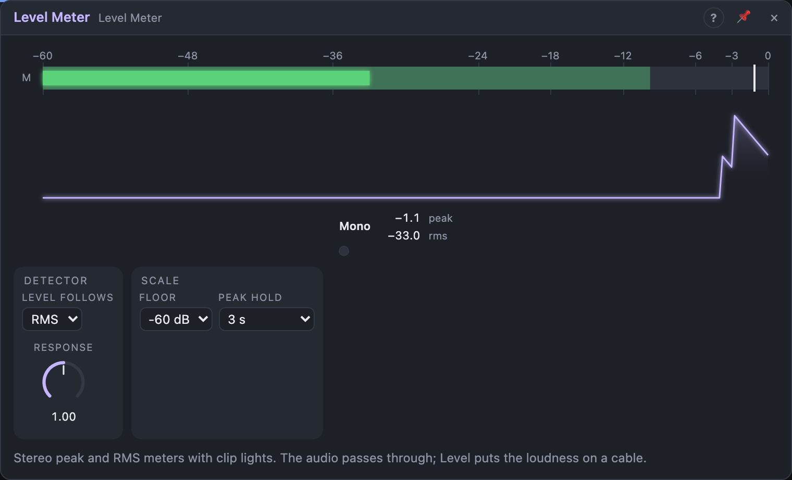

# Level Meter

## Introduction

The Level Meter shows **how loud a signal is**: a bar per channel for the
peak and the average (RMS) level, a peak-hold line and a clip light. Put it
anywhere in an audio path: the audio passes through unchanged, so it can sit
between a mixer and an output, or hang off a cable on the side.

Its *Level* output turns the loudness into a control signal, so a sound can
move other things: an envelope follower.

## How does it work?

Open the meter's view to see the bars. The bright part of each bar is the
**RMS** level (roughly how loud it sounds), the pale part above it the
**peak** level (the highest sample). The thin line is the **peak hold**; the
numbers below show the held peak and the RMS level in dB.

The **clip light** turns red when a sample goes over 0 dBFS, the point where
the signal would distort on its way out of the computer, and stays red until
you click it (or the meter).

With only *In L* patched, the meter shows one mono bar.

**Response** sets how quickly the RMS level and the *Level* output follow
the signal: short for punchy drums, long for a smooth average. **Floor** is
the bottom of the scale: everything quieter shows as empty and gives 0 on
*Level*. **Level Follows** picks what *Level* tracks: RMS (smooth) or Peak
(fast attack, falling over *Response*). **Peak Hold** is how long the hold
line stays up.

## How to use it?

- **Check the mix:** put it before an *Audio Out* and keep the RMS around
  −18 dB to −12 dB with the peaks below 0.
- **Ducking:** a kick's *Out* into the meter, *Level* into a VCA's *Gain*
  with a negative cable amount: the pad ducks under the kick.
- **Loudness to brightness:** *Level* into a Multi Filter's **Cutoff**, so
  louder playing opens the filter.
- **Watch the output:** leave one before the last *Audio Out* with Peak Hold
  at *Until Reset*: the hold line and the clip light tell you afterwards if
  anything overloaded while you weren't looking.

<!-- generated:demos -->
## Demo patches

Five whole patches show what Level Meter does. In the standalone app open **File → Presets…** (⌘P) and pick *Level Meter* under *Demos by module*; on the website, **Run in Play** opens one in your browser. Loading one replaces the project and starts the transport.

| Patch | What it shows |
|---|---|
| **Level Meter: Master Check** | A small band passes through a Level Meter on its way to the output: watch the RMS bars dance and the peak marks stop at the top of each hit, with the clip lights staying dark. Turn the band's mixer up until a clip light shows, then back off. |
| **Level Meter: Level Ducks the Pad** | The drums run through a Level Meter whose Level output, inverted, pulls the pad's volume down on every kick: a sidechain pump made from a meter. Raise Response for slower, wider pumping, or turn the cable amount down for a gentler duck. |
| **Level Meter: Loudness Opens the Filter** | The loudness of a drum loop, read by the Level Meter's Level output, opens the filter of a saw bass: loud passages sound bright, quiet ones muffled, like an envelope follower. Change Response for smoother or twitchier brightness. |
| **Level Meter: Before and After** | Two Level Meters sit either side of a Compressor: the first shows the raw band, the second what is left after the squeeze, so you can see the dynamics shrink. Drop the Compressor's Threshold and watch the second meter's peaks come down. |
| **Level Meter: Watching a Tail Fade** | Sparse bell notes ring into a long reverb, and a Level Meter with its Floor at minus 96 dB lets you watch the tail die away to nothing, long after the notes are gone. Change Floor to minus 24 dB to see how much of the tail the meter hides. |
<!-- /generated -->

## Reference

### Knobs

| Knob | Range | Default |
|---|---|---|
| Response | 10 ms – 2 s | 300 ms |

Every knob is a modulation destination.

### Settings

| Setting | Values | Default |
|---|---|---|
| Floor | −24, −36, −48, −60, −72, −96 dB | −60 dB |
| Level Follows | RMS, Peak | RMS |
| Peak Hold | Off, 1 s, 3 s, Until Reset | 3 s |

### Inputs

| Input | Signal | What it does |
|---|---|---|
| In L | audio | left channel, or mono |
| In R | audio | right channel; unpatched, it follows *In L* |

### Outputs

| Output | Signal | What it does |
|---|---|---|
| Out L, Out R | audio | the inputs, unchanged |
| Level | control | 0 at *Floor* and below, 1 at 0 dBFS, on a dB scale; the louder channel |
| Clip | gate | high while a sample goes over 0 dBFS, and 50 ms after |
