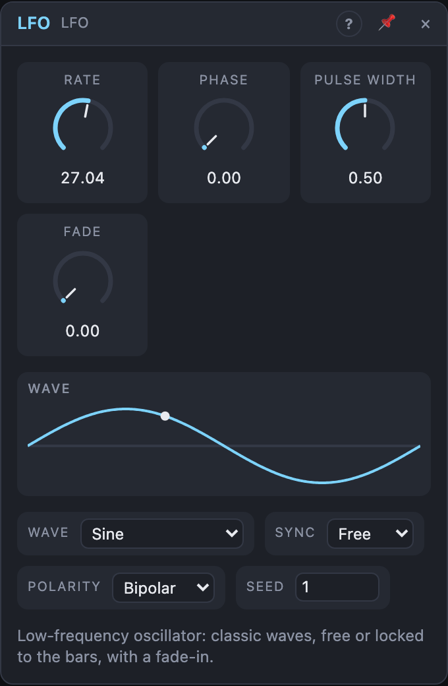

# LFO

## Introduction

The LFO is a **low-frequency oscillator**: it moves up and down by itself,
slower than you can hear, and makes whatever it's patched into move with it.
Patch it onto a filter's cutoff for a sweep, onto an oscillator's pitch for
vibrato, or onto a VCA's gain for tremolo.

Pick a wave, set the speed, done. It can run freely or lock to a clock or the song's tempo.

## How does it work?

**Speed.** *Sync* chooses what times the cycle:

- **Free:** *Rate* sets the speed in Hz.
- **Clock:** the cycle follows the pulses at the *Clock* input, phase-locked.
  *Rate* is a note value (1/64 … 16 bars, with dotted and triplet values) and a
  pulse counts as a 1/16 step, as for the sequencers. A *Clock* that stops
  holds the wave in place.
- **Tempo:** *Rate* is a note value and one cycle takes exactly that long. While
  the transport plays, the LFO follows the song position: it's always at the
  same point of its wave at the same bar, even after a loop jump, and renders
  the same every time. When the transport is stopped it keeps running at the
  synced speed.

**Waves.** *Wave* chooses what *Out* plays:

- **Sine** and **Triangle**: smooth up and down. Both start at the middle,
  rising.
- **Saw Up** / **Saw Down**: a ramp that jumps back at the end of each cycle.
- **Square**: high, then low. *Width* sets how much of the cycle is high (it only shows for this wave).
- **Random Step**: a new random value each cycle, held until the next.
- **Random Smooth**: glides from one random value to the next.

There is a single output, *Out*. For two waves at once, use two LFOs.

**Shape.** Three small knobs change the character of every wave:

- **Morph** (12 o'clock is the plain wave) bends each wave its own way: Sine and
  Triangle square up (right) or soften towards a triangle or spikes (left); the
  saws turn convex or concave; Square rounds its edges (right) or splits into
  2–4 pulses (left); Random Step glides (right) or steps through fewer levels
  (left); Random Smooth eases like a step (right) or runs straight (left).
- **Skew** moves the peak of the cycle: a triangle becomes a ramp at the ends.
- **Curve** bends the wave towards exponential (up) or logarithmic (down).

**Phase** shifts the wave within its cycle. **Polarity** chooses between
*Bipolar* (−1 … +1, moves both ways around the knob) and *Unipolar* (0 … 1, only
upwards). Random values repeat on every render.

**Reset and Fade.** A trigger at *Reset* restarts the cycle (on a free-running
LFO) and the fade-in. With *Fade* above 0, the output starts at 0 and grows to
full over that time after each Reset and each time the transport starts.

## How to use it?

- **Filter sweep:** *Out* onto a Multi Filter's **Cutoff**; set the cable's
  amount for the depth.
- **Vibrato in a Voice Cell:** put the LFO inside the cell, *Out* onto the
  oscillator's **Pitch** knob with a small amount, *Voice In › Trigger* into
  *Reset*, and set *Fade* to half a second: each note starts straight and
  then begins to wobble.
- **Rhythmic movement:** set *Sync* to Tempo, *Rate* to 1/8 and *Wave* to *Square* onto a VCA's
  gain for a tempo-locked chop.
- **Two related movements:** use two LFOs with *Phase* 0° and 90° for circular stereo movement.
- **Wobbling the wobble:** patch another LFO onto **Rate**.
- **Clocking other modules:** a *Square* LFO with a small *Width* onto a
  sequencer's *Clock* or an envelope's *Gate* gives a pulse at every cycle.

<!-- generated:presets -->
## Presets

The preset bar of the LFO view has 20 factory presets. Pick one to set the knobs, then change them to taste; your own presets sit next to them.

| Preset | What it does |
|---|---|
| **Gentle Sine** | Slow sine for subtle filter or pitch drift. |
| **Vibrato** | Classic vibrato speed that fades in after the note starts. |
| **Tremolo** | Unipolar triangle for amplitude tremolo. |
| **Beat Pump** | Falling ramp locked to the beat: sidechain-like ducking. |
| **Eighth Chop** | Square gate on every eighth for rhythmic chopping. |
| **Slow Sweep** | A 20-second triangle for long filter sweeps. |
| **Rising Saw** | Ramp that climbs over two bars and snaps back. |
| **Sample and Hold** | Random stepped values, a classic sample-and-hold. |
| **Smooth Random** | Wandering smooth random for organic movement. |
| **Narrow Pulse** | Thin pulse for staccato jumps. |
| **Wide Slow Tide** | A four-bar sine swell locked to the song. |
| **Triplet Feel Wobble** | Fast synced triangle for shimmering wobble. |
| **Offset Sine** | Sine starting at its peak: pair with another LFO for quadrature. |
| **Fast Flutter** | Tape-like flutter, best used very lightly. |
| **Wild Random** | Fast random jitter for glitchy modulation. |
| **Ramp from Triangle** | Skew pushes the triangle's peak to the end: a rising ramp. |
| **Exponential Sine** | Curve bends the sine towards exponential: slow start, fast finish. |
| **Soft Square** | Morph rounds the edges of the square into a trapezoid. |
| **Dotted Eighth** | A triangle locked to a dotted eighth. |
| **Triplet Pulse** | Square gate on eighth-note triplets. |
<!-- /generated -->

<!-- generated:demos -->
## Demo patches

Five whole patches show what LFO does. In the standalone app open **File → Presets…** (⌘P) and pick *LFO* under *Demos by module*; on the website, **Run in Play** opens one in your browser. Loading one replaces the project and starts the transport.

| Patch | What it shows |
|---|---|
| **LFO: Vibrato and Tremolo** | One slow LFO gently bends the pitch of a held lead and a second one swells its volume; Fade lets the vibrato arrive only after the note has settled. Raise the vibrato Rate or the cable amounts, or move Fade to zero. |
| **LFO: Synced Wobble** | A triangle LFO locked to eighth notes sweeps the low-pass filter of a bass line, a classic wobble that stays in time with the drums. Change Rate for a slower or faster wobble, switch Wave from Triangle to Square, or raise Resonance. |
| **LFO: Random Steps** | The LFO's Random Step wave picks a new level every sixteenth and sends it to the filter, so a repeating line is coloured differently on each step, always the same way. Switch Wave to Random Smooth for a gliding version. |
| **LFO: Auto Pan** | Two LFOs, half a cycle apart through Phase, raise and lower the left and right volume of a pad in opposite directions, so it travels across the stereo field. Change Rate, or set both Phase values the same to hear it collapse to a plain tremolo. |
| **LFO: Gate Chopper** | A square LFO locked to sixteenths chops a held pad into a rhythmic gate, and its rising edge also triggers the hi-hat on every pulse. Move Width to make the chops shorter or longer, or change Rate for another pattern. |
<!-- /generated -->

## Reference

### Knobs

| Knob | Range | Default |
|---|---|---|
| Rate | 0.01 – 50 Hz | 1 Hz |
| Phase | 0 – 360° | 0° |
| Pulse Width | 5 – 95 % | 50 % |
| Fade | 0 – 10 s | 0 s |

Every knob is a modulation destination.

### Settings

| Setting | Values | Default |
|---|---|---|
| Wave | Sine, Triangle, Saw Up, Saw Down, Square, Random Step, Random Smooth | Sine |
| Sync | Free, 1/32, 1/16, 1/8, 1/4, 1/2, 1 bar, 2 bars, 4 bars, 8 bars | Free |
| Polarity | Bipolar, Unipolar | Bipolar |
| Seed | 0 – 999 | 1 |

### Inputs

| Input | Signal | What it does |
|---|---|---|
| Reset | trigger | restarts the cycle (free-running) and the fade-in |
| Clock | trigger | the pulses a Clock-synced LFO follows (a pulse is a 1/16 step) |

### Outputs

| Output | Signal | What it does |
|---|---|---|
| Out | control | the wave chosen in *Wave* |
