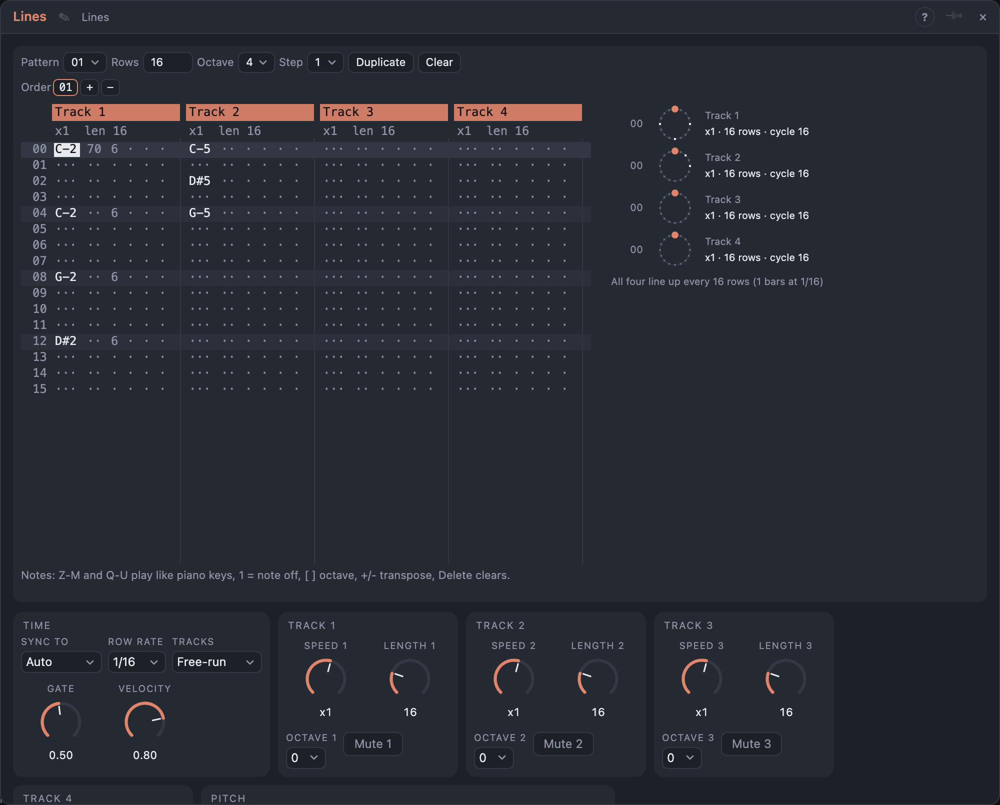

# Lines

## Introduction

Lines is a text tracker with **four tracks**. You type rows of notes on the
computer keyboard; each row can also carry a velocity, a gate length and one
**effect**: retrigger, slide, probability, transpose, jump or skip. Patterns of
16–64 rows are chained by an **order list**.

What makes it different is that **every track has its own speed and length**.
Track 1 may run 16 rows at normal speed while track 2 runs 5 rows at 3/2 speed
and track 3 runs 7 rows at half speed. They start together and slowly drift
apart, then meet again; the drift panel next to the grid shows where every
track is and after how many rows all four line up.

Each track has its own *Notes*, *Pitch*, *Gate* and *Velocity* outputs, so four
voices can play from one module.

## How does it work?

**Rows and time.** One *Row Rate* step (default 1/16) is one master row. With
nothing in *Clock* the rows follow the transport, so Lines stays on the bars and
lands right after a loop jump; with a trigger in *Clock* each pulse is one row.
*Reset* makes the next row row 0.

**Speed and length.** Track *k* plays rows at its *Speed* (¼ … ×4 of the master
rows) and wraps after its *Length* rows (never longer than the pattern). Because
the speeds and lengths differ, the tracks drift. *Tracks* decides what a new
pattern does: **Free-run** lets every track keep counting through the order list,
so the drift carries on across patterns; **Per pattern** restarts all tracks
at row 0 whenever a pattern starts.

**Cells.** A cell has five columns:
- **Note**: a pitch, or `===` which ends the note.
- **Velocity** 00–7F (hex); 00 uses the *Velocity* setting.
- **Gate** 1–F: the note's length in eighths of a row (8 is a whole row, F almost
  two); 0 uses the *Gate* setting. Notes shorter than a row leave a gap; longer
  ones play into the next row.
- **Effect** letter and a two-digit hex parameter.

An empty cell does nothing: the previous note keeps its own gate.

**Effects.**

| Effect | Parameter | What it does |
|---|---|---|
| R retrigger | 02 – 10 | plays the note that many times inside the row |
| S slide | 00 – FF | ties into the note: the new note starts before the old one ends (a Voice Cell in legato mode glides), and *Pitch* glides over up to four rows |
| P probability | 00 – FF | the cell plays with chance parameter / 255; otherwise nothing happens |
| T transpose | 00 – 7F up, 80 – FF down (FF = −1) | shifts this note by semitones |
| J jump | row | the track's next row is this row |
| K skip | count | the track leaves out that many rows after this one |

**Pitch.** Cells hold MIDI notes. *Octave 1…4* shifts a track by octaves and
*Transpose* moves everything. With *Quantize* on, notes snap to *Scale*, or to
a Harmony Master's key and scale when *Harmony* is set.

**Order and patterns.** The order list plays its patterns one after another
and starts over; *Pattern* fires at every change and *End* when the list
restarts. A pattern's row count (16–64) sets how long it lasts.

## How to use it?

- **Typing notes:** click a cell, then play the keys: Z S X D C V G B H N J M are one
  octave (C … B), Q 2 W 3 E R 5 T 6 Y 7 U the next one. `[` and `]` change the
  octave. `1` types a note off. *Step* sets how many rows the cursor moves down after
  each entry.
- **Moving:** arrows, Tab (next track), Page Up/Down (16 rows), Home/End. A click selects
  a cell directly.
- **Editing:** Delete clears the field, Shift + Delete the whole cell. `+` and `-`
  transpose the note under the cursor (Shift: octaves). Enter inserts a row in the
  current track and moves the rest down; Shift + Enter removes it.
- **Hex fields:** type the digits; velocity takes two, the effect parameter two, the gate one.
- **Muting:** click a track's header.
- **Drifting patterns:** give tracks lengths such as 16, 12, 9 and 7 and watch the
  drift panel. Odd speeds like ×2/3 slow a track against the others.
- **Patterns:** *Duplicate* copies the pattern into the next empty one; *+* adds the
  shown pattern to the order list after the selected entry, right-click on an entry
  removes it.

<!-- generated:demos -->
## Demo patches

Five whole patches show what Lines does. In the standalone app open **File → Presets…** (⌘P) and pick *Lines* under *Demos by module*; on the website, **Run in Play** opens one in your browser. Loading one replaces the project and starts the transport.

| Patch | What it shows |
|---|---|
| **Lines: Drifting Four** | Four lines of 16, 5, 7 and 9 rows start together and slide against each other, so the bass, a lead, an arp and a stab only meet again after 5040 rows. The drift panel in the view shows each track's place. Change a track's Length or Speed to move the meeting point. |
| **Lines: Ratchet and Slide** | A bass line that uses the effect column: slide cells tie notes together with a glide and retrigger cells split a row into quick repeats. A second track answers with probability cells, so it never plays quite the same bar. Edit the Fx column in the view. |
| **Lines: Odd Speeds** | The same twelve-row length on four tracks, but at speeds of one, two thirds, three halves and three quarters: the tracks stay in a simple ratio and phase slowly against each other, like gears. Change one Speed and the whole weave shifts. |
| **Lines: Order of Three** | Three patterns of 16, 16 and 32 rows run in an order list: a verse, a verse with a new bass note, and a long answer. Tracks restart with each pattern here (Tracks: Per pattern), so every section begins together; switch it to Free-run and the drift carries on. |
| **Lines: Chords from Three Tracks** | Tracks 1 to 3 each hold one voice of a chord at different lengths and speeds, and all three Notes outputs play one polyphonic Voice Cell: the harmony shifts as the three tracks drift. Track 4 adds a quiet high bell. Try the Quantize setting with another Scale. |
<!-- /generated -->

<!-- generated:presets -->
## Presets

The preset bar of the Lines view has 16 factory presets. Pick one to set the knobs, then change them to taste; your own presets sit next to them.

| Preset | What it does |
|---|---|
| **Drifting Four** | Four lines of 16, 5, 7 and 9 rows slide against each other. |
| **Locked Lines** | All tracks the same length: a plain four-part pattern. |
| **Double and Half** | Bass at half speed, a line at double, one at normal. |
| **Thirds and Fifths** | Same length, speeds in simple ratios: a slow phase shift. |
| **Ratchet Row** | Retrigger effects fill rows with quick repeats. |
| **Slide Line** | Slide cells tie notes together with a glide. |
| **Maybe Melody** | Every note carries a probability, so the tune varies. |
| **Transposed Echo** | Track 2 plays track 1's notes shifted by an effect column. |
| **Jump Around** | Jump and skip effects make the row order unpredictable. |
| **Two Patterns** | An order of two patterns: verse and variation. |
| **Per-Pattern Restart** | Tracks restart with each pattern instead of drifting on. |
| **Long Thirty-Two** | Four slow lines of 32, 24, 20 and 28 rows: very long drift. |
| **Octave Layers** | One motif on three tracks, an octave apart and at two speeds. |
| **Gate Lengths** | The gate column from a short tick to nearly two rows. |
| **Scale-Snapped Run** | Plain chromatic notes pulled into the scale on playing. |
| **Row Jumper** | Short loops at odd speeds: fast cells over a slow base. |
<!-- /generated -->

## Reference

### Knobs

| Knob | Range | Default |
|---|---|---|
| Gate | 5 – 100 % of a row | 50 % |
| Velocity | 5 – 100 % | 80 % |
| Speed 1 … 4 | x1/4, x1/3, x1/2, x2/3, x3/4, x1, x3/2, x2, x3, x4 | x1 |
| Length 1 … 4 | 1 – 64 rows | 16 |

Every knob is a modulation destination; Speed and Length are stepped knobs.

### Settings

| Setting | Values | Default |
|---|---|---|
| Row Rate | 1/1 … 1/32, dotted and triplet | 1/16 |
| Tracks | Free-run, Per pattern | Free-run |
| Octave 1 … 4 | −3 … +3 | 0 |
| Mute 1 … 4 | off, on | off |
| Root | C … B | C |
| Scale | the Step Sequencer's scales | Natural Minor |
| Quantize | Off, To scale | Off |
| Harmony | Off, Bus A … Bus D | Off |
| Seed | 0 – 999 | 1 |
| Sync To | Auto, Clock, Transport | Auto |

### Inputs

| Input | Signal | What it does |
|---|---|---|
| Clock | trigger | each pulse is one row |
| Reset | trigger | the next row is row 0; ends all notes |
| Transpose | pitch | added to every note (1 V/oct) |

### Outputs

| Output | Signal | What it does |
|---|---|---|
| Notes 1 … 4 | notes | the track's notes |
| Pitch 1 … 4 | pitch | the track's latest note; glides with a slide |
| Gate 1 … 4 | gate | high while the track's note sounds, a short dip at a retrigger |
| Velocity 1 … 4 | control, 0 – 1 | velocity of the track's latest note |
| Pattern | trigger | a pulse whenever a new pattern starts |
| End | trigger | a pulse when the order list starts over |
| Row | control, 0 – 1 | where the master row is inside the pattern |
