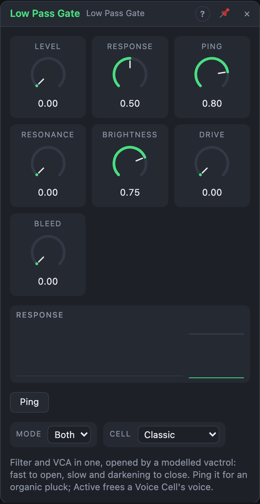

# Low Pass Gate

## Introduction

A low pass gate is a filter and an amplifier in one, opened by light. Inside
sits a model of a **vactrol**: a lamp shining on a light-sensitive resistor.
When the light comes on, the gate opens almost at once. When it goes out, the
gate closes slowly and unevenly, getting darker as it gets quieter. That is how
struck and plucked things die away, so one trigger at *Ping* gives a natural,
organic pluck without any envelope.

It is stereo and cheap, and its *Active* output makes it a good last stage in
every voice of a Voice Cell.

## How does it work?

The light is *Level* plus the *CV* input (together clipped to 0 – 100 %), plus
a short flash from every *Ping*. The cell follows the light:

- **Opening** is fast: a few milliseconds.
- **Closing** is slow, and it gets slower as the cell darkens. The first half
  of the decay goes quickly, the quiet tail lingers.
- **Memory:** after a long, bright gate the cell closes more slowly than after
  a short ping, as a real photoresistor does.

The cell's openness (shown on the *Light* output) drives a low-pass filter and
a gain together. As the gate closes, the sound gets both quieter and darker.
The cutoff rises quickly at the start of a pluck and lingers in the low range
as it fades.

A *Ping* is a 2 ms flash of light. A full ping with the *Classic* cell opens
the gate to about half and fades to silence (−60 dB) in about 0.6 s. A ping on
a gate that is still open adds to it instead of restarting it, so fast rolls
swell like a real struck object.

## How to use it?

- **Pluck:** Oscillator → *In L*; a trigger (a sequencer, a clock) → *Ping*.
  *Out L/R* to the output. Turn **Response** to make the plucks shorter or
  longer.
- **In a Voice Cell:** *Voice In › Trigger* → *Ping*, *Voice In › Velocity* →
  *Velocity*, *Out L/R* → *Voice Out*, and *Active* → *Voice Out › Active*.
  The cell then frees each voice exactly when its pluck has faded.
- **Held notes:** also patch *Voice In › Gate* → *CV*. The gate opens the cell,
  and the release is the cell's own slow fall.
- **Envelope for other modules:** *Light* is a ready-made pluck envelope:
  patch it onto a wavefolder's fold or a filter's cutoff so louder plucks are
  brighter, too.
- **Ping button:** fires a manual ping, for trying out *Response* and *Cell*.

<!-- generated:demos -->
## Demo patches

Five whole patches show what Low Pass Gate does. In the standalone app open **File → Presets…** (⌘P) and pick *Low Pass Gate* under *Demos by module*; on the website, **Run in Play** opens one in your browser. Loading one replaces the project and starts the transport.

| Patch | What it shows |
|---|---|
| **Low Pass Gate: Pentatonic Pings** | A saw oscillator is pinged by a pentatonic sequence through the gate's Classic cell: each note opens fast and darkens as it dies, like a struck wooden bar. Turn Response for shorter or longer plucks and Resonance for more ring. |
| **Low Pass Gate: Slow Memory Bass** | The Slow memory cell remembers earlier pings, so a sub-heavy bass line opens a little more with each note that follows another quickly. Switch Cell to Fast to hear it forget. |
| **Low Pass Gate: Vactrol Drums** | Three gates ping from a Drum Grid: a low sine for the kick, noise for the snare and a bright square for the ticks. Everything is the gate's own pluck envelope; Response sets how tight the drums are. |
| **Low Pass Gate: Light Follower** | The gate's Light output, a ready-made pluck envelope, opens a Multi Filter on a drone, so a quiet saw pad brightens with each ping and dims again. Change Response to stretch the glow. |
| **Low Pass Gate: Breathing Chord** | A slow LFO on the CV input opens and closes the gate over a held saw chord, with the Slow memory cell smoothing every swell into a breathing, darker-as-it-closes pad. Lower Brightness or add Resonance to change the colour. |
<!-- /generated -->

<!-- generated:presets -->
## Presets

The preset bar of the Low Pass Gate view has 13 factory presets. Pick one to set the knobs, then change them to taste; your own presets sit next to them.

| Preset | What it does |
|---|---|
| **Classic Pluck** | Ping it with a trigger for a natural, darkening pluck. |
| **Short Blip** | Tight, percussive blips for rhythmic lines. |
| **Bongo Tone** | Short resonant knock: good on sine and triangle. |
| **Soft Mallet** | Rounded, mellow hit. |
| **Long Decay** | Slow, ringing close with a long dark tail. |
| **Dark Pad Gate** | Slow swells and fades from a CV. |
| **Filter Only** | Just the low-pass: a vactrol-style filter on a steady tone. |
| **VCA Only** | Just the amplitude gate with vactrol smoothing. |
| **Resonant Ping** | Resonance gives the pluck a vocal, ringing pitch. |
| **Driven Hit** | Saturated, punchy attack. |
| **Leaky Gate** | Never fully closes: a muffled signal always leaks through. |
| **Open Bright** | Mostly open and bright, nudged by CV. |
| **Slow Memory Pluck** | The vactrol remembers earlier hits, so fast repeats bloom. |
<!-- /generated -->

## Reference

### Knobs and settings

| Control | Range | Default |
|---|---|---|
| Level | 0 – 100 % | 0 % |
| Response | 0 – 100 % | 50 % |
| Ping | 0 – 100 % | 80 % |
| Resonance | 0 – 100 % | 0 % |
| Brightness | 0 – 100 % | 75 % |
| Drive | 0 – 100 % | 0 % |
| Bleed | 0 – 100 % | 0 % |
| Mode | LP, VCA, Both | Both |
| Cell | Fast, Classic, Slow memory | Classic |

- **Level:** constant light, added to *CV*. At 0 % the gate is closed until
  something opens it; at 100 % it is fully open.
- **Response:** the speed of the cell. Every time constant is scaled from
  0.25× (0 %, snappy) through 1× (50 %) to 4× (100 %, slow and ringing).
- **Ping:** the strength of the flash on each *Ping* pulse (times *Velocity*).
- **Resonance:** emphasis at the cutoff (Q 0.5 – 6), in *LP* and *Both*.
  *Both* turns the level down a little as the resonance rises.
- **Brightness:** the cutoff when fully open, 1 kHz – 20 kHz.
- **Drive:** soft saturation of the input before the gate, for warmth on loud
  plucks. It is anti-aliased, so it stays clean on high notes.
- **Bleed:** how much the closed gate leaks. At 100 % the dark state still
  passes a muffled −24 dB.
- **Mode:**
  - *LP:* only the filter. Closed, it still passes the lowest bass (30 Hz).
  - *VCA:* only the amplifier, no change in tone.
  - *Both:* filter and amplifier together: the classic low pass gate.
- **Cell:** the character of the vactrol. *Fast* is short and snappy,
  *Classic* is the familiar bright-then-dark pluck, *Slow memory* has long,
  lingering tails that grow after long notes.

Every knob is a modulation destination: patch a cable onto it to move it.

### Inputs

| Input | Signal | What it does |
|---|---|---|
| In L | audio | left input; also feeds the right channel when *In R* is unpatched |
| In R | audio | right input |
| CV | control, 0 – 1 | the light driving the cell, added to *Level* |
| Ping | trigger | a short flash of light: a pluck |
| Velocity | control, 0 – 1 | scales the next ping; unpatched counts as 1 |

### Outputs

| Output | Signal | What it does |
|---|---|---|
| Out L, Out R | audio | the gated signal |
| Light | control, 0 – 1 | the cell's openness: a pluck envelope for other modules |
| Active | gate | high while the cell is open or the output is still audible; falls 50 ms after it goes quiet |
