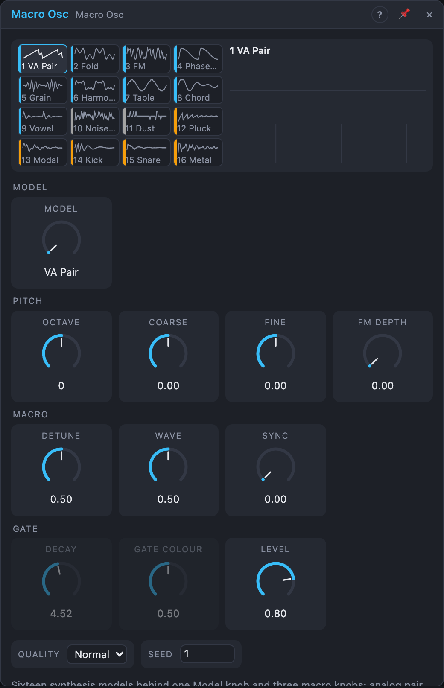

# Macro Osc

## Introduction

The Macro Osc is sixteen synthesis models behind one *Model* knob. Every
model is played with the same three macro knobs, *Tone*, *Shape* and
*Blend*: they stay where they are on the panel, but change their meaning
(and their label) with the model. One patch can move from a detuned analog
pair to FM, a sung vowel, a plucked string or a snare by turning one knob or
by sending it a cable.

Each model also has a second voice on *Aux*: the other oscillator, the
modulator, the root of a chord, the noise of a snare. And a *Trigger* input
with a built-in decay envelope and low-pass gate turns any model into a
struck, percussive sound without extra modules.

It is a sketching tool and a compact voice for Voice Cells. The dedicated
oscillators (Dual Osc, Wavefolder, Formant Osc, Additive Osc, Wavetable Osc,
Chord Osc, Resonator, Perc Voice) go deeper into one technique each; several
Macro Osc models are smaller versions of their cores.

## How does it work?

**Pitch.** The frequency is C4 × 2^(Octave + Coarse/12 + Fine/1200 + Pitch),
kept between 1 Hz and 0.45 × the sample rate. The *FM* input is linear and
through-zero, as on the Oscillator: f × (1 + 4 × FM Depth × FM), so at 100 %
a ±1 signal swings the frequency by ±4×. For the noise models the pitch is
the centre of their filter, for the drums the body pitch (C4 is a mid tom,
*Octave* −2 a kick). On the models without a playable pitch (Noise Band,
Dust, Kick, Snare, Metal) the *FM* input moves *Tone* instead (FM Depth 100 %
and a +1 signal = the whole knob).

**Changing models.** *Model* is a stepped knob: modulation snaps to the
nearest model. A change crossfades over 5 ms, both models running, so a
Step Sequencer or a Random can play the models like notes without clicks. A
change asked for during a fade follows when the fade ends. Every model keeps
its state while another one plays, so a ringing string carries on when you
come back to it. Only the selected model (and, for 5 ms, the previous one)
uses CPU.

**Trigger, envelope and gate.**

- *Trigger unpatched:* the pitched and noise models sound continuously,
  *Decay* and *Gate Colour* do nothing and *Env* is 0. *Pluck* and *Modal*
  are excited by a quiet stream of noise instead of a strike: bowed, blown,
  singing. *Kick*, *Snare* and *Metal* are silent (the view says so).
- *Trigger patched:* each trigger lifts the envelope to *Accent* (unpatched:
  1) in 0.5 ms, then it falls to −60 dB in *Decay*. *Env* outputs it. Out and
  Aux of models 1–11 go through a low-pass gate: a VCA and a 2-pole low-pass
  in series, both following the envelope (smoothed by 3 ms, so the gate
  closes with a soft tail). *Gate Colour* 0 % is a plain VCA (cubic), 100 %
  a pure filter sweep from 20 kHz down to 20 Hz, 50 % both.
- The struck models (*Pluck*, *Modal*, *Kick*, *Snare*, *Metal*) are hit by
  the trigger with strength *Accent* and decay with *Decay* themselves; the
  gate is not applied to them. A new hit adds energy to what is still
  ringing instead of restarting it, so fast rolls build up. The drums read
  *Tone* at the moment of the hit, so a moving knob doesn't smear a hit.

**Noise and Seed.** All noise is seeded from *Seed* and, inside a Voice
Cell, the voice number: renders repeat exactly, and every voice sounds a
little different. It is reseeded when the transport starts.

**Quality.** *Eco* runs everything at the sample rate and Modal with 8 modes.
*Normal* runs Fold, FM and Phase Warp at 2× and the band-limited oscillators
(VA Pair, Chord, the Vowel's glottis) at 4×, with 16 modes. *High* runs the
oversampled models at 4× and Modal with 24 modes. At high notes Fold, FM and
Phase Warp also rein in their brightness (drive, index, feedback,
resonance) so the sound stays clean instead of aliasing.

## The models

The knob names in brackets are what the panel shows for each model.

### Pitched

**1 VA Pair.** Two analog-style oscillators (band-limited saw, square and
pulse, also through hard sync).
- *Tone* [Detune]: up to 70 % detunes oscillator 2 by up to a semitone on a
  slow curve (50 % ≈ 19 cents, a fat chorus); above, it jumps to a third,
  fourth, fifth and octave.
- *Shape* [Wave]: saw → square over the first half, then the pulse narrows
  to 5 %.
- *Blend* [Sync]: 0 free; turning up hard-syncs oscillator 2 to oscillator 1
  and raises its ratio by up to three octaves: the classic sync sweep.
- *Aux*: oscillator 2 alone.

**2 Fold.** A sine (or triangle) folded back on itself by four stages.
- *Tone* [Fold]: drive 1…16×.
- *Shape* [Bias]: an offset before folding (50 % = none): even harmonics and
  movement.
- *Blend* [Source]: sine → triangle.
- *Aux*: the driven source, hard-clipped.

**3 FM.** Two-operator FM (phase modulation).
- *Tone* [Ratio]: the modulator's ratio: ½, 1, 1.5, 2, 2.5, 3 (centre), 3.5,
  4, 5, 7, 9. Each ratio owns a slice of the knob, with a short crossfade
  between slices.
- *Shape* [Index]: modulation index 0…8 (50 % = 2).
- *Blend* [Feedback]: the modulator modulates itself, sine → saw-like.
- *Aux*: the modulator.

**4 Phase Warp.** A cosine read through a bent phase, as on the Casio CZ.
- *Tone* [Warp]: from a pure sine to a sharp, saw-like wave.
- *Shape* [Resonance]: a sine at 1…16× the pitch under a falling window,
  restarted every cycle: a resonant filter sweep without a filter.
- *Blend* [Mix]: warp → resonance.
- *Aux*: a square one octave down.

**5 Grain.** One windowed sine burst per cycle (the Formant Osc's core).
- *Tone* [Formant]: the burst's frequency, ½…16× the pitch: a vocal or
  filter-like peak that moves without changing the note.
- *Shape* [Width]: the burst length (100 % = the whole cycle, smooth; low =
  short, buzzy).
- *Blend* [Pair]: adds a second burst at 1.5× the formant.
- *Aux*: a sine at the pitch.

**6 Harmonic.** 24 sine partials with a movable spectral peak.
- *Tone* [Centre]: the peak, from partial 1 to 24.
- *Shape* [Width]: narrow (one partial sings) → wide (a full, organ-like
  spectrum).
- *Blend* [Odd/Even]: all partials → odd only at 50 % (hollow, clarinet) →
  even only at 100 % (with the fundamental).
- *Aux*: the odd partials. Partials fade out before the Nyquist frequency,
  so sweeps never alias or click.

**7 Table.** Eight of the Wavetable Osc's factory banks.
- *Tone* [Bank]: Analog, Harmonic, Pulse, Sync, FM, Organ, Digital, Bell (in
  eighths of the knob; a change crossfades).
- *Shape* [X], *Blend* [Y]: the position on the bank's 8 × 8 grid.
- *Aux*: the same wave one octave down.

**8 Chord.** Four oscillators playing a chord, a few cents apart.
- *Tone* [Chord]: octaves, 5th, sus2, sus4, minor, major, m7 (50 %), maj7,
  7, m9, maj9, 6/9.
- *Shape* [Voicing]: root position, 1st, 2nd and 3rd inversion, Drop 2
  (50 %), Open, Wide, Spread.
- *Blend* [Wave]: sine → triangle → saw.
- *Aux*: the root alone, a bass voice that follows the chord.

**9 Vowel.** A glottal pulse and breath through three formant filters.
- *Tone* [Vowel]: a → e → i → o → u.
- *Shape* [Size]: the vocal tract: small (formants an octave up, a child or
  a chipmunk) → large (an octave down).
- *Blend* [Breath]: voiced → whispered.
- *Aux*: the breath (unvoiced) part alone.

### Noise

**10 Noise Band.** White noise through a resonant filter at the pitch.
- *Tone* [Resonance]: Q 0.5 (a wide band) … 40 (a whistling tone).
- *Shape* [Mode]: low-pass → band-pass → high-pass.
- *Blend* [Clock]: clean → sample-rate-reduced, crunchy noise.
- *Aux*: the other side: high-pass for low-pass, notch for band-pass.

**11 Dust.** Random clicks.
- *Tone* [Density]: 1 to 20 000 clicks per second (50 % ≈ 140): from
  crackle to rain to noise.
- *Shape* [Colour]: their filter, from dark (thumps an octave below the
  pitch) to bright (ticks).
- *Blend* [Bipolar]: all positive → half of them negative.
- *Aux*: the raw clicks.

### Struck

**12 Pluck.** A plucked string (a tuned delay-line waveguide).
- *Tone* [Bright]: the pluck: soft finger → hard pick.
- *Shape* [Damping]: bright, ringing string → dull, damped.
- *Blend* [Position]: where it is plucked: near the bridge (bright) → the
  middle (hollow).
- *Decay*: how long it rings. *Aux*: the pluck (the exciter) alone.

**13 Modal.** A struck object: 8 / 16 / 24 resonant modes by *Quality*.
- *Tone* [Material]: string → bar → plate → bell.
- *Shape* [Bright]: soft mallet and dark modes → hard mallet and bright.
- *Blend* [Stretch]: stretches the modes up to 15 % (more metallic).
- *Decay*: how long it rings. *Aux*: the odd modes.

**14 Kick.** A swept sine with a click. Patch *Octave* −2 for a kick drum,
higher for toms.
- *Tone* [Sweep]: the pitch drop, 0…4 octaves.
- *Shape* [Punch]: how fast it drops (80 ms → 4 ms).
- *Blend* [Drive]: soft clipping.
- *Decay*: the body. *Aux*: the click.

**15 Snare.** Two drum-head resonators and noise.
- *Tone* [Snappy]: the noise (snares) level.
- *Shape* [Tone]: the balance of the two heads (low → high).
- *Blend* [Noise Colour]: the noise band, 1.5 → 12 kHz.
- *Decay*: body and snares. *Aux*: the noise alone.

**16 Metal.** Six detuned square waves, as in the 808's cymbals and hats.
- *Tone* [Colour]: the high-pass cutoff: gong → closed hat.
- *Shape* [Spread]: the detune between the six: close (a chord) → wide
  (clang).
- *Blend* [Ring]: a ringing band-pass resonance (a cowbell, a bell).
- *Decay*: short = hi-hat, long = cymbal. *Aux*: the unfiltered metal.

## Demo patches

Five whole patches show what Macro Osc does. In the standalone app open **File → Presets…** (⌘P) and pick *Macro Osc* under *Demos by module*; loading one replaces the project and starts the transport.

| Patch | What it shows |
|---|---|
| **Macro Osc: Plucked Strings** | The *Pluck* model struck by a sequencer *Trigger*: its built-in decay and gate need no envelope. |
| **Macro Osc: Synthetic Kit** | Three Macro Oscs play a drum kit from one grid: *Kick*, *Snare* and *Metal* models. |
| **Macro Osc: Chord Mist** | The *Chord* model with slow LFOs on *Tone* and *Shape*; *Aux* carries a second voice. |
| **Macro Osc: Phase Warp Bass** | The *Phase Warp* model with an envelope on *Tone* for a bass that starts bent and settles. |
| **Macro Osc: Dust Garden** | The *Dust* model scattering pitched clicks over a *Noise Band* breath. |

## Controls and jacks

| Control | What it does |
|---|---|
| Model | The synthesis model (stepped, modulatable). |
| Octave, Coarse, Fine | Pitch: octaves, semitones, cents. |
| Tone, Shape, Blend | The three macros (names per model, above). |
| FM Depth | Depth of the FM input (or of the Tone modulation for unpitched models). |
| Decay | The envelope and the struck models' decay, 5 ms – 10 s. |
| Gate Colour | How the gate closes: VCA (0 %) → low-pass (100 %). |
| Level | Output level of Out and Aux. |
| Quality | Eco, Normal, High (see above). |
| Seed | The noise seed. |

Inputs: *Pitch* (1 V/oct, 0 V = C4), *FM*, *Trigger*, *Accent* (strength of
each hit, 0–1). Outputs: *Out*, *Aux* (named after what it carries), *Env*.

## Patch ideas

- **Model sequencing.** A Step Sequencer into *Model* (and its pitch into
  *Pitch*): every step a different sound, from one module.
- **Instant voice.** In a Voice Cell, *Voice In › Pitch* to *Pitch*,
  *Trigger* to *Trigger*, *Velocity* to *Accent*: a complete polyphonic voice
  with its own decay and gate. Try *Vowel* with Gate Colour 100 % for a
  plucked choir.
- **Drum kit.** Three Macro Osc on *Kick* (Octave −2), *Snare* and *Metal*,
  each with a trigger from a sequencer and *Accent* from its velocity.
- **Bass and chord.** *Chord* with *Aux* (the root) one octave down through a
  filter, *Out* to a reverb.
- **Talking FM.** An LFO into *Tone* on *Vowel*, or into *Ratio* on *FM*,
  slowly; *Env* to a filter elsewhere.
- **Bowed objects.** *Modal* with Trigger unpatched and a long Decay: a
  singing bowl. Move *Material* slowly.
- **Rhythmic noise.** *Dust* at low density into a reverb for vinyl
  crackle; at high density with *Clock* for rain on a tin roof.

## Tips

- *Decay* and *Gate Colour* only matter while *Trigger* is patched.
- Modulating *Model* with audio-rate signals is possible but each change
  takes 5 ms; for timbre modulation use the macros.
- Unpatched outputs cost nothing extra: Aux is only computed while something
  reads it (or the view is open).
- Lower *Quality* to *Eco* for many voices; *High* for exposed high notes.
