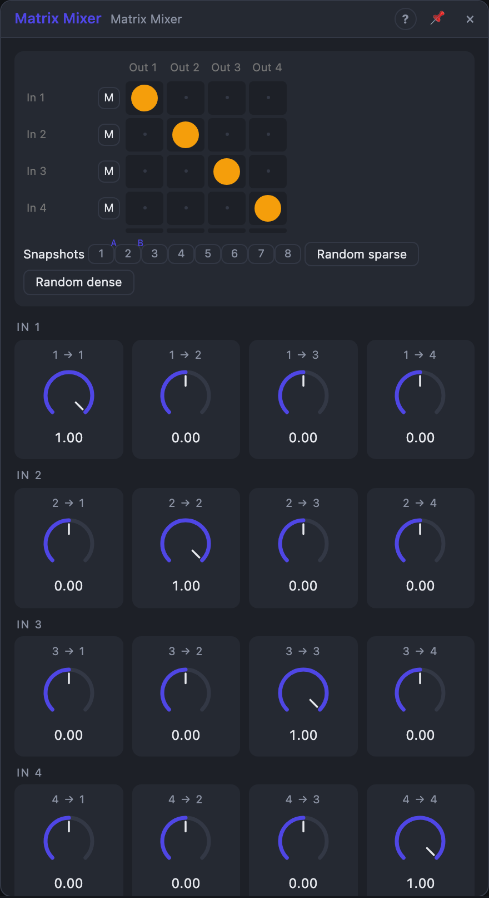

# Matrix Mixer

## Introduction

A grid of up to **8 inputs by 8 outputs**. Every crosspoint is a gain from −1
to +1, so each output is its own mix of all the inputs. It mixes audio
(send and return busses, feedback networks, spreading one sound to several
effects) and control signals (blending LFOs into many related movements).
Every crosspoint is a knob you can modulate, and whole matrices can be stored
as **snapshots** and **morphed**.

## How does it work?

**The mix.** `Out j = Level j × Σ (gain i→j × In i)`. *Inputs* and *Outputs*
set how many rows and columns are in use; jacks beyond them are hidden (their
cables stay) and carry nothing. An unpatched input is 0, or 1 with
*Unpatched* = 1, so its row becomes a set of fixed offsets.

**Crosspoints.** In the grid a circle's size is the gain, warm colours are
positive, cool ones negative. Click an empty crosspoint for +1, a set one for
0; Alt-click for −1; drag up and down to set it (Shift: fine); double-click
to type a value. Every crosspoint is also a knob: cables can modulate it, even
at audio rate (ring modulation). Changes ramp over 20 ms, so recalling a
snapshot doesn't click.

**Mutes** silence a row with a 5 ms ramp. **Level** sets each output from
silent to +6 dB.

**Output Stage.** *Clean* passes everything (limited to ±10). *Soft clip*
rounds peaks above 0.9 smoothly towards ±1. *Normalize* divides each output by
the sum of its gains when that is above 1, so a column never gets louder than
its loudest input: feedback patches stay tame.

**Snapshots.** The eight buttons below the grid hold whole matrices (gains,
levels, mutes). Click recalls one, Shift-click stores the current matrix,
right-click renames, clears or makes it morph end A or B.

**Morph.** With *Morph* on, the gains blend from snapshot A to snapshot B as
the *Morph* knob turns (*Morph Curve*: Linear, Smooth, Equal power); levels
blend too, mutes switch halfway. Cables on crosspoints still add on top.
Editing a crosspoint then edits the snapshot nearest the Morph position, so
move Morph to 0 % or 100 % to shape either end.

**Feedback.** Patching an output back into an input works (one 32-sample
delay); with *Normalize* such loops stay stable.

## How to use it?

- **Effect sends:** inputs are sounds, outputs go to a delay and a reverb;
  each crosspoint is a send amount.
- **A feedback network:** outputs through delays or filters back into the
  inputs, *Normalize* on, gains around ±0.5.
- **Modulation blender:** four LFOs in, eight related modulations out.
- **Scene changes:** store snapshots, patch a slow LFO into *Morph*.

<!-- generated:demos -->
## Demo patches

Five whole patches show what Matrix Mixer does. In the standalone app open **File → Presets…** (⌘P) and pick *Matrix Mixer* under *Demos by module*; on the website, **Run in Play** opens one in your browser. Loading one replaces the project and starts the transport.

| Patch | What it shows |
|---|---|
| **Matrix Mixer: Send Matrix** | Eight inputs, four outputs: a lead, a bass and a drum kit go in, outputs 3 and 4 are sends to an echo and a reverb, and their returns come back into the matrix to be mixed into the main left and right. Each crosspoint is a send amount - try the lead's 1 -> 3 and 1 -> 4 circles. |
| **Matrix Mixer: Scene Morph** | Two stored snapshots: A is a sparse scene (lead left, bass centre, pad), B a full groove with drums and the lead on the right. A slow LFO on Morph blends smoothly between them, so the arrangement keeps changing by itself. Click a snapshot button to hear it alone, or drag Morph. |
| **Matrix Mixer: Crosspoint Ring** | Every crosspoint is also a knob, so an audio-rate oscillator patched into the 1 -> 1 gain turns the matrix into a ring modulator: the left output is the metallic product, the right output the dry melody. A slow LFO detunes the modulator for sweeping bell tones. Try changing the 1 -> 2 crosspoint to blend dry and ring. |
| **Matrix Mixer: Feedback Web** | Two echo networks sit between matrix outputs and inputs, and their returns feed one another through the crosspoints with Normalize on, so the loops build a glassy web of repeats that never runs away. Lower or raise the crosspoint gains around 0.5 to thin out or thicken the web. |
| **Matrix Mixer: Modulation Blender** | The matrix isn't only for audio: four slow Quad LFO waves go in, and four differently blended mixes (some inverted) come out to move the filter of each voice of a chord. Change the crosspoint signs to make voices open when others close. |
<!-- /generated -->

## Reference

### Knobs

| Knob | Range | Default |
|---|---|---|
| i → j (64) | −1 … +1 | 1 on the diagonal, else 0 |
| Level 1 … 8 | 0 – 200 % | 100 % |
| Morph | 0 – 100 % | 0 % |

Every knob is a modulation destination. The knob list shows only the rows and
columns in use.

### Settings

| Setting | Values | Default |
|---|---|---|
| Inputs | 1 – 8 | 4 |
| Outputs | 1 – 8 | 4 |
| Mute 1 … 8 | on / off | off |
| Output Stage | Clean, Soft clip, Normalize | Clean |
| Unpatched | 0, 1 | 0 |
| Morph | Off, On | Off |
| Morph Curve | Linear, Smooth, Equal power | Linear |

### Inputs

| Input | Signal | What it does |
|---|---|---|
| In 1 … In 8 | audio (any signal) | the sources |

### Outputs

| Output | Signal | What it does |
|---|---|---|
| Out 1 … Out 8 | audio | Level × the weighted sum of the inputs, after the output stage |
