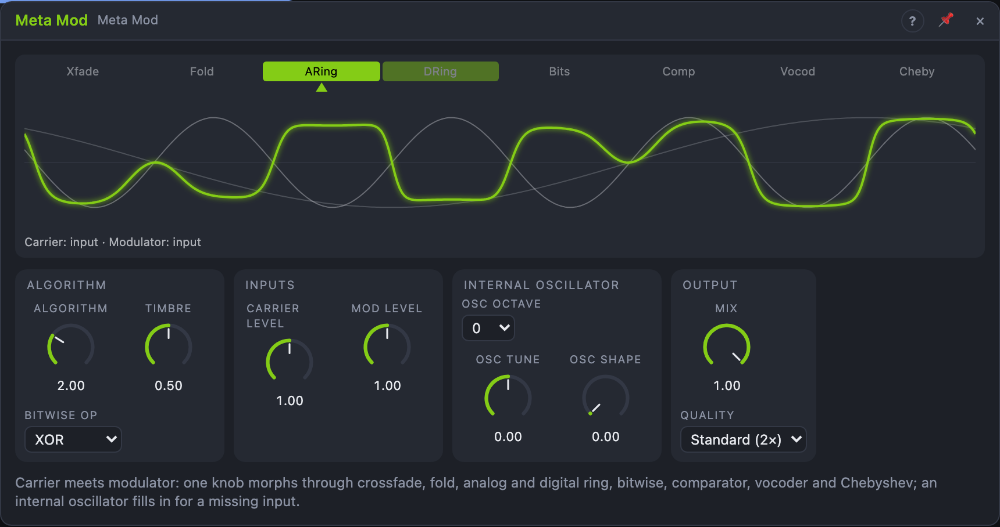

# Meta Mod

## Introduction

The Meta Mod combines two audio signals, a *Carrier* and a *Modulator*, into
one. A single **Algorithm** knob sweeps through eight ways of combining them,
from a plain crossfade over wavefolding and ring modulation to a vocoder, and
**Timbre** changes the character of whichever algorithm is selected. An
internal oscillator stands in for an unpatched input, so the module is a
sound source on its own, and a ring modulator or vocoder for any track with
one cable.

## How does it work?

**Inputs and the oscillator.** The internal oscillator is the Oscillator's
core (sine → triangle → saw → square with *Osc Shape*) at
C4 × 2^(Osc Octave + Osc Tune/12 + Pitch). It fills in for one input:

| Carrier patched | Modulator patched | Carrier is | Modulator is |
|---|---|---|---|
| no | no | oscillator | silence |
| no | yes | oscillator | Modulator |
| yes | no | Carrier | oscillator |
| yes | yes | Carrier | Modulator |

So a synth voice needs only the *Modulator* cable (the oscillator plays the
notes), and a track needs only the *Carrier* cable (the oscillator is a
tunable modulator: a classic ring modulator). Patching or unpatching fades
over 5 ms.

*Carrier Level* and *Mod Level* set the gain into the algorithm (up to 200 %,
+6 dB, which drives the nonlinear ones harder). Signals within ±1 pass
unchanged; hotter ones are softly limited towards ±4.

**Algorithms.** With carrier *a*, modulator *b* and Timbre *t*:

| # | Algorithm | What it does | Timbre |
|---|---|---|---|
| 0 | Crossfade | equal-power blend of *a* and *b* | 0 = carrier, 50 % = both, 100 % = modulator |
| 1 | Fold | sine-folds the sum *a* + *b* | fold depth, 1× to 8× |
| 2 | Analog ring | a diode-ring model: about *a* × *b*, saturating at high levels | 0 = matched diodes, clean; 100 % = mismatched, carrier bleeds through with odd harmonics |
| 3 | Digital ring | *a* × (*b* + *t*) / (1 + *t*) | 0 = ring modulation (only sum and difference tones), 100 % = amplitude modulation (carrier audible) |
| 4 | Bitwise | *a* and *b* as integers, combined by *Bitwise Op* (XOR, AND, OR, wrap-around sum) | resolution, 16 bits down to 2 |
| 5 | Comparator | 0–50 %: a square that is +1 where *a* > *b*, softening as Timbre rises; 50–100 %: towards max(*a*, *b*) | hardness, then the diode maximum |
| 6 | Vocoder | the carrier through 12 bands, each shaped by the modulator's level in that band | formant shift, ±1 octave (50 % = none) |
| 7 | Chebyshev | the *n*-th Chebyshev polynomial of *a*: a full-scale sine becomes its *n*-th harmonic | the order *n*, 1 to 16; the modulator sweeps it at audio rate |

Between two whole numbers the neighbours crossfade, so *Algorithm* 2.5 is
half analog, half digital ring; modulating it at audio rate is a sound of its
own. Every algorithm is levelled so two full-scale sines come out about
equally loud at every position.

**Vocoder.** The modulator is split into 12 bands from 100 Hz to 8 kHz; a
follower (2 ms attack, 40 ms release) measures each band. The carrier goes
through the same bands (moved by the formant shift), each levelled by its
own follower, and each takes the modulator's band level. So the carrier's own
spectrum hardly matters, only that it has energy in a band: noise and buzzy
waves (saw, square) work best. The modulator's hiss above 8 kHz is added at
−6 dB, which keeps consonants intelligible.

**Anti-aliasing.** Fold, both rings, Bitwise, Comparator and Chebyshev
create frequencies far above their inputs. *Standard* runs them at 2× the
sample rate, *High* at 4× (Fold also uses antiderivative anti-aliasing);
*Eco* doesn't oversample, for big Voice Cells. Crossfade, the vocoder and the
dry signal are delayed to match, so morphing stays in phase. The outputs are
delayed by 1 ms (*Standard*, 47 samples) or 1.5 ms (*High*, 70.5 samples).

**Output.** A 5 Hz high-pass removes the DC that the comparator, bitwise and
ring imbalance produce. Outputs stay within ±4.

## How to use it?

- **Ring modulator for a track:** Audio In → *Carrier L/R*. *Algorithm* 2
  (default), tune the oscillator with *Osc Tune* and *Osc Octave*. Patch an
  LFO into *Osc Tune* for sweeping bell tones.
- **Vocoder:** a voice or drum loop into *Modulator*, a saw or noise into
  *Carrier L*, *Algorithm* 6. Patch *Pitch* from a sequencer for a robot choir
  with the internal oscillator as the carrier (leave *Carrier* unpatched and
  set *Osc Shape* to saw).
- **Synth voice:** Voice In *Pitch* → *Pitch*, a second Oscillator into
  *Modulator*, sweep *Algorithm* with an envelope.
- **Harmonic sweeps:** *Algorithm* 7 with a sine carrier; patch an LFO onto
  *Timbre* for a harmonic arpeggio.
- **Envelope follower:** *Env* follows the modulator (5 ms attack, 120 ms
  release); patch it to a filter or VCA for ducking and auto-wah.
- **Dry/wet:** *Mix* blends the carrier (after *Carrier Level*) with the
  result.

<!-- generated:demos -->
## Demo patches

Five whole patches show what Meta Mod does. In the standalone app open **File → Presets…** (⌘P) and pick *Meta Mod* under *Demos by module*; on the website, **Run in Play** opens one in your browser. Loading one replaces the project and starts the transport.

| Patch | What it shows |
|---|---|
| **Meta Mod: Ring Bells** | With no modulator patched, the internal oscillator multiplies a simple melody in analog ring mode, giving clangorous bell tones. Change Osc Tune to move between consonant and metallic, or sweep Algorithm to the neighbours. |
| **Meta Mod: Talking Drums** | In vocoder mode a buzzing saw carrier is shaped by the drum beat as modulator, so the pad seems to pump and speak in the rhythm of the kit. Change Timbre for a different band balance, or the saw's pitch for another vowel colour. |
| **Meta Mod: Bitwise Grit** | Bitwise mode combines a bass line with the internal oscillator number by number, producing digital edge and odd harmonics that move with Osc Tune. Switch Bitwise Op between XOR, AND and OR, or sweep Timbre. |
| **Meta Mod: Algorithm Sweep** | A slow triangle LFO walks the Algorithm knob from crossfade through fold and ring modulation and back, so the same two tones keep changing character. Narrow the LFO's amount to stay in one family, or move Timbre by hand. |
| **Meta Mod: Chebyshev Glow** | The last algorithm adds harmonics to a plain sine bass line, with a slow LFO moving Timbre from a pure tone to a bright, organ-like glow. Try Quality for cleaner top end, or Mix to blend the pure sine back in. |
<!-- /generated -->

<!-- generated:presets -->
## Presets

The preset bar of the Meta Mod view has 15 factory presets. Pick one to set the knobs, then change them to taste; your own presets sit next to them.

| Preset | What it does |
|---|---|
| **Analog Ring** | Diode-style ring modulation with the internal oscillator. |
| **Ring Bells** | Inharmonic, bell-like sidebands from a sine carrier. |
| **Tremolo AM** | Amplitude modulation: slow oscillator wobbles the sound. |
| **Crossfade Blend** | Equal-power mix of carrier and modulator; sweep Timbre. |
| **Folded Input** | Wavefolded carrier with the modulator as fold source. |
| **Digital Ring** | Clean digital ring modulation: only sum and difference tones. |
| **Bitwise XOR** | Gritty digital combination of two sources. |
| **Bitwise AND** | Hollow, buzzy intersection of the two waveforms. |
| **Comparator Edge** | Hard-edged comparator tones that follow the input. |
| **Robot Vocoder** | Voice or drums in Modulator talk through a buzzy Carrier. |
| **Harmonic Pick** | Chebyshev: turns a sine into its Nth harmonic; sweep Timbre. |
| **Harmonic Shimmer** | Added harmonics blended under the dry signal. |
| **Algorithm Drift** | Between two algorithms: modulate Algorithm for morphing. |
| **Sub Osc Ring** | Low internal oscillator ring-modulates for growling bass. |
| **Metallic Clang** | Mismatched diodes and a bright oscillator: clangorous metal. |
<!-- /generated -->

## Reference

### Knobs and settings

| Control | Range | Default |
|---|---|---|
| Algorithm | 0 – 7 | 2 (analog ring) |
| Timbre | 0 – 100 % | 50 % |
| Carrier Level | 0 – 200 % | 100 % |
| Mod Level | 0 – 200 % | 100 % |
| Osc Tune | −24 … +24 st | 0 st |
| Osc Shape | 0 – 100 % | 0 % (sine) |
| Mix | 0 – 100 % | 100 % |
| Osc Octave | −3 … +3 | 0 |
| Quality | Eco (1×), Standard (2×), High (4×) | Standard |
| Bitwise Op | XOR, AND, OR, Sum mod | XOR |

All knobs are modulation destinations, evaluated every sample (audio-rate
*Algorithm* and *Timbre* work). *Osc Octave*, *Quality* and *Bitwise Op* are
settings. The view's algorithm strip sets *Algorithm* with a click.

### Inputs

| Input | Signal | What it does |
|---|---|---|
| Carrier L | audio | the carrier; unpatched: the oscillator |
| Carrier R | audio | right carrier; patched, the module runs in stereo, otherwise *Carrier L* feeds both sides |
| Modulator | audio | the modulator (mono, shared); unpatched while the carrier is patched: the oscillator |
| Pitch | pitch, 1 V/oct | the oscillator's pitch, added to *Osc Octave* and *Osc Tune*; 0.0 = C4 |
| Sync | trigger | restarts the oscillator's cycle (hard sync) |

### Outputs

| Output | Signal | What it does |
|---|---|---|
| Out L, Out R | audio | the result after *Mix*; *Out R* equals *Out L* in mono |
| Osc | audio | the internal oscillator, whatever it is used for |
| Env | control, 0 … 1 | envelope of the modulator |
