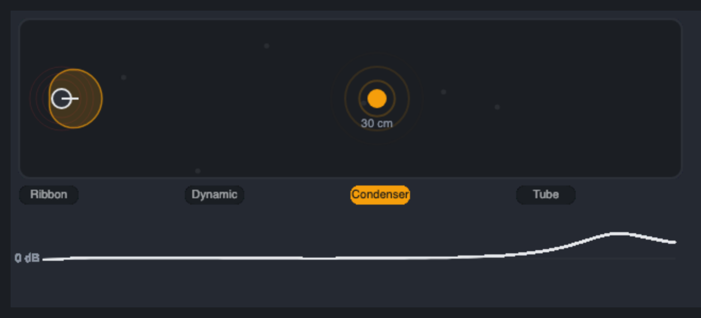

# Mic Colour



## Introduction

A synth, a DI guitar or a sampled drum has no microphone, no room and no distance in it. That is part of why it can sound flat or too clean. The Mic Colour puts one back: choose a **microphone model**, move the source **closer or farther away**, and the module adds what a real capsule and a real space do.

- **Ribbon**: a gentle roll-off at the top, a figure-8 style proximity bass bloom, a soft resonance in the bass, and softness on loud bass.
- **Dynamic**: a presence peak around 4 kHz, little below 80 Hz and above 15 kHz, a mid-focused sound, and fast softening of transients.
- **Condenser**: extended highs with a presence and air lift, a Diaphragm control that moves the peak, clean with a hint of transistor-style saturation.
- **Tube Condenser**: the same with warm, soft valve colour.

The module is stereo (In L / In R, Out L / Out R). It can also be used purely as a tone shaper with Room and Self-Noise at 0.

## How does it work?

```text
In -> tone filters -> saturation -> capsule high-pass -> model dynamics -> off-axis comb + early reflections -> Output -> Mix -> Out
                                                                                    ^
                                                                         Self-Noise (hiss)
```

**Tone filters.** Each model is a chain of analog prototypes (second-order and first-order sections), discretised with the bilinear transform and pre-warped so that every corner lands on its stated frequency. The tests compare the realised response of each model with its intended analog curve; below about a fifth of the sample rate the two agree within a fraction of a decibel, and in the top octave the digital curve is slightly squeezed (closer at 96 kHz).

| | Ribbon | Dynamic | Condenser | Tube Condenser |
| --- | --- | --- | --- | --- |
| Low cut (2nd order) | 35 Hz | 90 Hz | 18 Hz | 22 Hz |
| Proximity lift at full Proximity, 5 cm | up to +10 dB | +7 dB | +4 dB | +5 dB |
| Bass character | bump at 140 Hz, +3 dB | mid focus at 700 Hz, +1.5 dB | none | warmth at 120 Hz, +1.5 dB |
| Presence / top | bell at 3.2 kHz (Presence only) | bell at 4.2 kHz, +5 dB | bell at the diaphragm peak, +1.5 to +4.5 dB | the same, +1 to +3 dB |
| Top | low-pass 2nd order, 9.5 kHz | low-pass 15 kHz | open | low-pass 18 kHz |
| Air lift (shelf at 7 kHz) | none | none | up to +6 dB | up to +3 dB |
| Saturation | soft, low-band | symmetrical (odd harmonics) | a hint, with asymmetry | warm, even harmonics |

The gains of the Colour-dependent parts are for the Colour knob at 50 %; they scale with the knob (0 % is half the character, 100 % is double it).

**Distance and proximity.** Closer than 40 cm a bass shelf (200 Hz) lifts the low end: the proximity effect. It grows as the source approaches 3 cm and as the Proximity knob goes up, and each model has its own strength (the ribbon the most, the condenser the least). Beyond 100 cm the bass falls away by up to 2 dB. Beyond 50 cm air absorption dulls the highs by up to 4 dB. The direct level drops by up to 3 dB between 40 cm and 3 m, and the early reflections become stronger relative to it.

**Presence** lifts the model's presence region: up to 6 dB at 3.2 kHz for the ribbon, and up to 4 dB added to the model's own peak at 4.2 kHz (dynamic) or at the diaphragm peak (condensers).

**Diaphragm** moves the condenser peak from about 13 kHz (small capsule, 0 %) down to about 7.5 kHz (large capsule, 100 %).

**Off-Axis** turns the capsule away from the source: a high shelf cuts up to 8 dB (smoothly at the top) and a faint comb (a delay of about 0.35 ms mixed in negatively, high-passed above 2 kHz so only the highs are affected) adds the ripple of an off-axis response. The left and right delays differ slightly.

**Room** is a handful of early reflections: six taps between 3 and 29 ms with alternating signs and falling levels, low-passed at 5 kHz. The right channel's delays are 7 % longer than the left one's, so the two sides are decorrelated. The level grows with distance (a source at 5 cm gets about a third of the room that one at 2 m gets at the same setting). There is no feedback, so the reflections stop 30 ms after the sound.

**Saturation.** A smooth sigmoid with unity small-signal gain, so it only adds harmonics as the level rises and does not change the loudness at low levels. A bias in the condenser and tube models gives even harmonics; the ribbon and dynamic models are symmetrical. It is evaluated with first-order antiderivative anti-aliasing: a loud 7 kHz tone at nominal Colour keeps folded harmonics below about -45 dB, and quieter tones are far cleaner. On top of that the **ribbon** softens large bass excursions (a low-band saturator below about 200 Hz), and the **dynamic** model turns down a transient that is far above the recent average (a fast follower against a slow one), so the beginning of a loud note is about 2 dB softer.

**Self-Noise** adds a very quiet hiss that falls towards the top, independent in the left and right channel, from -100 dB (off) to -50 dB. It is deterministic: the same noise on every run.

**Mix** blends the dry input with the microphone signal. Mix 0 is exactly the input, in phase. The module has no latency.

## How to use it?

- **A synth lead in a room:** Condenser, Distance 80 cm, Room 25 %, Presence 30 %.
- **Vintage-sounding drums:** Ribbon, Distance 20 cm, Proximity 70 %, Colour 60 %, Room 20 %.
- **DI guitar to cabinet-and-mic:** Dynamic, Distance 10 cm, Presence 40 %, Off-Axis 20 %.
- **Warm vocal:** Tube Condenser, Distance 15 cm, Proximity 40 %, Colour 60 %.
- **Air on a pad:** Condenser, Diaphragm 20 % (small capsule), Colour 75 %, Distance 100 cm.
- **Far away, mono-ish source:** Distance 250 cm, Room 50 %, Off-Axis 30 %.
- **Lo-fi hiss:** Self-Noise -60 dB.
- **Parallel colour:** Mix 40 %: keeps the dry attack and adds the mic's tone.

## The module's own UI

A top-down room. The microphone shows the polar pattern of the chosen model (a figure-8 for the ribbon, rounder for the others); the source is a dot at a distance that follows the Distance knob. Rings round the capsule thicken with the proximity effect, dots bounce off the walls as early reflections (their number follows Room and distance), ripples leave the source with the signal level, and the response curve of the microphone is drawn underneath.

- Drag the source left or right to set Distance.
- Grab the microphone and turn it to set Off-Axis; the pattern rotates away from the source.
- Click a model pill to switch model.

Tricks it demonstrates: mapping a logarithmic knob (Distance) to a horizontal position and back; drawing a polar pattern from a formula; animating particles along piecewise paths with a single phase value; a response curve cached and recomputed only when a knob changed, with the module's own analog formulas; easing a polled probe.

## Reference

### Inputs and outputs

| Jack | Type | Meaning |
| --- | --- | --- |
| In L | audio | Left input |
| In R | audio | Right input (in Auto mode, the left signal is used for both channels while nothing is patched here) |
| Out L | audio | Left output |
| Out R | audio | Right output |

### Controls

| Control | Range | Default | Meaning |
| --- | --- | --- | --- |
| Model | Ribbon, Dynamic, Condenser, Tube Condenser | Condenser | The microphone (the change fades out and in) |
| Distance | 3 to 300 cm | 30 cm | Source distance: proximity bass, air absorption, direct level, room amount |
| Proximity | 0 to 100 % | 50 % | Strength of the close-mic bass lift |
| Presence | 0 to 100 % | 30 % | Extra lift in the presence region, up to 6 dB |
| Colour | 0 to 100 % | 50 % | The model's own tone and saturation amount; 50 % is nominal |
| Diaphragm | 0 to 100 % | 50 % | Condenser models: the peak moves from 13 kHz (0 %) to 7.5 kHz (100 %) |
| Off-Axis | 0 to 100 % | 0 % | High-frequency dulling (up to 8 dB) and a faint comb |
| Room | 0 to 100 % | 15 % | Level of the early reflections |
| Self-Noise | -100 (off) to -50 dB | -90 dB | Hiss level (rms) |
| Output | -12 to +12 dB | 0 dB | Level of the microphone signal |
| Mix | 0 to 100 % | 100 % | Dry / microphone blend |
| Input | Auto, Stereo, Mono | Auto | Auto: the left input feeds both channels while the right one is unpatched (exactly 0 for 2048 samples); Stereo: both inputs; Mono: left to both |

### Notes

- The module has no latency. Dry and wet stay in phase.
- The reflection buffer is cleared on reset for sample rates up to 96 kHz.
- Cost: about 59,000 operations per 32-sample block by the checker's conservative count, just below the 60,000 warning bound.
