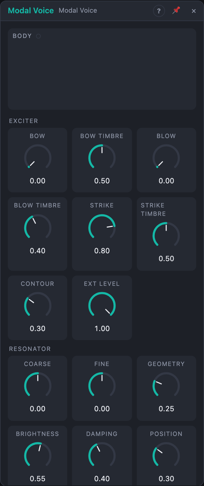

# Modal Voice

## Introduction

Modal Voice is a complete physical-modelling instrument in one module. An
**exciter** (a bow, breath, a mallet, or any audio) sets a **resonant body**
ringing (a string, a bar, a plate, a bell), and a small **room** places it in
a space.

A gate sustains bowed and blown sounds for as long as it is held; a trigger
strikes. It is built to sit inside a Voice Cell: one module per voice, with an
*Active* output that tells the cell when the sound has died away. Where the
*Resonator* is an effect that makes other sounds ring, Modal Voice is the
instrument that plays itself.

## How does it work?

**The body** is a bank of 16, 32 or 64 ringing partials. *Geometry* sets
their ratios: string (0 %), stiff string (25 %), bar (50 %), plate (75 %) and
a bell-like inharmonic set drawn from *Seed* (100 %), gliding smoothly in
between. *Damping* sets how long it rings, *Brightness* how bright it is and
how fast the high partials die, and *Position* where the exciter touches it
(50 %, the middle, cancels the even partials).

**The exciters** can all play at once:

- **Bow:** a friction model. The bow sticks to the body and slips, again and
  again, which makes the body sing at its own pitch for as long as the gate is
  held, even a bar or a bell (bowed metal). *Bow Timbre* goes from a light,
  airy bow to a heavy, scratchy one.
- **Blow:** breath noise, filtered around the pitch. Up to 60 % *Blow Timbre*
  it is a breathy rush that colours the body. Above 60 % the breath starts to
  couple with the body like the air jet of a flute, and the body sings on its
  own, with breath noise on top.
- **Strike:** a mallet hit on every trigger at *Strike* (or on every new gate
  when *Strike* is unpatched). *Strike Timbre* goes from soft felt through
  wood and a hard mallet to a sharp tick, and above 70 % adds a grainy scrape.
  A strike on a ringing body adds to it.
- **Ext In:** any audio, added to the exciters at *Ext Level*. With the other
  exciters at 0, the module is a resonator with a room.

The bow and the breath follow a gate envelope shaped by *Contour*: at 0 % a
slow swell and a long release, at 100 % a fast attack with a short decay to a
lower sustain. *Velocity* scales every exciter.

**The space** is a small stereo room. *Size* goes from a booth to a hall,
*Space* is its level. At 0 % it is switched off and costs nothing.

## How to use it?

- **In a Voice Cell:** *Voice In › Pitch* → *Pitch*, *Gate* → *Gate*,
  *Trigger* → *Strike*, *Velocity* → *Velocity*, *Out L/R* → *Voice Out*, and
  *Active* → *Voice Out › Active*. Patch *Voice In › Pressure* onto *Bow* or
  *Blow* so aftertouch swells the sound.
- **Marimba, vibraphone, bells:** Strike only, Geometry 50 – 100 %, Damping
  30 – 50 %, Strike Timbre 30 – 60 %.
- **Bowed strings and bowed metal:** Strike 0 %, Bow 60 – 90 %, Contour low for
  a slow swell; Geometry 0 – 25 % for strings, 50 % and up for metal.
- **Flute-like tones:** Blow 70 %, Blow Timbre 70 – 90 %, Geometry 0 %.
- **A resonator with a room:** any audio → *Ext In*, all exciters at 0.
- **Many voices:** set *Space* to 0 % inside the cell and put one reverb after
  it: that saves CPU and gives all voices one shared room.
- **Play button:** held, it is a gate (and a strike), for trying sounds
  without patching.

## Demo patches

Five whole patches show what Modal Voice does. In the standalone app open **File → Presets…** (⌘P) and pick *Modal Voice* under *Demos by module*; loading one replaces the project and starts the transport.

| Patch | What it shows |
|---|---|
| **Modal Voice: Mallet Bars** | Mallet strikes (*Strike*) on a damped bar-like body; *Strike Timbre* changes soft to hard mallets. |
| **Modal Voice: Bowed Strings** | Held gates with *Bow* up make the string sing; an LFO moves *Bow Timbre*. |
| **Modal Voice: Breath Tube** | *Blow* excites a tube-like body for an airy melody, with a slowly rising vibrato on *Fine*. |
| **Modal Voice: Metal Plate Groove** | Rhythmic hits on a large plate while LFOs morph *Geometry* and *Brightness*. |
| **Modal Voice: Drums Through a Body** | A drum beat on the *Ext* input excites the body, tuned by a bass line; *Ext Level* sets the amount. |

## Reference

### Knobs and settings

| Group | Control | Range | Default |
|---|---|---|---|
| Exciter | Bow | 0 – 100 % | 0 % |
| | Bow Timbre | 0 – 100 % | 50 % |
| | Blow | 0 – 100 % | 0 % |
| | Blow Timbre | 0 – 100 % | 40 % |
| | Strike | 0 – 100 % | 80 % |
| | Strike Timbre | 0 – 100 % | 50 % |
| | Contour | 0 – 100 % | 30 % |
| | Ext Level | 0 – 100 % | 100 % |
| Resonator | Coarse | −24 … +24 semitones | 0 |
| | Fine | −100 … +100 cents | 0 |
| | Geometry | 0 – 100 % | 25 % |
| | Brightness | 0 – 100 % | 55 % |
| | Damping | 0 – 100 % | 40 % |
| | Position | 0 – 100 % | 30 % |
| Space | Size | 0 – 100 % | 40 % |
| | Space | 0 – 100 % | 20 % |
| | Partials | 16, 32, 64 | 32 |
| | Seed | 0 – 999 | 1 |

- **Bow / Blow / Strike:** the level of each exciter. Exciters at 0 % cost
  nothing.
- **Bow Timbre:** bow pressure and roughness: airy → scratchy.
- **Blow Timbre:** breath colour, dark rush → bright hiss; above 60 % the
  breath couples with the body and makes it sing.
- **Strike Timbre:** soft felt → wood → hard mallet → tick → scrape.
- **Contour:** the shape of the bow and breath envelope: attack from 400 ms
  (0 %) to 2 ms (100 %), release from 1.5 s to 30 ms; from 50 % up the attack
  overshoots and settles to a lower sustain.
- **Ext Level:** the level of *Ext In*.
- **Coarse / Fine:** transposition in semitones and cents; *Pitch* adds to it.
- **Geometry:** the partial ratios: string → stiff string → bar → plate → bell.
- **Brightness:** spectral tilt and how fast the high partials decay.
- **Damping:** how long the body rings: 0 % = 20 s, 50 % ≈ 1 s, 100 % ≈ 40 ms.
- **Position:** where the exciter touches the body and where it is heard.
- **Size:** the room, from a small booth to a hall.
- **Space:** the room's level. The body itself always stays at full level.
- **Partials:** the number of partials of the body: more sounds richer and
  costs more.
- **Seed:** the bell partials (Geometry 100 %) and the scrape of the mallet.
  The scrapes repeat from the start of the transport.

Every knob is a modulation destination: patch a cable onto it to move it.

### Inputs

| Input | Signal | What it does |
|---|---|---|
| Pitch | pitch | 1 V/oct, 0 V = C4 |
| Gate | gate | while high, bow and breath play; a new gate also strikes when *Strike* is unpatched |
| Strike | trigger | fires the mallet |
| Velocity | control, 0 – 1 | scales all exciters, read at each gate start and strike; unpatched counts as 1 |
| Ext In | audio | an external exciter, at *Ext Level* |

### Outputs

| Output | Signal | What it does |
|---|---|---|
| Out L, Out R | audio | the body and the room, stereo |
| Exciter | audio | the exciters before the body, to watch or to feed another resonator |
| Active | gate | high while the gate is high or the sound (with the room's tail) is audible; falls 50 ms after it goes below −80 dB |
