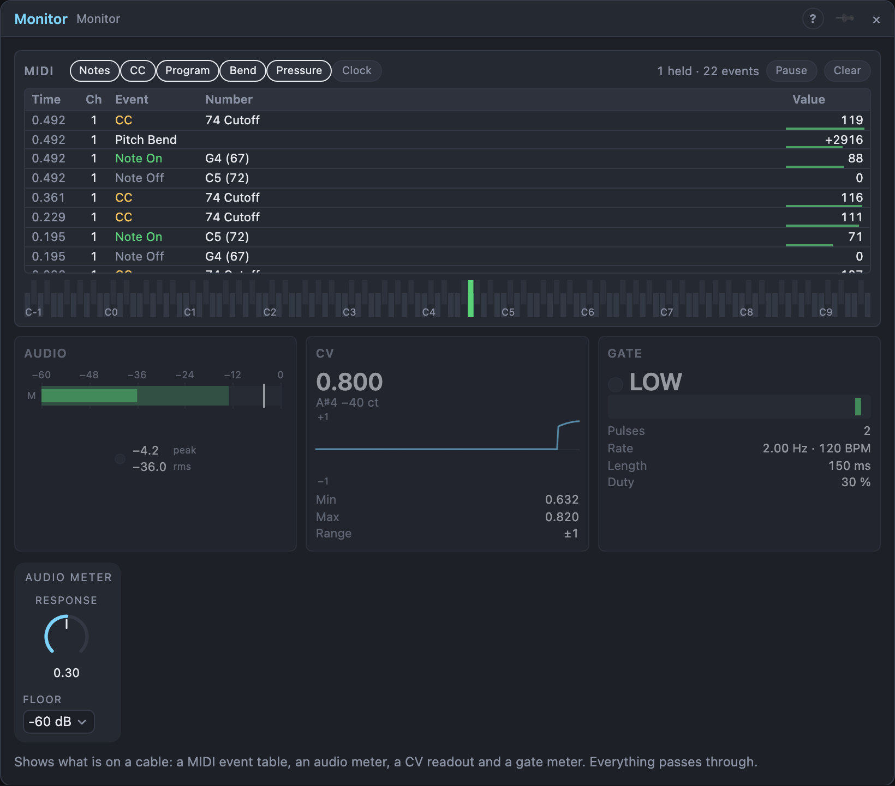

# Monitor

## Introduction

The Monitor shows **what is on a cable**. Patch a *Notes* cable into it to
see every note, controller, program change and bend in a table; patch audio
for a level meter, a control signal for a readout and a gate or trigger for a
pulse meter. Everything passes through: each input comes out of the output
with the same name, so the Monitor can sit in the middle of a patch or hang
off a cable on the side. Use as many of the inputs as you need; the others
stay dim.

## How does it work?

Open the Monitor's view.

**MIDI.** Every event that arrives on *Notes* becomes a row, newest on top:
the time since you opened the window, the MIDI channel (1–16), the kind of
event, its number and its value. A note shows its name and number (60 is C4),
a controller its number and, where it has a standard name, the name (74 is
*Cutoff*). The small bar under a value shows it from 0 to 127; for a bend it
shows the position of the wheel. Under the table, a keyboard lights the
**notes that are on** right now. A note that stays lit after you let go is a
**stuck note**: its note-off never arrived. *All Notes Off* (controller 123)
clears them.

The chips above the table choose what you see: *Notes*, *CC*, *Program*,
*Bend*, *Pressure* and *Clock*. *Clock* is off at first, since it sends 24
events per quarter note and would bury everything else. *Pause* stops adding
rows (the events still pass through); *Clear* empties the table. If more events
arrive than the window can follow between two updates (a knob sweeping a
controller), the count says how many were *missed*. The cables are not
affected.

**Audio.** A bar per channel: the solid part is the RMS level (about how loud
it sounds), the pale part the peak, and the thin line the held peak. The
numbers show both in dB, and the lamp turns red when a sample goes over 0 dB.
With only *Audio L* patched you get one mono bar. Click the bars to reset the
hold and the lamps. *Response* is how quickly the RMS level follows, *Floor*
the bottom of the scale.

**CV.** The value as a number, the **note name** it would play if you read it
as 1 V per octave with 0 as C4 (0.25 reads *D♯4*), a history graph with a band
for the lowest and highest value of each update, and the lowest and highest
value since you last clicked the graph. A short spike is never missed. The
graph's scale follows the signal.

**Gate.** A lamp and *HIGH* or *LOW*, a strip of the recent gate history,
and numbers: **Pulses** counted since you last clicked the strip, the **Rate**
of the pulses in Hz and in BPM (taken from the last two; it shows a dash when
the pulses stop), the **Length** of the last gate and the **Duty**, the share
of the last second the gate was high. A one-sample trigger lights the lamp for
a moment, so even the shortest pulse shows.

## How to use it?

- **What does my controller send?** *MIDI In* or *MIDI Device* into *Notes*;
  turn the knob you are interested in and read its controller number. Give one
  of the *MIDI In*'s *CC* settings that number to get it as a control signal.
- **Find a stuck note:** keep an eye on the keyboard under the table; a lit
  key with no note-off row means the sender missed one.
- **Check a clock:** a clock or sequencer *Gate* into *Gate*; the BPM is the
  pulse rate × 60, so a clock with four pulses per beat shows four times the tempo.
- **Check an envelope or LFO:** into *CV*. The graph shows its shape, the
  numbers its range.
- **Set a level:** a source into *Audio L* and *R*, with the RMS around
  −18 dB and the peaks below 0.
- **Chain it:** the outputs follow the inputs, so a Monitor can sit between
  a *MIDI In* and a Voice Cell without changing anything.

<!-- generated:demos -->
## Demo patches

Five whole patches show what Monitor does. In the standalone app open **File → Presets…** (⌘P) and pick *Monitor* under *Demos by module*; on the website, **Run in Play** opens one in your browser. Loading one replaces the project and starts the transport.

| Patch | What it shows |
|---|---|
| **Monitor: Note Table** | The sequencer's notes pass through a Monitor on their way to a synth voice: its table lists each note on and off with pitch and velocity as it happens. Change a step's note or velocity in the sequencer and read the difference in the table. |
| **Monitor: Watch a Control Signal** | A slow LFO runs through the Monitor's CV input before it sweeps the filter of a gentle line: the readout shows the value moving between its extremes while you hear the same thing. Change the LFO's rate or wave and watch the shape change. |
| **Monitor: Gate Meter on the Kick** | The kick's gate from the Drum Grid goes through the Monitor's gate meter, which lights on every hit and shows how long the gate lasts, before it triggers the drum. Lengthen the Drum Grid's Gate Length and watch the meter stay lit. |
| **Monitor: Stereo Meter** | A ping-pong delay bounces a pluck line left and right through the Monitor's audio meters, so you see the two channels take turns. Raise the Floor to see only the loud part, or lower Response to make the bars fall slowly. |
| **Monitor: Everything at Once** | One Monitor watches four kinds of signal on a single synth voice: the notes going in, a vibrato CV, the envelope's gate and the stereo audio coming out. Change the vibrato LFO or the sequence and see which panel reacts. |
<!-- /generated -->

## Reference

### Knobs

| Knob | Range | Default |
|---|---|---|
| Response | 10 ms – 2 s | 300 ms |

Every knob is a modulation destination.

### Settings

| Setting | Values | Default |
|---|---|---|
| Floor | −24, −36, −48, −60, −72, −96 dB | −60 dB |

### Inputs

| Input | Signal | What it does |
|---|---|---|
| Notes | notes | the MIDI events for the table and the keyboard |
| Audio L | audio | left channel, or mono |
| Audio R | audio | right channel; unpatched, it follows *Audio L* |
| CV | control | the signal for the CV readout |
| Gate | gate | the gate or trigger for the gate meter (high at 0.5 and above) |

### Outputs

| Output | Signal | What it does |
|---|---|---|
| Notes | notes | the input's events, unchanged |
| Audio L, Audio R | audio | the inputs, unchanged |
| CV | control | the input, unchanged |
| Gate | gate | the input, unchanged |
