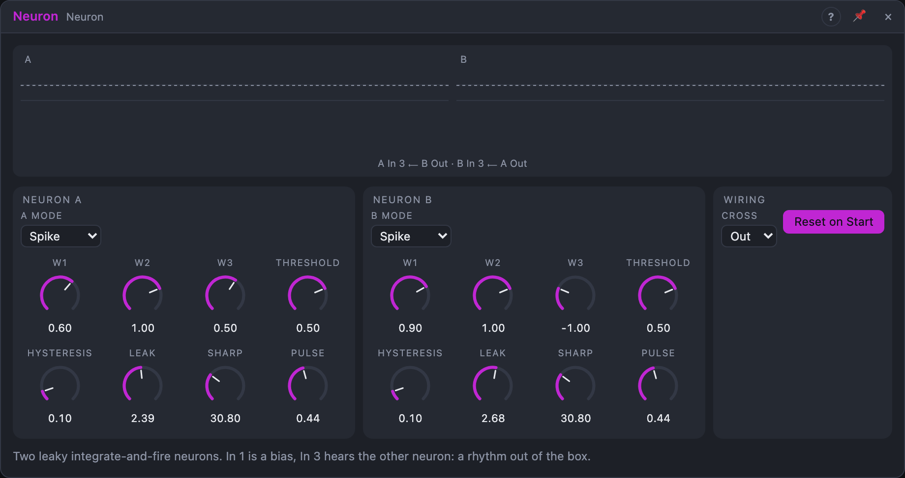

# Neuron

## Introduction

Neuron holds two simple artificial neurons. Each one adds up three weighted
inputs, lets the sum charge a leaky "membrane" and fires a gate when the
membrane crosses a threshold. The two neurons listen to each other out of
the box, so with no cable at all they already play a two-voice rhythm. Patch
slow modulation in, or the outputs back into the inputs, and you get
rhythms and gestures nobody programmed.

## How does it work?

**Sum.** Each neuron computes `W1 · In 1 + W2 · In 2 + W3 · In 3`.

- *In 1* reads **+1** while nothing is patched, so *W1* works as a bias knob.
- *In 2* reads 0 while nothing is patched.
- *In 3* hears the **other** neuron while nothing is patched: its *Out* or its
  *Gate*, chosen with *Cross*, one sample late. That's a much tighter feedback
  loop than a cable could make.

**Membrane.** The membrane follows the sum with a delay set by *Leak*: a short
burst at the input moves it a little, a sustained input charges it fully.
*Leak* 0 makes the membrane equal the sum.

**Gate.** In **Compare** mode the gate is high while the membrane is above the
threshold, with *Hysteresis* as a gap between the on and off levels (no
chatter on wobbly inputs). In **Spike** mode the neuron *fires*: when the
membrane crosses the threshold, the gate goes high for *Pulse*, the membrane
drops to 0 and stays there during the pulse, then charges again. A constant
input above the threshold gives a steady rhythm: the higher the input and the
shorter the leak, the faster it fires. At or below the threshold it never
fires.

**Out.** A smooth version for modulation. In Compare mode it rises from 0 at
the threshold with a slope of *Sharp*, up to 1. In Spike mode the ramp ends at
the threshold, so *Out* shows the membrane charging and drops at each spike:
a saw locked to the neuron's rhythm. *Sharp* 1 is gentle; 100 is almost a gate.

**Logic.** *AND*, *OR* and *XOR* combine the two gates; *Diff* is A Out − B Out.

Neuron has no randomness: the same inputs always give the same outputs. With
*Reset on Start* on, both neurons are cleared when the transport starts, so
every render is identical.

## How to use it?

- **The default rhythm:** patch *A Spike* and *B Spike* to two drums. A fires
  regularly from its bias; as A charges, its *Out* pushes B down, so B fires in
  irregular gaps.
- **Rhythm from a level:** an LFO or envelope into *A In 2*: the higher the
  level, the faster A fires.
- **Velocity to density:** inside a Voice Cell, *Voice In › Velocity* into
  *In 2*: louder notes fire faster.
- **A Schmitt trigger:** *A Mode* on *Compare*, a noisy signal into *A In 2*,
  *W1* 0, *Hysteresis* up until it stops chattering.
- **Audio:** *Leak* near 0 and *Cross* on *Gate* oscillates at audio rate.

<!-- generated:demos -->
## Demo patches

Five whole patches show what Neuron does. In the standalone app open **File → Presets…** (⌘P) and pick *Neuron* under *Demos by module*; on the website, **Run in Play** opens one in your browser. Loading one replaces the project and starts the transport.

| Patch | What it shows |
|---|---|
| **Neuron: Self-Playing Rhythm** | Two neurons charge up, fire and listen to each other, and that conversation is a drum pattern: A fires the kick, B the snare, and the logic outputs add hats and claps where they agree or differ. Change the Threshold or Leak of either neuron and the rhythm re-forms. |
| **Neuron: Spiking Melody** | Neuron A's gate plays the notes and its membrane level, passed through a Quantizer, picks the pitch: as the neuron charges the notes climb, then drop when it fires. Lower the Threshold for a faster tune, or raise Leak to flatten the climb. |
| **Neuron: Call and Response** | With Cross on Gate, each neuron's firing nudges the other, so a low bass note from A is answered by a high bell from B. Set Cross to Off and the two stop listening and drift apart; change B's W3 to turn the answer into a hesitation. |
| **Neuron: Slow Charge** | The neurons' membrane levels (A Out and B Out) are slow, irregular swells here: one fades a pad in and out and the other opens its filter. Lower Leak for longer swells, or raise Sharp on a neuron for a harder snap at the top. |
| **Neuron: Driven by an LFO** | A slow triangle LFO feeds the neurons' inputs: when it is high they fire fast and when it is low they go quiet, so a bass, tom and hat pattern speeds up and thins out in waves. Change the LFO Rate or the neuron weights to change the ebb and flow. |
<!-- /generated -->

<!-- generated:presets -->
## Presets

The preset bar of the Neuron view has 13 factory presets. Pick one to set the knobs, then change them to taste; your own presets sit next to them.

| Preset | What it does |
|---|---|
| **Default Rhythm** | Two neurons that answer each other: a rhythm with no cables. |
| **Steady Pulse** | Two independent steady pulse trains, no cross talk. |
| **Slow Heartbeat** | Low, slow double-thump patterns. |
| **Fast Chatter** | Rapid spikes for glitchy triggers. |
| **Call and Response** | B only fires after A: a delayed answer. |
| **Mutual Silence** | Each neuron inhibits the other for alternating bursts. |
| **Compare Gates** | Self-switching gates that settle into slow on-off patterns. |
| **Smooth Out** | Gentle control outputs with soft slopes for modulation. |
| **Logic Mix** | Long pulses so the AND, OR and XOR outputs show overlaps. |
| **Gate Cross** | Neurons listen to each other's gates instead of their outputs. |
| **Independent Pair** | No cross talk: two polyrhythmic pulses of different speeds. |
| **Sparse Triggers** | Barely above threshold: occasional, slow triggers. |
| **Chaotic Pair** | Strong coupling creates unpredictable patterns. |
<!-- /generated -->

## Reference

### Knobs and settings

Per neuron (A and B):

| Control | Range | Default A / B |
|---|---|---|
| W1, W2, W3 | −2 … +2 | A: 0.6, 1, 0.5 · B: 0.9, 1, −1 |
| Threshold | −1 … +1 | 0.5 |
| Hysteresis | 0 – 100 % | 10 % |
| Leak | 0 – 5 s | 250 ms / 400 ms |
| Sharp | 1 – 100 | 4 |
| Pulse | 1 ms – 1 s | 30 ms (Spike mode only) |

| Setting | Values | Default |
|---|---|---|
| A Mode, B Mode | Compare, Spike | Spike |
| Cross | Out, Gate, Off | Out |
| Reset on Start | on / off | on |

- **W1 … W3:** the weight of each input; negative weights inhibit.
- **Threshold:** the level the membrane must cross. Drag the dashed line in the
  view to set it.
- **Hysteresis:** the gap between the on and off levels: the gate switches on
  at Threshold + Hysteresis / 4 and off at Threshold − Hysteresis / 4.
- **Leak:** the membrane's time constant. 0 = no delay.
- **Sharp:** the slope of *Out*.
- **Pulse:** the gate length in Spike mode, and the time the membrane rests after firing.
- **Cross:** what *In 3* hears from the other neuron while unpatched.
- **Reset on Start:** clear both neurons when the transport starts.

All knobs are modulation destinations.

### Inputs

| Input | Signal | What it does |
|---|---|---|
| A In 1, B In 1 | control | weighted by W1; unpatched: +1 |
| A In 2, B In 2 | control | weighted by W2; unpatched: 0 |
| A In 3, B In 3 | control | weighted by W3; unpatched: the other neuron (see *Cross*) |
| Reset | trigger | clears both membranes and ends any spike |

### Outputs

| Output | Signal | What it does |
|---|---|---|
| A Gate, B Gate | gate | the neuron's firing state |
| A Out, B Out | control, 0 … 1 | the sharpened membrane |
| A Spike, B Spike | trigger | a pulse each time the gate goes high |
| AND, OR, XOR | gate | logic of A Gate and B Gate |
| Diff | control, −1 … +1 | A Out − B Out |
