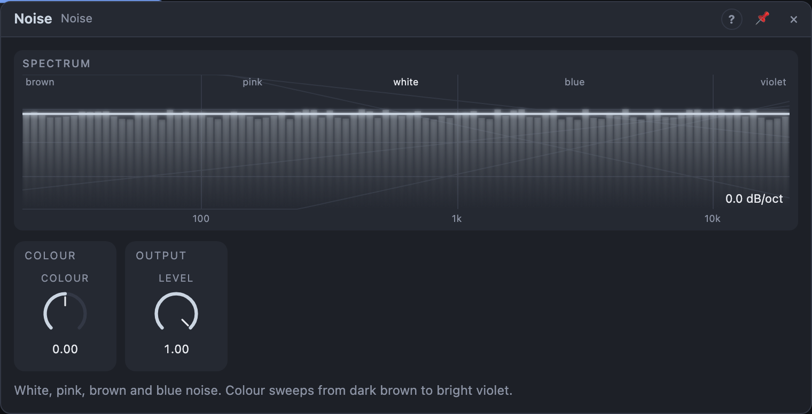

# Noise

## Introduction

Noise is random audio: every frequency at once, with no pitch. It's the raw
material for snares, hi-hats, wind, breath, surf and risers, and a handy
random source for modulation. Noise gives you four classic colours on their
own outputs, plus a *Colour* knob that sweeps smoothly from dark to bright.

## How does it work?

All colours come from one white noise source and are filtered from it:

- **White:** equal energy at every frequency. Bright and hissy.
- **Pink:** falls by 3 dB per octave, so every octave has the same energy.
  Sounds even and natural, like rain or a waterfall.
- **Brown:** falls by 6 dB per octave. Deep and rumbling, like distant
  thunder or surf.
- **Blue:** rises by 3 dB per octave. Thin and fizzy.

Every output is about equally loud (around −10 dB RMS), so you can switch
colours without jumping in level.

*Out* follows the **Colour** knob: −100 % is brown, −50 % pink, 0 % white,
+50 % blue and +100 % violet (rising by 6 dB per octave, the brightest).
Between those points it blends the two neighbours, so turning the knob, or
modulating it, sweeps the noise from dark to bright. *Level* sets the volume
of *Out* only.

Each Noise node plays its own noise. Two nodes, or two voices of a Voice Cell,
never play the same noise.

## How to use it?

- **Snare wires or hi-hats:** Noise *Out* → Multi Filter (band-pass or
  high-pass) → VCA, with a short ADSR on the VCA's *Gain*. For ready-made
  drums, the Ring and Punch drum nodes already include their own noise.
- **Wind and surf:** brown or pink noise → a resonant low-pass filter, with
  a slow Function or Random on the cutoff.
- **Risers:** patch a long rising envelope onto *Colour*, so the noise gets
  brighter as it builds.
- **Breathy oscillator:** mix a little pink noise into an oscillator before
  the filter.
- **Random modulation:** brown noise wanders slowly; patched with a small
  amount onto a pitch or cutoff, it adds unsteady, analog-style drift.

<!-- generated:presets -->
## Presets

The preset bar of the Noise view has 12 factory presets. Pick one to set the knobs, then change them to taste; your own presets sit next to them.

| Preset | What it does |
|---|---|
| **White Noise** | Flat, full-spectrum noise: the all-round source for hats and snares. |
| **Pink Noise** | Equal energy per octave: natural, balanced, like rain. |
| **Brown Rumble** | Dark, deep noise: thunder, wind and engine rumble. |
| **Soft Hiss** | A quiet, slightly bright hiss for tape or room atmosphere. |
| **Bright Air** | Bright, airy noise for breaths, cymbals and shimmer. |
| **Violet Fizz** | Only the top end: fizzy, icy noise for hats and sprays. |
| **Wind** | Darkened noise: run it through a band-pass and sweep for wind. |
| **Ocean** | Deep, rolling noise: modulate Level slowly for waves. |
| **Snare Noise** | Full-level near-white noise: gate it with a fast envelope. |
| **Hat Noise** | Very bright noise for closed and open hats. |
| **Vinyl Bed** | A very quiet noise floor to add some grit under a mix. |
| **Half Level** | White noise at half level: a safe starting point for mixing. |
<!-- /generated -->

<!-- generated:demos -->
## Demo patches

Five whole patches show what Noise does. In the standalone app open **File → Presets…** (⌘P) and pick *Noise* under *Demos by module*; on the website, **Run in Play** opens one in your browser. Loading one replaces the project and starts the transport.

| Patch | What it shows |
|---|---|
| **Noise: Blue Hat Patterns** | Blue noise, cut short by an envelope and high-passed, is played as hi-hats from a drum grid pattern over a soft kick. Slide Colour toward white for a duller tick, or toward blue for a thinner, brighter sizzle. |
| **Noise: Ocean Surf** | Brown noise swells and recedes as two slow LFOs open a low-pass filter and the level together, like waves washing in. Raise Colour for foam and hiss, or speed up the LFO for a stormier sea. |
| **Noise: Wind Whistle Melody** | White noise through a very resonant band-pass filter that follows the sequencer's pitch: a breathy, whistling tune with no oscillator at all. Lower Resonance for a wind that only hints at pitch. |
| **Noise: Colour Riser** | Every four bars a ramp sweeps Colour from dark brown to bright violet while a filter opens, building tension over a steady beat before it drops back. Change the LFO's Sync to lengthen or shorten the build. |
| **Noise: Four Colours** | The white, pink, brown and blue outputs go to four mixer channels whose pans drift on slow LFOs, then through a gently resonant filter into a hall. Mute channels on the mixer to hear each colour alone. |
<!-- /generated -->

## Reference

### Knobs and settings

| Control | Range | Default |
|---|---|---|
| Colour | −100 … +100 % | 0 % (white) |
| Level | 0 – 100 % | 100 % |

- **Colour:** the colour of *Out*: −100 % brown, −50 % pink, 0 % white,
  +50 % blue, +100 % violet.
- **Level:** the volume of *Out*. The fixed colour outputs always play at
  full level.

Both knobs are modulation destinations.

### Inputs

None (apart from the knobs).

### Outputs

| Output | Signal | What it does |
|---|---|---|
| Out | audio | noise in the colour set by *Colour*, at *Level* |
| White | audio | white noise, flat |
| Pink | audio | pink noise, −3 dB/oct |
| Brown | audio | brown noise, −6 dB/oct |
| Blue | audio | blue noise, +3 dB/oct |
