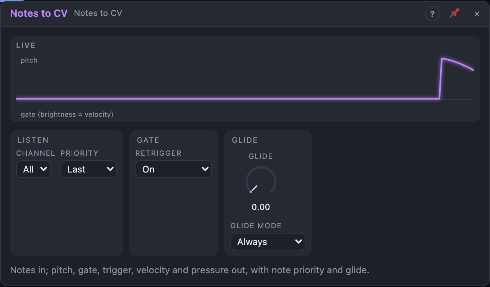

# Notes to CV

## Introduction

Notes to CV turns **notes** into **pitch**, **gate** and friends. Notes come
from a MIDI port, a MIDI Device or the Step Sequencer's *Notes* output; this
module lets them play an oscillator, open an envelope or move a filter
outside a Voice Cell. It is the opposite of *CV to Notes*.

## How does it work?

The module remembers which notes are held. One of them is the **active
note**, chosen by *Priority*:

- **Last:** the most recent note. Releasing it goes back to the note held
  before, like a classic mono synth.
- **Lowest** / **Highest:** the lowest or highest held note.
- **First:** the oldest held note; others take over only when it is released.

*Pitch* and *Velocity* follow the active note and hold their values after
release. *Gate* is high while any note is held. *Trigger* fires each time the
active note changes.

With *Retrigger* **On**, the gate drops for one sample when the active note
changes while another is held, so envelopes restart. With **Off (Legato)**, the
gate stays high and only *Trigger* marks the change.

*Glide* smooths *Pitch*. With *Glide Mode* **Legato Only**, it only glides
between overlapping notes; detached notes jump.

All held notes are released when the transport stops or the *Notes* cable is
removed, so the gate never hangs.

## How to use it?

- **A mono synth from MIDI:** MIDI port *Notes* → Notes to CV; *Pitch* →
  Oscillator *Pitch*; *Gate* → ADSR gate; ADSR → VCA.
- **Acid lines:** *Retrigger* off, *Glide Mode* *Legato Only*, some *Glide*:
  overlapping notes slide, others don't.
- **Velocity to the filter:** *Velocity* onto the filter's cutoff knob.
- **Key tracking for modulation:** *Pitch* onto an LFO's rate, so higher
  notes move faster.
- **Bass from chords:** *Priority* *Lowest* always plays the lowest held note.

<!-- generated:demos -->
## Demo patches

Five whole patches show what Notes to CV does. In the standalone app open **File → Presets…** (⌘P) and pick *Notes to CV* under *Demos by module*; on the website, **Run in Play** opens one in your browser. Loading one replaces the project and starts the transport.

| Patch | What it shows |
|---|---|
| **Notes to CV: Accent Lead** | A sequencer's notes come in, and Notes to CV hands out pitch, gate, trigger and velocity: the velocity opens the envelope harder on the accented steps. Try Retrigger Off to hear the tied notes run together. |
| **Notes to CV: Gliding Bass** | Tied notes slide into each other because Glide is up and Glide Mode is Legato Only; separate notes still jump. Turn Glide to 0 for a plain bass, or set Glide Mode to Always to slide into every note. |
| **Notes to CV: Lowest and Highest** | A Chord Quantizer sends four-note chords as notes; one Notes to CV follows the lowest note for a bass, another the highest for a bright lead. Change either Priority to Last or First to follow a different note of the chord. |
| **Notes to CV: Drifting Pad** | Overlapping long notes with Retrigger Off and a slow Glide make the pad drift from chord root to chord root without restarting its envelope. Switch Retrigger to On and every note swells again. |
| **Notes to CV: Trigger Out Kick** | Every note that arrives also leaves Notes to CV as a trigger, here firing a kick drum in step with a bass line, while Pitch plays the bass. Change the sequencer's pattern and the kick follows it. |
<!-- /generated -->

## Reference

### Knobs and settings

| Control | Range | Default |
|---|---|---|
| Glide | 0 … 2 s | 0 s |
| Priority | Last, Lowest, Highest, First | Last |
| Retrigger | Off (Legato), On | On |
| Glide Mode | Always, Legato Only | Always |
| Channel | All, 1 … 16 | All |

- **Channel:** only notes on this MIDI channel are used.

### Inputs

| Input | Signal | What it does |
|---|---|---|
| Notes | notes | The note stream |

### Outputs

| Output | Signal | What it does |
|---|---|---|
| Pitch | pitch | The active note, 1 V/oct (0 = C4); holds after release |
| Gate | gate | High while any note is held |
| Trigger | trigger | A pulse at each new active note |
| Velocity | control | The active note's velocity, 0 … 1; holds after release |
| Release | control | The last note-off's release velocity, 0 … 1 |
| Pressure | control | The active note's pressure, 0 … 1; 0 after release |
| Count | control | Held notes ÷ 16 |
